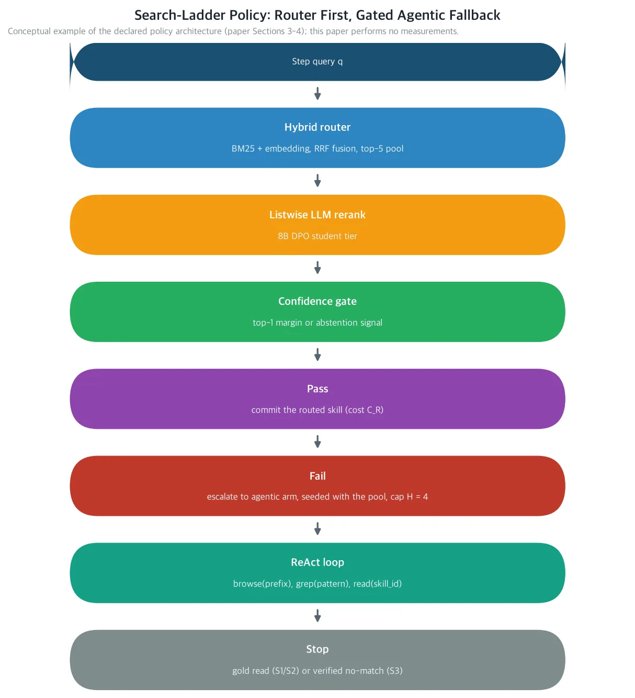
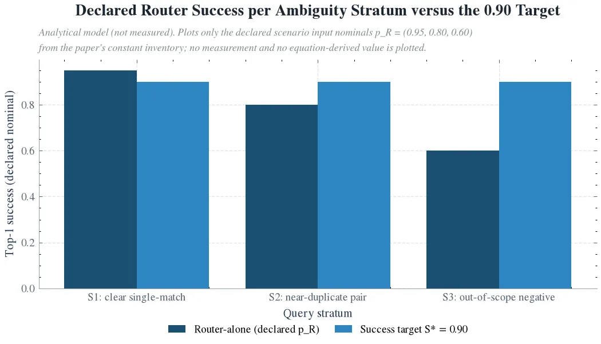
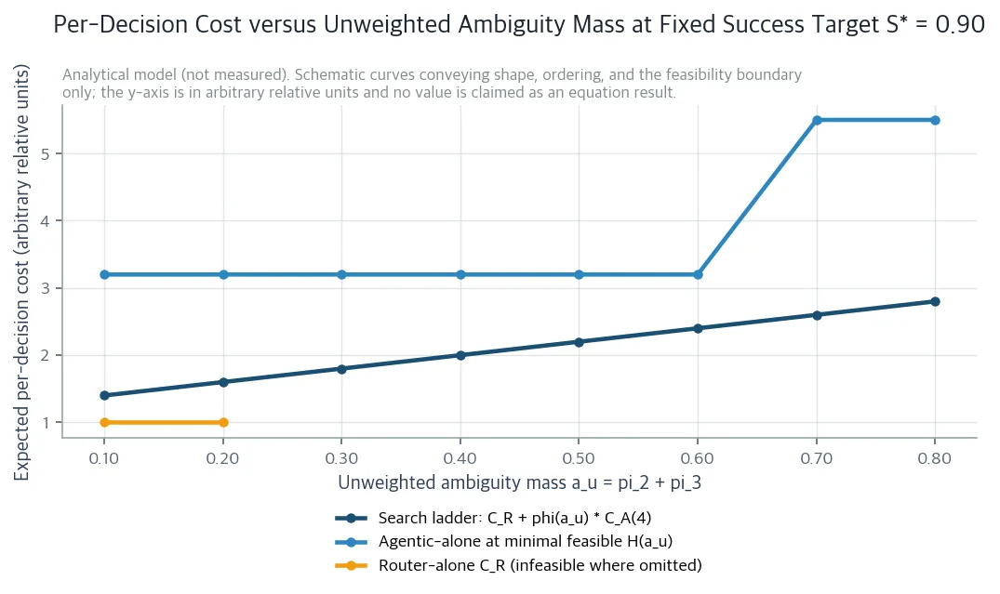

셀프호스트드 GPU 위에서 2,200개 스킬 레지스트리를 밤마다 라우팅하는 무인 에이전트 하네스를 돌리는 분, 혹은 그 라우팅 구조를 바꾸고 싶지만 어떤 대안이 어느 만큼 비싸는지 모르는 분을 위한 글입니다. 에이전트는 스텝 쿼리 하나마다 등록된 스킬 가운데 하나를 골라 실행에 넘깁니다. 지금은 그 선택이 고정 파이프라인을 거칩니다. 하이브리드 리트리버가 top-k 풀을 던지고 listwise LLM 리랭크가 하나의 스킬을 확정합니다. ThakiCloud의 라우터 시리즈는 그 파이프라인 내부의 단계를 차례로 정가해 왔습니다. 리랭크 모델 티어, 풀 폭, 근접 타이 안의 브레이크, 리랭크 호출당 배치되는 결정 수까지 전부입니다. 이 논문은 파이프라인 밖의 질문을 합니다. 라우터 자체가 올바른 추상화인지, 실행 LLM이 browse, grep, read 도구로 레지스트리를 스스로 탐색해도 되는지를, 같은 작업 성공률에서 비용으로 따집니다.

핵심 결과는 선언된 요금 카드 위에서 닫힘 형태로 나옵니다. 90% 성공 목표에서 라우터 단독은 이미 불가능합니다. 공칭 운영점의 모호성 질 a = 0.525가 라우터 단독의 가능계한 a_max = 0.333을 넘기 때문입니다. 라우터가 먼저 가고 신뢰도 게이트를 넘은 결정만 top-5 풀로 시드된 에이전틱 탐색으로 올리는 서치 래더는 결정당 $3.18×10^-4에 그 목표를 지킵니다. 최소 가능 예산의 에이전틱 단독($6.76×10^-4)보다 2.1배 싸고 브레이크이븐 미스라이트 가격은 $0.0022로 시리즈의 공개 앵커($0.113 스텝 예산, $1.40 미스 가격)보다 약 50~640배 낮습니다.

읽기 전에 한 가지를 밝혀 둡니다. 이 논문은 선언된 전제 위에서 값을 세는 분석 논문이고 새 실측을 보고하지 않습니다. 모든 수치는 선언된 설계 상수, 기존 작업의 공개 상수, 또는 둘에 대한 닫힘 형태 산술입니다. 본문에 든 그림 세 장은 분석 모델이 그린 도식이며 실측 데이터가 아닙니다. 라우터 시리즈의 직전 네 편이 라우터 안의 각 단계를 정가했다면, 이 편은 라우터 그 자체를 정가합니다. 한 단계 위, 추상화 경계입니다.

## 문제: 라우터 내부의 값은 다 나왔고 라우터가 맞는지만 남았습니다

시리즈의 네 편은 라우팅 품질을 고정하고 고정 하이브리드 라우터의 내부 부품 하나씩을 정가해 왔습니다. 증류 리랭크 티어 편이 모델 티어를 정가했고 라우팅 장부의 LLM 리랭크 점유율 71.6%를 공개했습니다. 풀 폭 편이 top-k와 commit의 트레이드를 정가해 knee k = 5를 공개했고 타이브레이크 편이 인디퍼런스 밴드를 정가했으며 배칭 편이 리랭크 호출 하나당 공유되는 결정 수를 정가했습니다. 모든 편에서 라우터 자체는 고정되어 있었습니다.

N = 2,200개 스킬의 레지스트리 규모라면, 실행 LLM은 파이프라인을 통째로 우회할 수 있습니다. browse(prefix), grep(pattern), read(skill_id) 도구로 ReAct 스타일 루프에서 레지스트리를 직접 탐색하는 방식입니다. 그것이 실행 가능한 대안인지는 만만하지 않은 질문입니다. 대규모에서 툴을 고르는 문제는 아직 열려 있고 거대한 툴셋은 선택을 측정 가능한 만큼 열화시킵니다. 이 논문이 세우는 질문은 에이전틱 탐색이 되는지가 아니라, 같은 작업 성공률에서 그것이 대체하는 정적 하이브리드 라우터보다 얼마를 쓰는지입니다.

비교가 시의적인 데에는 비용 이유가 있습니다. 폴백이 오프로딩할 단계가 정확히 비싼 단계입니다. listwise LLM 리랭크는 호출 스케줄을 요구하며 호출당 수백 후보는 실행 불가능합니다. 공개된 라우터 회계에서 LLM 리랭크 하나만 장부의 71.6%를 차지합니다. 라우터가 불확실한 곳에서만 결정의 작은 분율 φ를 에이전틱 탐색에 쓰는 신뢰도 게이트 폴백은, 가장 비싼 단계에서 값이 정해져 나가는 출구입니다.

## 설계: 세 팔, 그리고 라우터 출력을 읽는 게이트

무대는 동결된 레지스트리와 선언된 카드입니다. 레지스트리는 2,200개 스킬을 담고 있고(공개, 현재치) 라우팅 품질은 SRA, 공개된 0~100 스케일 위 top-1 정확도로, 동결된 2,295개 항목 스냅샷과 63케이스 골드 홀아웃 위에서 평가됩니다. 스텝 쿼리는 모호성으로 세 층에 나뉩니다. S1이 명확한 단일 매칭, S2가 근사 중복 쌍, S3가 범위 밖 네거티브이고 선언된 공칭 선편은 (0.55, 0.30, 0.15)입니다. 모호성 질은 a = π2 + 1.5·π3으로, 선언된 카드에서 범위 밖 미스라우팅이 근사 중복 미스라우팅의 1.5배로 청구됩니다.

요율 카드는 한 번 선언됩니다. 셀프호스트드 H200, 8B NVFP4 티어, 인풋 $0.20/백만 토큰, 아웃풋 $0.80/백만 토큰. 민감도 스윕은 3배와 1/3배입니다. 두 팔 모두 같은 8B 셀프호스트드 티어를 쓰므로 비교는 티어 중립이고 프런티어 모델의 청구서가 들어오지 않습니다.

팔 R은 정적 하이브리드 라우터입니다. 레지스트리 위의 BM25와 dense 임베딩 인덱스가 RRF로 융합되고 top-5 풀(공개 knee) 위를 공개된 8B DPO 증류 학생 티어의 listwise LLM 리랭크가 하나의 스킬을 확정합니다. 토큰 설계 상수는 쿼리 60, 스킬 카드 120, 리랭크 출력 캡 64입니다. 선언된 카드를 대입하면 결정당 비용 C_R = $1.83×10^-4, 벽 시간 W_R = 0.726초로 계산됩니다.

팔 A는 에이전틱 레지스트리 탐색입니다. 같은 티어의 실행 LLM이 search-as-code 규율 아래 ReAct 스타일 루프에서 레지스트리를 직접 탐색합니다. 이 코퍼스 규모에서는 불리언 부분문자열 검색이 dense 검색과 경쟁력이 있어 grep이면 됩니다. 에피소드는 골드 리드(S1, S2) 또는 검증된 no-match(S3)에서 멈추고 이 멈춤은 증거 커버리지 기준입니다. 선언된 상수는 시스템+툴 스키마 300, 스텝당 평균 누적 툴 출력 150, 스텝당 에이전트 출력 80, 스텝당 벽 시간 2.0초입니다. 층별 스텝당 발견 위험도는 (0.50, 0.35, 0.50)이고 C_A(3) = $4.62×10^-4, C_A(4) = $6.76×10^-4, C_A(6) = $1.19×10^-3으로 나옵니다.

팔 L이 서치 래더입니다. R을 먼저 돌리고 게이트가 리랭크 출력을 읽습니다. top-1 스코어 마진 또는 abstention 신호, 둘 다 1급 라우팅 객체입니다. 게이트가 실패하면 A로 에스컬레이션하는데, 이때 k-풀과 그 부정 증거로 시드됩니다. 풀은 에스컬레이션의 첫 관측이므로 C_R 안에 한 번만 지불됩니다. 시드된 에피소드는 H_max = 4스텝으로 끊깁니다. 선언된 에이전틱 캡 6에 0.6배 축소를 적용한 값입니다. 게이트 품질도 층별로 선언됩니다. 오탐 α = (0.02, 0.10, 0.30)은 R이 성공했을 결정을 에스컬레이션시키고 오탐 η = (0.01, 0.10, 0.05)은 구제를 놓칩니다. 래더의 결정당 비용은 C_L = C_R + φ·C_A(4)입니다.

모델은 여섯 가지를 전제합니다. A1 결정론적 토큰 회계, A2 팔 A의 스텝별 선형 전사 증가, A3 에피소드 안의 스텝 위험도 불변, A4 층 조건부에서 게이트 결정의 에피소드 결과 독립, A5 두 팔의 티어 중립, A6 에스컬레이션 에피소드의 태스크 내 순차 루프, 결정 배치 불가입니다. carpool은 팔 R의 리랭크 호출에만 적용됩니다. 이 구조를 거치는 라우팅 결정 하나가 아래 그림에 있습니다.

*정적 하이브리드 라우터를 지나는 라우팅 결정 하나입니다. 신뢰도 게이트가 라우팅된 스킬을 확정하거나, top-5 풀로 시드된 에이전틱 탐색 에피소드로 에스컬레이션하며 스텝은 4로 캡됩니다. 분석 모델 도식이며 실측이 아닙니다.*

## 결과 1: 라우터 단독은 90%를 못 지납니다, 모호성 질이 구조적 장벽입니다

선언된 품질 공칭은 (S1, S2, S3)에 대해 p_R = (0.95, 0.80, 0.60)이고 ±25%로 스윕됩니다. 순서는 구조적인 것이지 피팅된 것이 아닙니다. 근사 중복 스킬이 앞선 스킬을 밀어내는 라우팅 간섭 때문에 p_{R,2}가 p_{R,1} 아래에 있고 abstention이 가장 어려운 라우팅 모드라 p_{R,3}가 p_{R,2} 아래에 있는 셈입니다. 공칭 선편에서 혼합 성공은 0.55×0.95 + 0.30×0.80 + 0.15×0.60 = 0.8525입니다. 선언된 운영 목표 0.90에 미치지 못합니다.

*선언된 품질 공칭에서 라우터 단독의 모호성 층별 성공률과 0.90 목표입니다. 라우터 단독은 명확한 단일 매칭 쿼리에서만 목표를 지날 뿐, 근사 중복과 범위 밖 층은 에스컬레이션 게이트가 짊어져야 합니다. 분석 모델 도식이며 실측이 아닙니다.*

가능성은 모호성 질에 대한 부등식으로 닫힙니다. 목표 S* = 0.90에서 라우터 단독의 가능성은 0.15·π2 + 0.35·π3 ≤ 0.95 − S*로 정리되고 두 코너가 a_max = 0.333(전체 S2)과 0.214(전체 S3)를 줍니다. 공칭 운영점은 a = 0.30 + 1.5×0.15 = 0.525입니다. 0.333을 넘는 값이고 논문의 헤드라인 결과가 여기에 있습니다. 공칭 운영점이 라우터 단독의 가능 영역 바깥에 놓입니다. 장벽은 파이프라인의 부품이 아니라 층의 구성 자체입니다. 층 구성을 고치는 것은 고정 파이프라인 안의 어떤 변화도 할 수 없고 정책 티어의 에스컬레이션만 할 수 있습니다.

래더는 정확히 그 부분을 짭니다. 층별 래더 성공은 p_L = (0.9774, 0.8679, 0.7762)이고 층별 순 변화는 (0.0274, 0.0679, 0.1762)입니다. 이득이 가장 큰 곳은 S3인가. 혼합 이득은 +6.2 SRA 포인트이고 래더 성공 S_L = 0.9144가 0.90을 지납니다.

## 결과 2: 래더는 $3.18×10^-4에 목표를 지키고 브레이크이븐은 $0.0022입니다

공칭 선편에서 기대 에스컬레이션 분율 φ = 0.1997입니다. 에스컬레이션 프리미엄 φ·C_A(4)은 결정당 $1.35×10^-4이고 래더의 결정당 비용 C_L = $3.18×10^-4, 벽 시간 W_L = 2.32초로 나옵니다. 같은 성공에서 에이전틱 단독은 H = 4에서 0.90을 지닙니다(성공 0.9027, $6.76×10^-4). 선언된 캡 H = 6에서는 0.9664까지 갑니다($1.19×10^-3). 래더는 동등하거나 더 나은 성공에서 에이전틱 단독보다 엄격히 싸고 최소 가능 예산 기준 2.1배 차이입니다.

프런티어를 정의하는 브레이크이븐 조건은 둘입니다. 에이전틱 단독에 대한 조건에서, 래더가 동등 성공에서 더 싼 것은 에스컬레이션 분율이 φ* = 1 − C_R / C_A(H_a) 아래일 때입니다. 선언된 캡 6에서 φ* = 0.847이고 최소 가능 H = 4에서 0.729로 빡빡해집니다. 공칭 φ = 0.1997은 두 임계 모두 한참 아래입니다. 라우터 단독에 대한 조건에서, 프리미엄은 미스라우팅 가격 M_d가 M_d* = φ·C_A(4) / dp 이상일 때만 회수됩니다. 공칭 값을 대입하면 $1.35×10^-4 / 0.0619 = 결정당 $0.0022입니다. 미스라우팅 가격은 시리즈 공칭에 앵커됩니다. 공개된 $2,040 야간 예산을 시리즈 선언의 18,000스텝 야간 부피로 나누면 M_d ≈ $0.113, 공개된 미스당 가격은 $1.40입니다. 브레이크이븐 가격은 스텝당 예산보다 약 50배, 미스당 가격보다 약 640배 아래에 있습니다. 한 줄짜리 런 규칙은 이것입니다. 선언된 게이트 공칭이 유지되고 M_d ≥ $0.0022이면 래더는 기본값으로 켜져 있습니다.

명제 1(요율 카드 균질성)이 경제학을 지탱합니다. 모든 닫힘 형태 비용이 선언된 토큰 수의 선형 결합이라, 공통 계수 s가 모든 비용을 s배로 곱하면 φ*는 불변이고 공개된 야간 예산과 부피에 앵커된 M_d도 불변입니다. 비교 M_d ≥ M_d*는 카드에 의존하지 않습니다. 그래서 3배와 1/3배 스윕이 청구서를 움직여도 결론은 그 자리에 남습니다.

야간 회계는 절대값이 작습니다. 밤마다 라우팅 장부는 18,000×C_R = $3.29로, $2,040 스텝 예산의 1.6×10^-3입니다. D = 6결정 세션당 라우팅 장부는 $1.10×10^-3에 그칩니다. 라우팅은 스텝 실행의 작은 한 조각이고 래더가 그 위에 더하는 $1.35×10^-4는 라우터 단독 비용의 약 0.74배입니다. 폴백이 오프로딩하는 LLM 지배 단계, 공개된 장부 점유율 71.6%인 단계보다 적게 쓰는 것입니다.

아래 그림은 가중 없는 모호성 질 a_u = π2 + π3을 0.10에서 0.80까지 한 매개변수 선편 가족으로 스윕한 것입니다.

*고정 성공 목표 S* = 0.90에서 기대 결정당 비용과 가중 없는 모호성 질 a_u = π2 + π3의 관계입니다. 서치 래더는 스윕 전체에서 에이전틱 단독 아래에 머무르고 라우터 단독은 저모호성 영역에서만 가능합니다. 공칭 운영점(점선, a_u = 0.45)은 래더 영역의 안쪽에 놓입니다. 선언된 모델의 닫힘 형태 평가이며 실측이 아닙니다.*

세 곡선을 읽으면 됩니다. 래더는 a_u = 0.10에서 2.56×10^-4로 시작해 a_u = 0.80에서 4.14×10^-4까지 단조로 올라가고 모든 스윕점에서 에이전틱 단독의 스텝 아래에 있습니다. 에이전틱 단독은 최소 가능 예산 H = 4가 더 이상 목표를 못 지날 때(이 스윕 가족에서 a_u ≥ 0.75) H = 6($11.90×10^-4)으로 올라섭니다. 라우터 단독 팔은 그려진 범위에서 가장 싸지만, 이 스윕에서는 a_u ≤ 0.1765까지만 가능합니다. 가중 경계 a_max = 0.333은 어떤 선편에든 적용됩니다. 공칭 점은 a_u = 0.45(가중 a = 0.525)로, 래더 영역의 깊숙한 곳에 있습니다. 헤드라인 결과가 그림으로 된 것입니다.

## 사전등록 프로토콜: 63케이스, 세 팔, 세 시드, 1달러 미만

닫힘 형태는 선언된 카드 위의 예측입니다. 프로토콜은 측정이라면 무엇이 필요할지를 미리 전부 고정합니다. 팔은 R, 선언된 캡 H = 6의 A, 게이트와 시드 캡 H_max = 4의 L입니다. 코퍼스는 동결된 2,295개 항목 스냅샷 위의 공개된 63케이스 SRA 골드 홀아웃이고 층은 융합 RRF 스코어의 마진 임계로 배정됩니다. 카운트는 런타임에 읽으므로 어떤 층 선편도 가정되지 않습니다. 미터링은 가족 규약의 결정론적 토큰 회계이고 스텝별 툴 출력을 로그하며 팔별 벽 시간을 잽니다. 온도 0에 팔-케이스당 3개의 독립 시드로 커널 레벨 비결정성을 탐색합니다.

수용 임계는 S* = 0.90에서 사전등록되며 선언된 허용 폭과 유도된 기준 값이 쌍을 이룹니다. (i) 래더 성공이 91.4의 +1 SRA 포인트 이내이고 라우터 단독 기준선 85.2 아래로 내려가지 않는 것, (ii) 래더 결정당 비용이 $3.18×10^-4의 1.5배 이내인 것, (iii) 층별 에스컬레이션 분율이 (0.0685, 0.26, 0.56)의 2배 이내인 것, (iv) 에이전틱 단독 성공이 H = 6에서 96.6의 ±3 SRA 포인트 이내인 것입니다. 각 임계는 고칠 선언이 명명되어 있습니다. (i)와 (iv)는 p_R와 ρ를, (iii)은 α와 η를, (ii)은 σ를 고칩니다. 선언된 층 선편 π는 어떤 임계가 적용되기 전에 런타임 카운트로 대체되고 요율 카드는 명제 1에 의해 개정 대상이 아닙니다.

예산은 끝까지 유도됩니다. 63케이스(공개)×3팔(선언)×3시드(선언), 케이스-시드당 최악은 선언된 H = 6의 에이전틱 팔에 라우터를 얹은 것, $1.19×10^-3 + $1.83×10^-4 = $1.37×10^-3입니다. 전체 예산은 최대 63×3×3×$1.37×10^-3 ≈ $0.78에 머무릅니다. 1달러 미만입니다.

## 회사, 사회, 과학에 닿는 곳

회사가 얻는 것은 스킬 라우팅에 들어가는 측정 가능한 아키텍처 결정 규칙입니다. 검색 인덱스가 에이전트 직접 탐색보다 저렴한 경계를 짚어 주며 밤샘 무인 루프에서 라우팅 비용을 성공률 손실 없이 줄이는 router-first/search-fallback 운영 정책을 줍니다. 그 경계는 a = 0.525 > a_max = 0.333이고 바깥에서는 라우터 단독이 90% 목표에 닿지 못합니다. 에스컬레이션 프리미엄은 결정당 $1.35×10^-4로, 토큰 회계된 라우터 비용의 약 0.74배입니다. 폴백이 오프로딩하는 장부 점유율 71.6%의 LLM 지배 단계보다 적게 씁니다. 런 규칙은 한 줄입니다. M_d ≥ $0.0022이고 선언된 게이트 공칭이 유지되면, 래더는 기본값으로 켜져 있어야 합니다.

사회가 얻는 것은 대규모 스킬 생태계에서 에이전트 자율성의 컴퓨트 비용 정량화입니다. 검색 인프라가 대화형 LLM 탐색으로 대체되거나 보완될 수 있고 그것이 얼마인지 계산할 수 있습니다. 셀프호스트드 하드웨어에서 자기진화형 에이전트 하네스를 돌리는 소규모 팀에겐, 에이전틱 탐색 전체가 아니라 라우터 우선/게이트 탐색 조합이 더 싼 자율성 정책입니다. 범용으로 남는 설계 원리는 이것입니다. 비싼 단계에는 게이트를 달고 값싼 단계가 불확실한 곳에서만 탐색에 돈을 쓰는 구조입니다.

과학에 남는 것은 같은 gold 사례에서 agentic(다단계·도구사용) 스킬 검색과 정적 하이브리드 검색의 첫 head-to-head 정가입니다. 스킬 라우팅 cost-quality frontier 문헌에 task-ambiguity라는 새로운 축과 break-even 곡선이 추가됩니다. 시리즈의 이전 작업이 라우터 안의 모든 단계를 정가했다면, 이 논문은 라우터 자체, 그것들 전체보다 한 단계 위인 추상화 경계를 정가합니다.

## 한계: 경제가 아니라 게이트 캘리브레이션이 구속 조건입니다

클레임을 가두는 한계는 네 개입니다. 첫째, 선언된 요율 카드가 라이브 가격을 대신합니다. 명제 1에 의해 브레이크이븐 결론은 카드 불변입니다. φ* = 0.847도, M_d ≥ M_d* 비교도 움직이지 않습니다. 둘째, 품질과 게이트 공칭 p_R, ρ, α, η는 선언된 시나리오 입력이지 측정이 아닙니다. 층 선편은 동결된 gold 위에서 런타임에만 읽힙니다. 셋째, 게이트 캘리브레이션이 구속 조건입니다. abstention 신호는 기계적으로 존재하지만, 층별 α_i와 η_i는 앞의 프로토콜로 추정돼야 합니다. 둘은 dp에 직접 들어갑니다. 래더를 붙잡는 것은 가격이 아니라 게이트의 정확도입니다. 넷째, 티어 중립(A5)은 두 팔이 8B 셀프호스트드에 있다는 뜻이고 프런티어 티어의 에이전틱 팔은 별개 질문으로 남습니다.

에이전틱 단독이 이기는 영역도 셋입니다. 첫째, M_d → 0입니다. 미스라우팅이 공짜면 M_d ≥ $0.0022 조건이 실패하고 에스컬레이션 프리미엄은 아무것도 사지 못합니다. 둘째, p_R이 체계적으로 낮은 경우입니다. 규모의 깨진 레지스트리 메타데이터, 라우팅 간섭이나 거버넌스 드리프트가 모든 층에서 첫 단계를 열화시키고 래더는 각 결정에서 그 약점을 상속합니다. 셋째, a → 1입니다. 모든 것이 모호하면 라우터는 아무 확정도 못 주고 래더는 에스컬레이션 전에 C_R을 온전히 지불합니다. 래더는 중간 영역의 기본값이고 공칭 선편은 정확히 그 안입니다. 라우터 단독이 85.2까지 가고 게이트된 에스컬레이션이 에이전틱 단독 장부의 일부로 나머지 포인트를 메웁니다.

논문 원문과 수반 자료는 Hugging Face 논문 상세 페이지에서 볼 수 있습니다. https://huggingface.co/datasets/thaki-AI/daily-paper-2026-11-25-agentic-skill-search-ladder

*본문의 모든 수치는 선언된 공칭 전제 위의 닫힘 형태 예측이거나 인용 참고 문헌에 귀속된 결과입니다. 정밀 닫힘 형태 값은 C_R = $1.83×10^-4, C_A(3/4/6) = $4.62×10^-4 / $6.76×10^-4 / $1.19×10^-3, W_R = 0.726초, W_A(4) = 8.0초, φ = 0.1997, φ_i = (0.0685, 0.26, 0.56), p_R = (0.95, 0.80, 0.60), p_L = (0.9774, 0.8679, 0.7762), dp = 0.0619, S_L = 0.9144, C_L = $3.18×10^-4, W_L = 2.32초, 에스컬레이션 프리미엄 $1.35×10^-4, M_d ≈ $0.113, M_d* = $0.0022, φ* = 0.847(H = 4에서 0.729), a = 0.525, a_max = 0.333, 야간 라우팅 장부 $3.29, 프로토콜 비용 ≈ $0.78, 사전등록 임계(91.4 +1, 1.5배, 2배, 96.6 ±3)까지입니다. 그림 세 장은 분석 모델 도식, 선언된 모델의 닫힘 형태 평가이며 실측이 아닙니다. 63케이스 골드 셋의 3팔 사전등록 프로토콜은 이 논문에서 실행되지 않았고 실측값의 보고는 실행 시점에 이뤄집니다.*