일반 모델과 도구를 결합해 과학 에이전트를 만들거나 평가하는 분, 그리고 "추론+코드"로 전문 모델을 대체할 수 있는 선이 어디인지 가늠하려는 분을 위한 글입니다. OpenAI가 2026년 11월 24일 GPT-6 패밀리의 단백질 설계 능력을 wet lab 검증과 함께 발표한 프리프린트를 다룹니다. 핵심 결론을 먼저 씁니다. 랩 검증 결과는 실재하지만, 이것은 "일반용으로 충분하다"의 전면 승리가 아닙니다. GPT-6가 설계를 스스로 만들어낸 것은 사실이고, 후보 필터링과 접힘 예측에는 Boltz-2, ESMFold2 같은 전문 예측기가 동원됐습니다. OpenAI 스스로 이 프로필을 '자글한 능력 프런티어(jagged capability frontier)'라고 부릅니다.

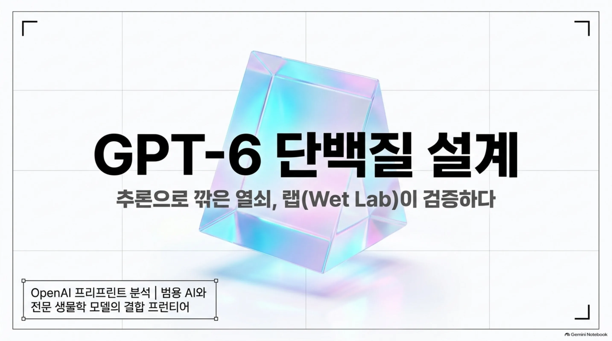
*GPT-6 단백질 설계: 추론으로 깎은 열쇠, 랩(Wet Lab)이 검증한다. OpenAI 프리프린트 분석, 범용 AI와 전문 생물학 모델의 결합 프런티어.*

## 쉽게 말하면

특정 대상에 결합하는 단백질을 설계하는 일은 자물쇠에 맞는 열쇠를 깎는 것과 같습니다. 자물쇠는 대상 단백질이고, 열쇠는 자물쇠의 특정 부위에 끼워지는 바인더 단백질입니다. 이 분야에는 RFdiffusion이나 ProteinMPNN처럼 열쇠만 깎는 데 특화된 '전문 깎이 기계'가 있었습니다. 이 프리프린트의 새로운 점은 GPT-6라는 일반 모델이 전문 깎이 기계 없이 자물쇠 구조를 보고, 추론하고, 코드를 짜서 새 열쇠를 깎았다는 것입니다. 그리고 깎은 열쇠가 실제 자물쇠에서 돌아가는지 실험실에서 확인했습니다. 이하 본문에서는 설계된 단백질을 '열쇠'라고 부릅니다.

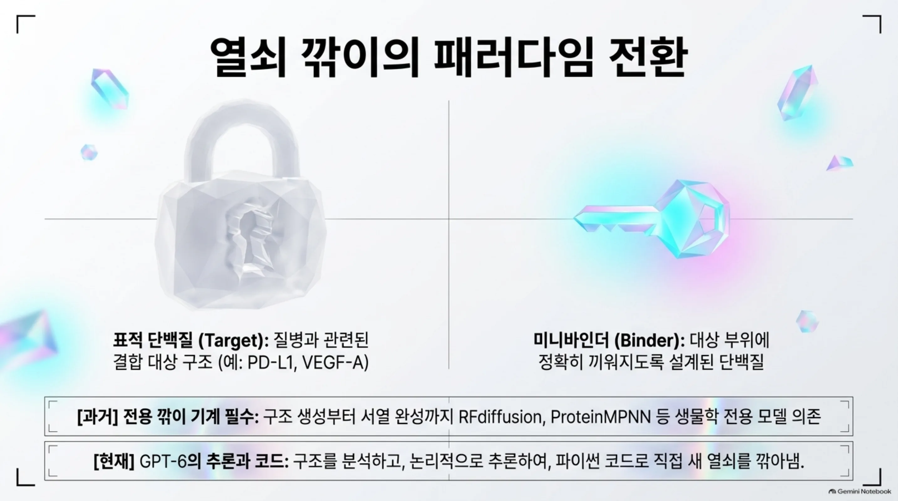
*표적 단백질(자물쇠)은 PD-L1, VEGF-A 같은 질병 관련 결합 대상 구조이고, 미니바인더(열쇠)는 그 부위에 정확히 끼워지도록 설계되는 단백질입니다. 과거에는 RFdiffusion, ProteinMPNN 등 생물학 전용 모델에 의존했지만, 이제는 GPT-6가 구조를 분석하고 추론과 코드로 직접 새 열쇠를 깎습니다.*

## 일반 모델과 열쇠 깎이 기계

지금까지 신규 단백질 설계(de novo protein design)는 전문 모델의 영역이었습니다. RFdiffusion 같은 생성 모델이 백본(열쇠의 모양)을 만들고, ProteinMPNN이 아미노산 서열(열쇠의 이빨)을 채우고, ESMFold나 Boltz-2가 예상대로 접히는지 판단했습니다. 각 단계마다 전용 도구가 서 있었습니다. GPT-6 패밀리는 텍스트와 코드와 추론을 모두 다루는 일반 목적 기초 모델입니다. 이 프리프린트의 주장은, 전문 생물학 모델을 호출하지 않아도 GPT-6가 추론과 코드만으로 설계를 만들어낸다는 것입니다.

프리프린트 제목은 "GPT-6 as a Universal Foundation Model for Protein Biology: Beyond Specialized Models"입니다. wet lab 검증은 파트너 랩 Onava가 수행했습니다. 본문에서 이름이 언급되는 모델 버전은 GPT-5.6, GPT-6, GPT-6.2와 이름이 공개되지 않은 내부 버전입니다. 내부 버전은 계산 벤치마크에서 일관되게 가장 좋은 성적을 냈습니다.

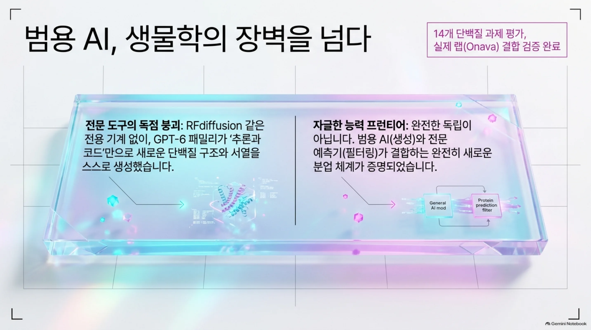
*GPT-6 패밀리는 '추론과 코드'만으로 새로운 단백질 구조와 서열을 스스로 생성해 전문 도구의 독점을 풀어냈습니다. 동시에 전문 예측기가 필터링을 맡는 자글한 능력 프런티어도 증명됐습니다. 14개 단백질 과제를 평가했고, Onava 랩 결합 검증까지 완료했습니다.*

GPT-6의 설계 대상은 '바인더 만들기'보다 넓습니다. 신규 미니바인더 형상, 기존 형상의 새 서열, 항체 루프 재설계, 모티프 스캐폴딩, CATH 접힘 설계, 소분자 도킹, 항체 도킹, 돌연변이 효과 랭킹까지. OpenAI는 총 14개 단백질 과제를 평가했고, 최신 세대일수록 많은 과제에서 성능이 향상됐다고 명시합니다.

## 추론이 열쇠를 깎고, 전문 도구가 확인한다

미니바인더는 특정 대상 부위에 결합하도록 설계되는 작은 단백질입니다. '열쇠'가 되는 것이 바로 이 미니바인더입니다. wet lab 실험은 설계의 일을 두 갈래로 나눴습니다.

첫 갈래는 형상(백본)을 새로 만드는 일입니다. GPT-6.2가 대상의 3차원 구조와 표시된 부착 지점을 받아 추론과 코드로 백본 설계를 생성합니다. 프롬프트 제어가 세밀한 것이 특징입니다. 결합 위치는 원자 두 개 사이의 단일 결합 단위까지, 모양과 구조 클래스(coil-only, strand-only, 혼합)와 각 구조의 개수를 지정할 수 있습니다. 논문의 표현을 빌리면 이 충실도는 '거의 완벽'에 가깝습니다.

두 갈래는 형상을 그대로 두고 새 서열을 만드는 일입니다. 열쇠의 모양은 이미 결합하는 것으로 확인된 상태이고, 질문은 "같은 모양의 다른 열쇠를 깎을 수 있는가"입니다.

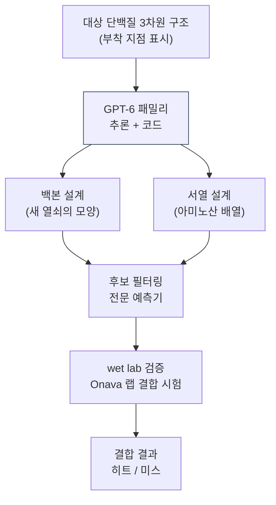

*GPT-6이 추론과 코드로 열쇠를 깎는 흐름입니다. 생성 단계(B, C, D)에는 전문 생물학 모델이 쓰이지 않고, 전문 예측기(E)는 후보 필터링과 접힘 판단에 개입합니다.*

전문 예측기들이 역할을 나누어 돕는 지점은 명확합니다. Boltz-2, OpenDDE, ESMFold2는 열쇠를 만들지 않습니다. 깎인 열쇠 중 어느 것을 시험관에 넣을 가치가 있는지 골라내고, 예상대로 접힐지 예측합니다. 이 분업이 후술할 '자글한 프런티어'의 핵심입니다.

## wet lab 검증 1: 322개 중 35개가 결합

첫 실험의 대상은 다섯 개입니다. PD-L1, IL-7Rα, TrkA, VEGF-A, IL-17A. 면역과 종양 분야에서 주목받는 단백질들입니다. GPT-6.2가 각 대상마다 새 바인더 형상을 만들었고, Onava 랩에서 322개 단백질을 시험했습니다. 35개가 결합했습니다. 히트율은 10.9%입니다.

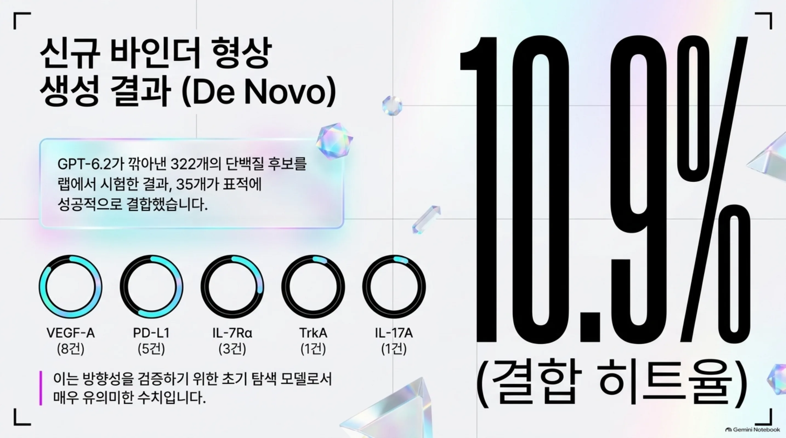
*GPT-6.2가 깎아낸 322개의 단백질 후보를 랩에서 시험한 결과, 35개가 표적에 결합했습니다. VEGF-A 8건, PD-L1 5건, IL-7Rα 3건, TrkA·IL-17A 각 1건. 방향성 검증의 조기 신호로 매우 유의미한 수치입니다.*

대상별로는 고르게 나지 않았습니다. VEGF-A가 8건, PD-L1이 5건, IL-7Rα가 3건, TrkA와 IL-17A가 각각 1건입니다. OpenAI는 이전 RFdiffusion 계열 작업이 더 높은 성공률을 보고했다고 전하지만, 프리프린트는 그 수치를 제시하지 않습니다. 결합의 정의와 필터링 기준에 따라 히트율이 바뀐다는 점도 함께 명시합니다.

같은 과제의 계산 비교에서는 GPT-6.2가 RFdiffusion보다 낮고, 내부 버전이 높았습니다. 수치가 공개되지 않아 방향성만 기록합니다.

10.9%는 단백질 단위 히트율입니다. 대상 단위로 읽으면 다섯 대상 모두에 결합하는 열쇠가 최소 하나씩 생겼다는 말이기도 합니다. 두 읽기는 다른 질문에 답합니다. "얼마나 많이 만들어야 하나를 설계할 때"는 전자가, "이 방향으로 갈 가치가 있는지를 판단할 때"는 후자가 관련됩니다.

## wet lab 검증 2: 미공개 형상에서 107개 중 14개

두 실험은 형상이 알려진 상태에서 새 서열을 요구합니다.

이미 결합이 확인된 세 형상(MDM2, VEGF-A, PD-1)에서는 원본 서열을 숨긴 뒤 시작했습니다. MDM2는 88개 중 75개(85%)가 결합했고, VEGF-A는 42개 중 26개(62%), PD-1은 59개 중 8개(14%)였습니다. 원본 서열과의 중앙값 차이는 VEGF-A 50%, MDM2 43%, PD-1 15%입니다. 복사한 열쇠가 아니라 다른 열쇠를 깎았다는 뜻입니다.

미공개 형상 세 개(2개 PD-L1, 1개 IL-7Rα)가 더 흥미롭습니다. 각 형상마다 ProteinMPNN이 앞서 공급한 서열 하나씩은 결합했습니다. GPT-6.2가 직접 만든 서열은 107개 중 14개(13.1%)가 결합했습니다. PD-L1 형상 하나에서는 두 서열이 원본과 90잔류 중 각각 52, 58개를 달리었고, 서로 44개를 달랐습니다. 같은 모양의 두 갈래 다른 열쇠가 모두 자물쇠에서 돌아갔습니다.

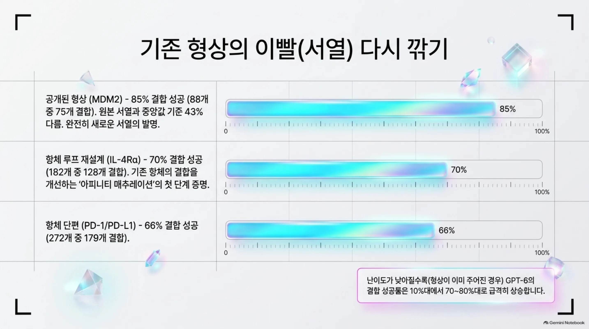
*공개된 형상 MDM2는 85%(88개 중 75개) 결합 성공, 원본 서열과 중앙값 43% 차이입니다. 항체 루프 재설계(IL-4Rα)는 70%(128/182), 항체 단편(PD-1/PD-L1)은 66%(179/272). 형상이 이미 주어질수록 GPT-6의 결합 성공률이 10%대에서 70~80%대로 급격히 상승합니다.*

## 항체 루프 재설계: 아피니티 매추레이션의 첫 단계

세 실험은 항체에서 했습니다. OpenAI는 이 결과를 '아피니티 매추레이션(affinity maturation)'의 첫 단계로 규정합니다. 기존 항체의 결합을 개선하는 과정입니다.

IL-4Rα 대상 VHH(단일도메인 항체) 6종에서 결합에 관여하는 세 루프를 제거하고, GPT-6.2가 대체 루프를 설계했습니다. 182개 중 128개가 결합했습니다. 70%입니다.

PD-1 또는 PD-L1 대상 치료용 항체 5종에서는 세 루프의 잔류 절반 가까이를 바꾸고, 단편(fragments)으로 시험했습니다. 272개 단편 중 179개가 결합했습니다. 66%입니다.

보도에서 떠돈 '70% 결합률'이 여기서 나옵니다. VHH 루프 재설계 결과이며, 신규 형상 실험의 10.9%와 다른 숫자입니다. 과제 난이도가 다르기 때문입니다. 하나는 자물쇠를 보고 새 열쇠를 처음부터 깎는 일이고, 다른 하나는 이미 들어맞는 열쇠의 이빨을 다시 깎는 일입니다.

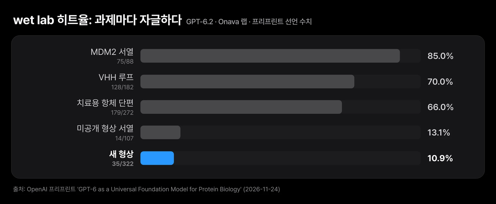
*처음부터 깎은 새 형상은 10.9%이고, 형상이 알려진 서열 재설계와 항체 루프 재설계는 66~85%로 올라갑니다. wet lab 히트율은 과제마다 자글합니다.*

## 계산 벤치마크: 자글한 프로필이 숫자에 드러난다

계산 과제 결과는 아래 표에 모았습니다. '내부 버전'은 이름이 공개되지 않은 GPT-6 패밀리 최상위입니다. 일부 과제는 모든 버전의 수치를 공개하지 않아, 공개되지 않은 값은 '미공개'로 표시합니다.

| 과제 (규모) | GPT-6.2 | 내부 버전 | 전문 기준선 |
|---|---|---|---|
| MotifBench 모티프 스캐폴딩 (30케이스) | 미공개 | 43.7% | RFdiffusion 27.8% |
| CATH 접힘 설계 (200케이스) | 미공개 | 18.9% | Proteina 17.1% |
| PoseBusters 소분자 도킹 | 93% | 96% | DiffDock-L 50% |
| Scarpino tethered 도킹 (179구조) | 92% | 97% | DiffDock 60% |
| 항체 도킹 DockQ (1=완벽) | 0.57 | 0.81 | GPT-5.6 0.05 · GPT-6 0.28 |
| 돌연변이 효과 랭킹 (안정성, 265세트) | 0.57 | 0.66 | ESM2-650M 4세트 평균 우위 |
| 접힘 예측 TM-score (1=완벽) | 0.26 | 0.38 | ESMFold2 0.93 |

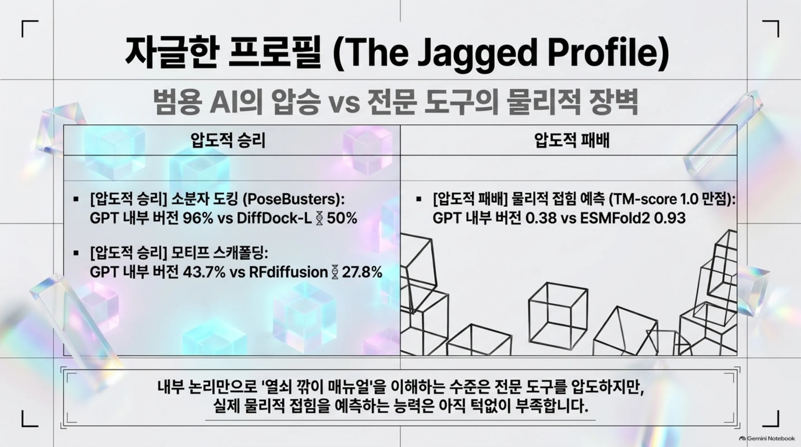
*소분자 도킹(PoseBusters)은 GPT 내부 버전 96% 대 DiffDock-L 50%, 모티프 스캐폴딩은 43.7% 대 RFdiffusion 27.8%로 압승입니다. 반면 물리적 접힘 예측(TM-score)은 GPT 내부 버전 0.38이 ESMFold2 0.93에 크게 못 미칩니다. '열쇠 깎이 매뉴얼'을 내부 논리로 이해하는 수준은 전문 도구를 압도하지만, 실제 물리적 접힘을 예측하는 능력은 아직 부족합니다.*

프로필은 자글합니다. 도킹과 모티프 스캐폴딩에서는 GPT-6 패밀이가 전문 도구를 큰 폭으로 이겼습니다. 접힘 예측에서는 내부 버전 TM-score 0.38이 ESMFold2 0.93에 못 미칩니다. TM-score 0.5가 전체 접힘 일치선인데, 내부 버전은 그 선도 넘지 못합니다.

세대별 상승은 항체 도킹에서 가장 명확합니다. DockQ는 1이 완벽 자세인데, GPT-5.6의 0.05에서 내부 버전의 0.81로 세대를 거듭할 때마다 전문 도킹 도구와의 격차를 줄입니다.

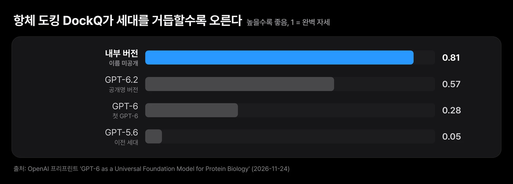
*항체 도킹 DockQ는 GPT-5.6의 0.05에서 내부 버전의 0.81로 GPT-6 패밀리를 거듭하며 올라갑니다.*

돌연변이 효과 랭킹은 따로 봐야 합니다. 원본 서열과 변이 50개를 주고 안정성에 대한 효과를 코드를 쓰지 않고 랭킹하는 과제입니다. GPT-5.6 0.41, GPT-6 0.52, GPT-6.2 0.57, 내부 버전 0.66으로 세대가 오를수록 매끄럽게 올라갑니다. 도구 없이 내부 표현만으로 '열쇠 깎이 매뉴얼'을 읽는 수준이 높아졌다는 뜻이고, 4개 공개 데이터셋 전체에서 GPT-6.2와 내부 버전이 ESM2-650M을 평균적으로 이겼습니다.

## ThakiCloud 제품 적용 시사점

Paxis의 실행 모델은 이 프리프린트가 검증한 구성 그 자체입니다. 일반 모델이 추론하고 코드를 쓰면, 전문 모델과 도구는 주역이 아니라 필터링과 평가를 돕는 도구로 붙습니다. 논문에서 Boltz-2와 ESMFold2는 '어느 열쇠를 시험관에 넣을지'를 확인하는 역할이고, ProteinMPNN은 '비교용 서열 하나'를 공급하는 역할입니다. Paxis는 ThakiCloud의 Agent-Native Cloud로 스킬, 도구, 정책, 감사 로그를 일급 리소스로 다룹니다. 단백질 설계를 하는 과학 에이전트도 같은 구조로 조립됩니다. 엔지니어링의 핵심은 '어떤 기초 모델을 쓰느냐'가 아니라 '어떤 전문 도구를 어느 단계에 붙이느냐'입니다.

자글한 프런티어는 평가 설계에 직접적인 함의입니다. 전문 예측기가 이기는 단계(접힘 예측)에서는 일반 모델의 출력을 신뢰하지 않고, 일반 모델이 이기는 단계(도킹)에서는 전문 도구 비용을 낭비하지 않는 것입니다. Paxis의 정책 게이트와 감사 로그에 '어느 단계에서 일반 모델 결과가 충분했는가'를 기록해 두면, 이 프리프린트의 운용 형태가 됩니다.

ai-platform 렌즈는 비용 구조입니다. wet lab 검증은 가장 비싼 평가고, 단백질 단위 히트율이 10.9%라는 것은 후보를 전부 랩에 보내면 비용이 폭발한다는 뜻입니다. 이 프리프린트에서는 전문 예측기가 후보를 걸러내고 322개만 시험관에 들어갔습니다. 고객 데이터가 밖으로 나갈 수 없는 환경에서, 기초 모델과 전문 예측기와 평가 파이프라인을 하나의 플랫폼 안에서 돌리는 self-hosting 구성이 이 워크플로가 성립하는 전제입니다. ThakiCloud의 Metis 서빙과 온프렘·소버린 배포 옵션은 정확히 그 구성을 겨냥합니다.

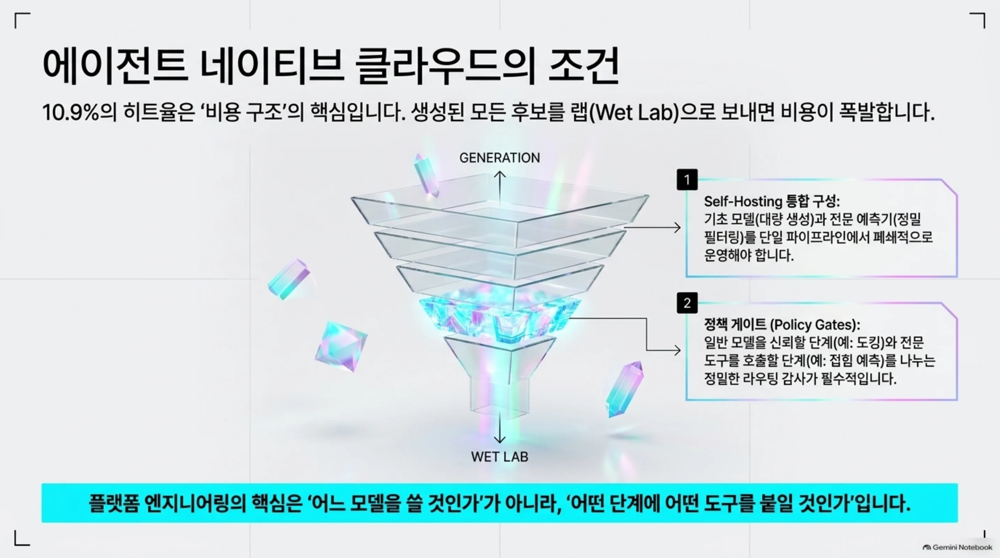
*10.9%의 히트율은 비용 구조의 핵심입니다. 생성된 모든 후보를 wet lab으로 보내면 비용이 폭발하므로, 기초 모델(대량 생성)과 전문 예측기(정밀 필터링)을 단일 파이프라인에서 운용하는 self-hosting 통합 구성이 필요합니다. 일반 모델을 신뢰할 단계와 전문 도구를 호출할 단계를 나누는 정책 게이트와 감사까지. 플랫폼 엔지니어링의 핵심은 '어느 모델을 쓸 것인가'가 아니라 '어떤 단계에 어떤 도구를 붙일 것인가'입니다.*

## 한계 및 반론

가장 강한 반론은 "열쇠를 GPT-6만 깎은 게 아니다"입니다. 맞는 지적입니다. 두 wet lab 실험 모두 후보 필터링과 접힘 예측에 전문 예측기(Boltz-2, OpenDDE, ESMFold2)를 썼고, 신규 형상 실험의 서열 제안은 SolubleMPNN이 했습니다. 논문 스스로도 이 결과는 백본 생성과 서열 재설계의 고유 능력을 지원하지만, 전문 도움 없이 신규 미니바인더를 끝까지 자율 설계했다는 증거는 아니라고 씁니다. 주장은 그 세기로 읽어야 합니다.

둘째, 결합은 첫 마일스톤에 그칩니다. 특이성, 안정성, 활성, 안전성, 효능은 모두 검증되지 않았습니다. 자물쇠에서 돌아가는 열쇠와 집 밖까지 맡길 수 있는 열쇠는 다릅니다. 항체 루프 재설계의 70%도 결합 친화력(affinity)이 원본보다 높아졌는지는 아직 답하지 못합니다.

셋째, 일부 계산 점수가 암기나 생성 산출물을 반영할 가능성이 있습니다. 논문이 스스로 제기한 리스크입니다. 공개 데이터셋에 가까운 과제일수록 '패턴을 학습했다'와 '답을 외웠다'의 선을 이 프리프린트만으로 긋기 어렵습니다.

넷째, 기준선 비교가 불완전합니다. 이전 RFdiffusion 작업의 히트율이 명시되지 않고, 일부 도킹 퍼센트의 분모가 제시되지 않으며, 개별 저자 명단도 없습니다. 수치를 인용할 때는 이 프리프린트가 선언한 세기에 맞게 인용해야 합니다.

다섯째, 바이오시큐리티입니다. 결합 단백질 설계 능력이 일반 모델에 들어오면서 보안 리스크 평가가 논문에 명시적으로 등장합니다. 능력 숫자만 읽으면 안 되고, 일반 모델의 단백질 설계가 열어젖히는 위험 영역을 함께 읽어야 합니다.

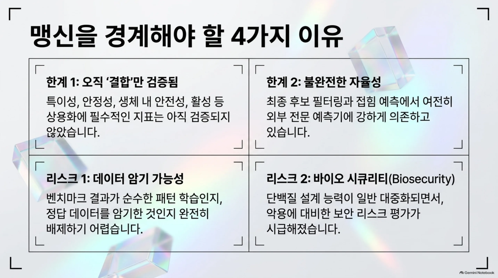
*한계 1: 오직 '결합'만 검증됐습니다. 특이성, 안정성, 생체 내 안전성, 활성 등 상용화에 필수적인 지표는 아직 검증되지 않았습니다. 한계 2: 불완전한 자율성. 최종 후보 필터링과 접힘 예측에서 여전히 외부 전문 예측기에 강하게 의존하고 있습니다. 리스크 1: 벤치마크 결과가 순수한 패턴 학습인지, 정답 데이터를 암기했는지 완전히 배제하기 어렵습니다. 리스크 2: 단백질 설계 능력이 일반 대중화되면 악용에 대비한 보안 리스크 평가가 시급해졌습니다.*

## 끝으로

시작에서 내린 결론을 회수합니다. GPT-6는 일반 추론과 코드만으로 열쇠를 깎았고, Onava 랩의 시험관에서 322개 중 35개가 자물쇠에서 돌아갔습니다. 항체 루프 재설계에서는 이빨을 다시 깎은 열쇠 70%가 결합했고, 도킹과 모티프 스캐폴딩 계산 벤치마크에서는 전문 도구가 크게 밀렸습니다. 접힘 예측에서는 격차가 여전히 큽니다.

과학 에이전트를 만드는 분을 위한 takeaway는 한 문장입니다. 일반 모델은 단백질 설계의 외인이 됐지만, 여전히 유일한 열쇠 깎이가 아닙니다. 엔지니어링 질문은 '어느 단계에서 일반 모델을 믿고, 어느 단계에 전문 도구를 붙이는가'입니다. 이 프리프린트는 그 질문에 wet lab 숫자로 처음 답을 보였습니다.

*GPT-6의 단백질 설계 검증은 AI 에이전트 조립의 새 청사진을 제시합니다. 일반 모델과 전문 도구의 장벽을 허물고 최저의 비용으로 결합하는 아키텍처 설계가 미래 바이오 산업의 핵심 경쟁력이 될 것입니다.*

## 출처

- OpenAI 발표 페이지: https://openai.com/index/gpt-6-models-demonstrate-intrinsic-protein-design-capabilities/ (2026년 11월 24일)
- 프리프린트 PDF: "GPT-6 as a Universal Foundation Model for Protein Biology: Beyond Specialized Models" https://cdn.openai.com/pdf/gpt-6-a-universal-foundation-model-for-protein-biology.pdf

*본문의 모든 수치는 위 프리프린트와 발표 페이지가 선언한 값 그대로 인용했습니다. 공개되지 않은 수치(이전 RFdiffusion 작업의 히트율, 일부 도킹 퍼센트의 분모, 개별 저자 명단)은 '미공개'로 표시했습니다.*
