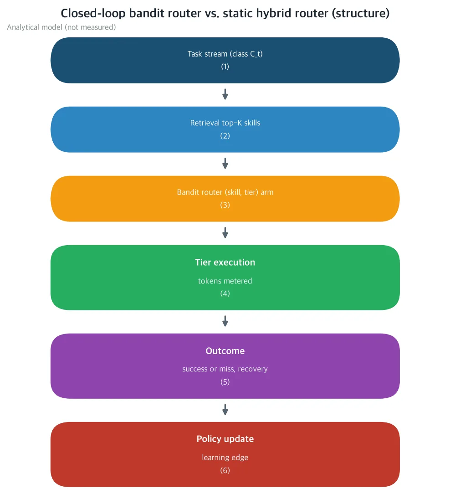
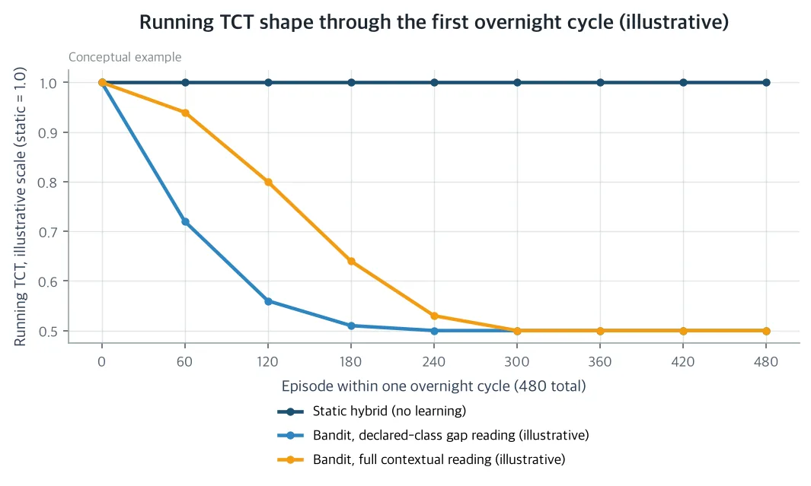
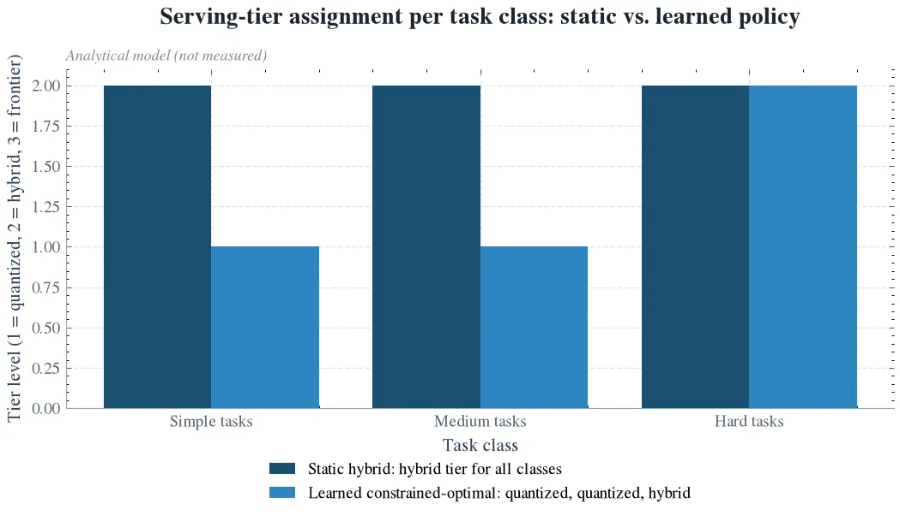

셀프호스트드 GPU 플릿에서 무인 에이전트 루프를 밤새 돌리는 분, 혹은 각 태스크를 어떤 스킬과 모델 티어로 실행할지를 정하는 라우팅 구조를 고치려는데 대안이 얼마인지 모르는 국내 클라우드와 AI 엔지니어를 위한 글입니다. 에이전트는 2,200개 스킬로 된 자기진화형 레지스트리에서 스킬을 골라 서빙 티어에 넘깁니다. 그 선택은 지금 플릿에서 정적 라우터를 지나갑니다. 구성이 배포 시점에 고정되어 있고 사람 재튜닝까지 바뀌지 않는 라우터입니다. 이 논문은 라우터가 realized downstream outcome에서 배우기 시작하면 무엇이 벌어지는지를 정가합니다.

핵심 결과는 선언된 요금 카드 위에서 나옵니다. 학습 라우트가 첫 밤사이 사이클 안에 패리티 밴드에 닿고 그 지점의 완결 태스크당 토큰 TCT는 2,744.6에서 1,554.4로 43.4% 떨어집니다. 최종 성공은 1.54포인트 내린 0.9484로, 사전등록된 2포인트 패리티 밴드 안에 머무릅니다. 밤사이 지출은 사이클당 $2.248에서 $0.834로 62.9% 내려갑니다. 수렴 지평은 선언된 클래스 갭 독해에서 32에피소드(사이클의 6.7%), 완전 컨텍스트 독해에서 229에피소드(47.7%)입니다.

읽기 전에 한 가지를 밝혀 둡니다. 이 논문은 선언된 전제 위에서 값을 세는 분석 논문이고 새 실측을 보고하지 않습니다. 모든 수치는 선언된 공칭 요금 카드 위의 닫힘 형태 예측이거나, 인용 참고 문헌에 귀속되는 결과입니다. 본문에 든 그림 세 장은 분석 모델이 그린 도식과 개념 예시이며 실측 데이터가 아닙니다. 시리즈의 직전 논문 Indifference Band가 인디퍼런스 밴드 안의 근접 타이 결정을 정적 기대비용 타이브레이크로 정가했다면, 이 논문은 그 분석의 명시적 업그레이드입니다. 라우터가 고정 대상이던 그 결과를, 밴딧 정책의 밴드 내 선전으로 바꿔 값이 한 번 정해지는 정적 곡선에서 결과에서 다시 정해지는 학습 프런티어로 옮깁니다.

## 문제: 라우터 안의 값은 다 나왔고 라우터 자체만 배우지 않습니다

라우팅 시리즈는 정적 하이브리드 라우터의 부품을 하나씩 정가해 왔습니다. Thinking Router가 라우팅 단계와 실행 단계 사이의 추론 예산을 정가했고 Miss Price가 라우팅 미스 하나를 정가했습니다. 미스 배율 m, 복구 분류 R = {S, F, E, N}와 복구율 rho, 브레이크이븐 정확도 alpha*까지입니다. Indifference Band는 밴드 안의 근접 타이 결정을 기대비용 타이브레이크 CommitByCost(delta)로 정가했습니다. 부전에는 값이 다 있습니다. 움직이지 않는 것은 라우터입니다. 구성은 배포 시점에 고정되고 realized downstream outcome은 정책을 한 번도 갱신하지 않습니다.

외부 문헌도 같은 형상입니다. RouteLLM은 선호 데이터로 강/약 라우터를 오프라인 훈련하고 FrugalGPT는 코스트 인식 캐스케이드 순서를 오프라인 학습합니다. conformal 계열은 신뢰도 임계를 보정하지만 결과로부터 루프를 닫지는 못합니다. 이 모든 작업에서 라우팅 규칙은 배포 시점에 고정됩니다. 가장 가까운 외부 작업 Skill Adapter는 성장하는 스킬 풀 위에서 라우팅 결과를 보상으로 쓰는 온라인 라우팅이지만, 목적은 태스크 성공입니다. 플릿이 정가를 요구하는 수렴 지평은 특성화되어 있지 않습니다. 이 논문이 세우는 질문은 하나입니다. 행동 공간은 정적 라우터와 동일하게 리트리발 top-K x 티어로 두고, 학습 신호를 리트리발 랭킹이 아니라 downstream 태스크 결과로 바꿨을 때 무엇이 달라지는지를 묻습니다.

## 설계: 태스크 결과가 보상이 되는 밴딧 라우터

무대는 480에피소드의 밤사이 사이클입니다. 각 에피소드에서 태스크 x_t가 정지 클래스 스트림(단순:보통:어려움 = 0.40:0.35:0.25)에서 도착하고 리트리발은 2,200개 레지스트리에서 top-5 스킬을 돌려줍니다. 정책은 그 5개 스킬과 티어 3개의 곱, 15개의 팔 (스킬, 티어)에서 하나를 고릅니다. 티어는 셀프호스트드 H200의 frontier(R1), hybrid(R2), quantized(R3) 서빙 구성입니다. 실행은 성공 또는 미스를 돌려주고 티어별 선언된 가격으로 토큰이 미터링됩니다. 미스는 반드시 끝이 아닙니다. miss의 일부 rho가 사후 복구를 통해 나중에 완료되고 남은 미완료의 재작업 토큰은 완결된 태스크에 배분됩니다.

보상에 TCT가 들어갑니다. 에피소드가 재작업을 포함해 기대적으로 소모하는 토큰을 E = c_r + c_e x (p + (1-p) x m)로, 결국 완료될 확률을 p* = p + (1-p) x rho로 놓으면 TCT는 이 둘의 비 E/p*가 됩니다. Miss Price의 미스 배율 m과 복구율 rho가 가산으로 들어가는 구조라, 밴딧이 훈련받는 것은 리트리발 랭킹이 아니라 미스 가격 분석이 정의한 downstream 비용 그 자체입니다. 보상은 매 에피소드 관측되므로 (스킬, 티어) 팔에 대한 크레딧 할당은 잘 정의되고 목적은 TCT 최소화에 패리티 밴드 제약이 붙는 것입니다.

요금 카드는 티어별 실행 토큰과 가격을 선언합니다. 실행 비용은 frontier 3,200, hybrid 2,400, quantized 900 토큰이고 router 비용은 1,100, 180, 70 토큰입니다. 가격은 백만 토큰당 $4.427, $1.7708, $0.664이며 시리즈가 선언한 $2,040/night 스텝 실행 장부와 정합합니다. 미스 배율은 frontier 1.20, hybrid 1.40, quantized 2.10입니다. 실행이 싼 티어일수록 후보 풀에서 더 나쁜 데코이를 조립해 미스 하나당 비용이 오히려 비싸다는 결합입니다.

알고리즘은 제약 컨텍스트 밴딧으로 동작합니다. 컨텍스트는 리트리발 스텍터 벡터와 클래스 피처의 선언된 선형화, d = 32로 잡힙니다. 각 에피소드는 플러그인 TCT 추정자에 UCB 지수를 두고 보상이 비용이라 지수를 최소화하는 팔을 칩니다. 실행 결과 이후에 팔 카운터, 성공과 복구 카운터, 집합 p*가 갱신됩니다. p*를 패리티 밴드 하한 아래로 밀어낼 갱신은 거절되고 이전 정책이 재실행됩니다. 지연 제약 투영입니다. 초기화가 주목됩니다. 탐색은 균일한 노이즈가 아니라 정적 분석에서 시작합니다. 인디퍼런스 밴드 안에서 CommitByCost(w=2) 순서가 밴드 내 선전이 되고, 밴딧은 각 클래스-티어 셀의 가장 싼 멤버를 먼저 시도합니다. 같은 후보의 제로 오버헤드 재순서라 시딩이 라우팅 단계 토큰을 하나도 더 쓰지 않습니다.

*클로즈드 루프 밴딧 라우터와 배포된 정적 하이브리드 라우터의 구조입니다. realized outcome과 미터링 토큰, 복구 이벤트를 정책 갱신으로 되돌리는 학습 엣지가 유일한 구조적 차이이며 정적 기준선은 갱신 엣지가 없습니다. 분석 모델 도식이며 실측이 아닙니다.*

## 결과 1: 수렴 지평은 첫 밤사이 사이클 안에 있습니다

수렴 지평 T*는 집합 평균 TCT가 정적 기준선 아래 지역, 품질이 패리티 밴드 안인 지역에 처음 들어와 머물 때까지 걸리는 에피소드 수의 상한입니다. 상한은 두 항으로 나뉩니다. 클래스별 티어 팔에 대한 확률적 갭 기반 항과, d차원 리트리발 스텍터 컨텍스트의 탐색 예산 항입니다. 선언된 요금 카드에서 갭 항은 31.4에피소드, 컨텍스트 항은 197.6에피소드로 닫힘 형태 평가됩니다.

읽기는 두 갈래입니다. 갭 독해는 태스크 클래스가 컨텍스트에 선언되어 있고 CommitByCost 선전이 밴드 내 탐색의 대부분을 제거했다고 읽는 것입니다. 그러면 E[T*]는 31.4, 약 32에피소드, 사이클의 6.7%입니다. 18생산시간에 480에피소드라는 선언된 페이싱으로 환산하면 약 72분입니다. 컨텍스트 독해는 d = 32 전체 컨텍스트를 처음부터 탐색하는 최악의 경우로, E[T*]는 229.0, 약 229에피소드, 사이클의 47.7%입니다. 어떤 독해에도 학습 라우트는 첫 밤사이 사이클 안에 패리티 밴드에 닿습니다. 첫 사이클 끝의 집합 TCT도 갭 독해에서 1,662.9 이하(-39.4%), 컨텍스트 독해에서 2,354.6 이하(-14.2%)로 정적 TCT 2,744.6보다 엄격히 아래입니다. 두 값 사이 간격은 클래스를 선언하지 않는 대가이고, CommitByCost 선전이 그 간격을 줄이는 선언된 메커니즘입니다.

*첫 480에피소드 밤사이 사이클을 지나는 집합 TCT의 형상입니다. 두 수렴 독해 모두에서 학습 라우트가 하나의 사이클 안에 낮은 TCT 평지에 닿는다고 예측되며 선언된 클래스 갭 독해는 훨씬 일찍 수렴합니다. 개념 예시이며 실측이 아닙니다.*

## 결과 2: 단순과 보통은 quantized로, 어려움은 hybrid에 남습니다

제약 최적 정책 pi_L은 (R3, R3, R2)입니다. 단순 태스크와 보통 태스크가 quantized 티어로 내리고 어려움 태스크가 hybrid에 남습니다. 내림을 가르는 것은 닫힘 형태 티어 스왑 테스트입니다. 티어 r에서 더 싼 r'로의 내림은 E_{c,r'} x p*_{c,r} < E_{c,r} x p*_{c,r'}일 때, 즉 원시 TCT가 내려갈 때에만 TCT 최적입니다. 선언된 공칭에서 단순과 보통은 이 테스트를 통과합니다. 어려움도 원시 TCT로는 통과합니다(1,346.2 x 0.898 < 2,743.2 x 0.772). 그 내림을 막는 것은 TCT가 아니라 패리티 밴드 제약입니다. 어려움까지 내리면 집합 최종 성공이 0.9169로 떨어져 밴드 하한 0.9438 아래로 2.69포인트 내려갑니다.

집합 예측은 다음과 같습니다. TCT는 2,744.6에서 1,554.4로 43.4% 떨어집니다. 최종 성공은 0.9638에서 0.9484로 1.54포인트 내려가며 사전등록된 2포인트 밴드 안에 들어옵니다. 에피소드당 토큰은 2,645.3에서 1,474.2로 44.3% 줄고 사이클당 완결 태스크는 462.6에서 455.2로 1.6% 줄어듭니다. 밤사이 지출은 $2.248에서 $0.834로 62.9% 떨어져 사이클당 $1.414가 남고 이 금액은 다른 회계 기준 위에서 Indifference Band의 Band-Two 예측 $60.5/사이클을 포섭합니다.

*태스크 클래스별 서빙 티어 할당입니다. 정적 정책은 모든 클래스를 hybrid에 고정하고 제약 최적의 학습 정책은 단순과 보통을 quantized로 내리고 어려움은 hybrid에 둡니다. 어려움까지 내리면 집합 성공이 사전등록된 2포인트 패리티 밴드 아래로 떨어지기 때문입니다. 분석 모델 도식이며 실측이 아닙니다.*

포스트호라이즌 지배 정리가 이 결과를 고정시킵니다. 모든 N >= T*에서, 확률 1 - 2 x e^(-(N-T*)/16) 이상으로 학습 라우트의 집합 TCT가 정적 TCT보다 최소 1,081.7토큰(정적 값의 39.4%) 엄격히 아래에 머무릅니다. 그리고 정적 정책 pi_0는 pi_L의 제로 탐색, 그리디 한계 제한으로 인디퍼런스 밴드 안에서 되찾겨집니다. Indifference Band의 결과는 흡수됩니다. 그 타이브레이크가 밴딧의 밴드 내 선전이 되고, $60.5/사이클 예측이 정적 구성에서 나가는 내림의 1차항이 됩니다. 플릿 운영 규칙은 한 줄입니다. 클로즈드 루프를 한 번 켜고 이후 라우터를 재튜닝하는 사람은 없습니다. N < T*에서는 정적 라우트가 싼 운영이고(탐색 없음), N > T*에서는 학습 라우트가 싼 운영입니다. 비용-품질 프런티어는 한 번 값이 정해지는 정적 곡선에서 (delta, N)의 함수로, 특성화된 진입 시간 T*(delta)를 가진 학습 프런티어로 올라갑니다.

## 사전등록 반증 프로토콜: 팔 넷, 기준 다섯

새 실측이 없는 논문의 예측은 감사 가능해야 합니다. 프로토콜은 셀프호스트드 H200의 티어별 토큰 미터링을 둔 공유 SRA-bench 스트림 위에 사전등록됩니다. 팔은 넷이고 모두 같은 케이스 스트림 위를 달립니다. B0는 정적 하이브리드 pi_0, 현재 프로덕션 기본값입니다. B1은 클로즈드 루프 밴딧 pi_L입니다. B2는 t = 0에 고정되는 오라클 정지 정책 (R3, R3, R2)으로, 학습 없이 B1이 수렴할 것으로 예측된 점입니다. B3는 탐색만 하는 제어 팔로, 매 에피소드 밴드 안에서 균일하게 티어를 재샘플링해 탐색 오버헤드를 학습 이득에서 분리합니다. 윈도우 통계는 예측 지평 이후의 첫 100에피소드입니다.

반증 기준은 다섯 개이고 기준이 걸리면 고치는 것은 장부가 아니라 각 기준이 명명한 메커니즘입니다. F1은 B1의 윈도우 TCT가 B0 전체 TCT(2,744.6)를 넘는 것, F2는 B1의 윈도우 최종 성공이 B0 전체(0.9638)보다 2포인트 이상 낮은 것, F3는 B1의 실현 지평이 2사이클(960에피소드)을 넘는 것, F4는 B1과 B2의 안정상태 TCT 차이가 예측된 B0-B1 갭의 25%(297.6토큰)를 넘는 것, F5는 B3의 윈도우 TCT가 B0 전체 TCT를 넘는 것입니다. F1은 학습 이득이 없고 F2는 패리티 밴드가 깨졌으며, F3는 컨텍스트 독해(229)에서도 지평 상한이 반증된 것입니다. F4는 크레딧 할당, 즉 미스 가격과 복구 항의 보상이 보정되지 않은 것이고, F5는 탐색 오버헤드가 정적 기준선을 넘어 밴드 선전 시딩이 반증된 것입니다. 닫힘 형태 숫자마다 반증 진술 하나가 매핑됩니다.

## 회사, 사회, 과학에 닿는 곳

회사가 얻는 것은 사람 재튜닝 없이 무인 에이전트 플릿의 완결 태스크당 토큰을 내리는 적응형 라우터입니다. 기존 SRA-bench 하네스와 토큰 미터링 위에 바로 올라가고 탐색 비용은 지평 상한과 윈도우 통계로 사전 제한됩니다. 운영 규칙은 한 줄입니다. 클로즈드 루프를 한 번 켜고 N > T*에서 학습 라우트가 더 싼 운영입니다.

사회가 얻는 것은 대규모 자동화 태스크당 추론 비용과 에너지의 감소입니다. 라우터가 realized downstream outcome에서 "최소로 충분한 가장 싼 티어"를 배우면, 단순과 보통 태스크는 quantized가 소화하고 frontier 티어의 토큰은 정말 필요한 어려움 태스크에만 쓰입니다. 셀프호스트드 에이전트 플릿을 돌리는 팀에, 품질 비용을 1.54포인트로 두고 밤사이 지출을 62.9% 내리는 운영점은 선언된 밴드 안에서 구체적 운영 규칙이 됩니다.

과학에 남는 것은 downstream 태스크 결과로 훈련된 클로즈드 루프 컨텍스트 밴딧 스킬 라우터의 첫 특성화입니다. 이전의 정적 프런티어 분석은 라우팅 구성을 고정하고 비용-품질 곡선을 그렸지만 정적에서 학습된 정책으로 넘어가는 전환 자체를 정가한 것은 아닙니다. 이 논문은 그 전환의 수렴 지평과 완결당 비용을 특성화하고 Indifference Band의 정적 타이브레이크를 밴딧의 밴드 내 선전으로 흡수해 정적 프런티어를 진입 시간 T*(delta)를 가진 학습 프런티어로 올리습니다.

## 한계: 결과를 붙드는 전제 여섯 개

한계는 여섯 개입니다. 첫째, 사이클 내 정지성입니다. 레지스트리는 자기진화형이라, (A1)는 밤사이 태스크 스트림의 구성에 의해 한 사이클 안에서 성립합니다. 하지만 사이클 간 스킬 풀 드리프트는 학습된 포스터를 무효화하고 선언된 시정인 stale 관찰 할인은 드리프트마다 T*를 다시 부풀립니다. 둘째, 선언된 미스 경제학입니다. 미스 배율 m_r과 복구율 rho_c는 알려진 상수로 들어갑니다. 이 분석의 밴딧은 자신의 m, rho 오차를 추정하지 않아 Miss Price의 브레이크이븐 민감도가 보상으로 그대로 전이됩니다.

셋째, 집합 패리티 밴드입니다. 제약은 사이클 레벨 최종 성공이고 태스크별 SLO가 아닙니다. 태스크별 품질 하한을 두면 가능 집합이 좁아지고 T*가 길어지며 그 극한은 TCT를 9.6%만 아끼고 지출은 43.5% 더 쓰는 엄격 패리티 점 (R3, R2, R1)입니다. 넷째, 단일 비용 채널입니다. 목적은 토큰 비용뿐이고 벽 시간과 goodput과 에너지는 선언된 티어 가격에 비례한다고 가정됩니다. SLO 인식 라우팅은 선언된 장부 바깥입니다. 다섯째, 컨텍스트 충분성입니다. 성공이 선언된 리트리발 스텍터와 클래스 피처보다 더 세밀한 수준에서 결정된다면 갭 독해는 T*를 과소추정하고 컨텍스트 독해가 정직한 폴백입니다. 여섯째, 라이브 트래픽 위 탐색입니다. B1은 실제 밤사이 스트림에서 탐색하고 캐너리 분할 q는 라이브 노출을 q 비율로 제한하는 대신 T*를 1/q로 늘립니다.

논문 원문과 수반 자료는 Hugging Face 논문 상세 페이지에서 볼 수 있습니다. https://huggingface.co/datasets/thaki-AI/daily-paper-2026-11-26-closed-loop-bandit-skill-router-cost

*본문의 모든 수치는 선언된 공칭 요금 카드 위의 닫힘 형태 예측이거나 인용 참고 문헌에 귀속된 결과입니다. 이 논문은 새 실측을 보고하지 않습니다. 정밀 닫힘 형태 값은 TCT 2,744.6에서 1,554.4로(-43.4%), 최종 성공 0.9638에서 0.9484로(-1.54포인트), 밤사이 지출 $2.248에서 $0.834로(-62.9%), 에피소드당 토큰 2,645.3에서 1,474.2로, 완결 태스크 462.6에서 455.2로, T* <= 32(갭 독해) / <= 229(컨텍스트 독해), 첫 사이클 끝 집합 TCT <= 1,662.9 / <= 2,354.6, 지배 마진 1,081.7토큰(정적 값의 39.4%)까지입니다. 그림 세 장은 분석 모델 도식과 개념 예시이며 실측이 아닙니다. 4팔(B0~B3) x 5기준(F1~F5) 사전등록 프로토콜은 이 논문에서 실행되지 않았고 실측값의 보고는 실행 시점에 이뤄집니다.*
