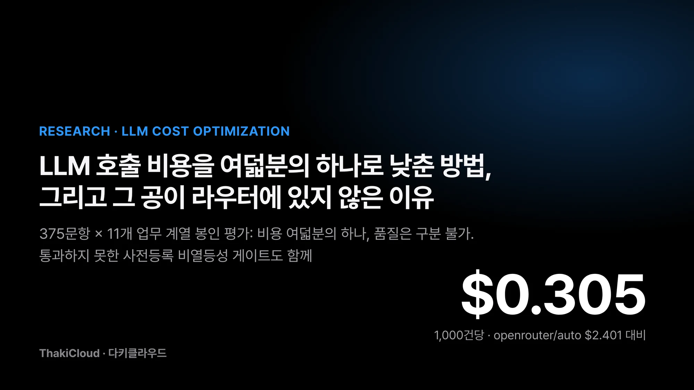
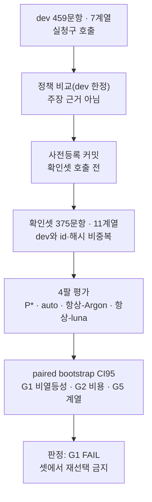
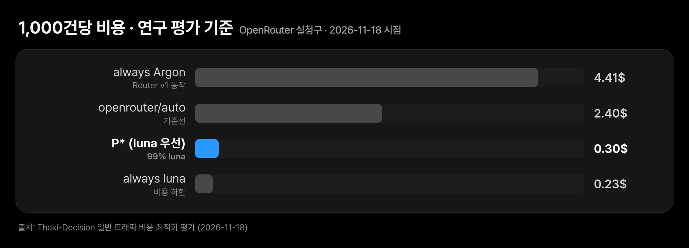
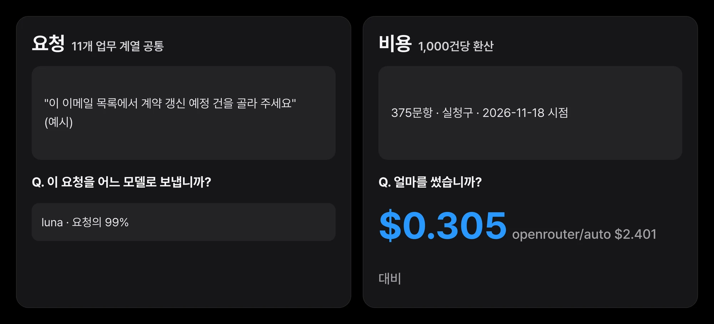

LLM 호출이 매 요청마다 일어나는 서비스에서 비용을 줄이려고 손을 뻗는 첫 지점은 보통 라우터입니다. 어떤 요청을 어떤 모델에 보낼지 결정한답시고 학습까지 시키는 기술이고, 우리는 두 달간 그 길을 갔습니다. 결과가 우리의 전제와 정반대로 나왔습니다. 375문항 봉인 평가에서 요청 1,000건당 비용을 여덟분의 하나로 낮춘 것은 런타임에서 배우는 라우팅이 아니라, 싼 모델 하나를 기본으로 고르는 단순한 정책이었습니다. 이 글은 그 수치를 그대로, 사전등록한 게이트를 통과하지 못한 부분도 함께 보고합니다.

## 한 줄 결론부터

저비용 모델 우선 정책은 375문항, 11개 업무 계열의 연구 평가에서 OpenRouter 자동 선택(openrouter/auto, 2026-11-18 시점) 대비 비용을 약 여덟분의 하나로 낮췄습니다. 품질은 0.926 대 0.928로 0.24%p 차이이고, 95% 신뢰구간에 0이 포함되어 통계적으로 구분되지 않습니다. 다만 사전등록한 비열등성 검정은 통과하지 못했습니다. 그래서 이 연구에서 말할 수 있는 것은 "auto와 동급"이 아니라 "이 정밀도에서는 차이가 구분되지 않지만, 비열등성 게이트는 실패했다"입니다. 그리고 비용 절감의 공이 어디에 있는지도 함께 짚었습니다. 요청의 99%를 기본 모델이 처리했습니다.

## 어떻게 평가했나

실험은 세 단계로 나갔습니다. 먼저 dev 셋 459문항(7개 계열)으로 고정 모델 6종과 openrouter/auto를 실제 호출하고, OpenRouter `usage.cost` 실청구액을 받았습니다. 정책 비교는 dev에서 끝나고, dev에서 고른 정책의 수치는 주장 근거로 쓰지 않았습니다. 그 뒤 확인셋을 만들었습니다. 380문항 중 평가에 쓰인 375문항, 11개 계열이며, dev와 문항 id·프롬프트 해시가 모두 비중복입니다. dev에 없던 계열(ARC-Challenge, HRM8K, BBH, KoBEST, Arena-Hard)이 포함됩니다.

확인셋 호출 전에 판정 규칙을 커밋했습니다(사전등록). 비교 대상은 하나뿐인 저비용 우선 정책(P*)과, 기준선이 되는 openrouter/auto, 그리고 "항상 Argon"(현 Router v1의 실제 동작)·"항상 luna" 두 고정 팔. 품질 차이는 paired bootstrap(층화, B=4000)으로 95% 신뢰구간을 계산하고, 사전등록한 세 게이트로 판정합니다. G1은 비열등성(auto 대비 품질 차이 하한이 −0.02 이상), G2는 비용(1,000건당 비용비가 auto의 25% 이하), G5는 계열별 하한(어떤 계열도 auto보다 10%p 이상 뒤처지지 않음)입니다.

채점 방식도 짚습니다. 수치 문제는 정답 일치, 객관식은 선택지 글자, MATH 계열은 정규화 후 등치 판정, 코딩은 네트워크 차단(`--network none`) 도커에서 숨은 테스트 실행, 열린 질의는 참조 답 없이 사내 Qwen3.8-27B가 단일 판정자로 1~10점을 줍니다. 판정자 편향은 따로 재지 못했습니다. 이 한계는 뒤에서 다시 나옵니다.

## 네 팔의 결과

같은 375문항을 네 팔이 풀었습니다. 품질은 11개 계열 점수의 단순 평균(매크로)이고, 비용은 OpenRouter 실청구의 1,000건당 환산입니다.

| 팔 | 품질(매크로) | 비용 $/1,000건 | 지연 p95 |
|---|---|---|---|
| P* (luna-first) | 0.926 | $0.305 | 21.2초 |
| openrouter/auto | 0.928 | $2.401 | 27.4초 |
| 항상 Argon (Router v1 동작) | 0.959 | $4.409 | 31.5초 |
| 항상 luna | 0.920 | $0.225 | 미측정 |

P*와 auto의 차이부터 봅니다. 품질은 −0.0024로, 95% 신뢰구간이 −0.0221에서 +0.0172까지입니다. 0을 포함합니다. 비용비는 0.126이고 구간은 0.090~0.176입니다. 즉 openrouter/auto가 같은 문항에 $2.401을 썼을 때 P*는 $0.305를 썼습니다. 연구 평가 기준으로 87.4% 감소입니다. 이 수치를 말할 때는 언제나 "vs openrouter/auto, 연구 평가 기준"이라는 두 맥락이 함께 가야 합니다. 비교 기준은 2026-11-18 시점의 auto이고, auto가 어떤 모델을 고르는지는 시점에 따라 바뀝니다.

다른 기준선과 비교하면 그림이 또 달라집니다. P*는 항상 Argon 대비 품질 −0.0335(95% CI −0.0543~−0.0156, 유의한 하락), 비용비 0.068로 93.2% 감소입니다. "기존 Router v1(항상 Argon)보다 낫다"는 주장은 이 표에서 성립하지 않습니다. 품질이 유의하게 낮아졌기 때문입니다. P*는 항상 luna 대비 품질 +0.0052(95% CI 0.0~+0.0136), 비용비 1.33입니다. 이 팔이 핵심이고, 다음 절에서 봅니다.

게이트 판정은 G1 FAIL, G2 PASS, G5 PASS. 신뢰구간 하한(−0.0221)이 비열등성 마진(−0.02)에서 0.0021 모자랐습니다. 셋에서 정책을 다시 고르지 않았습니다.

## 계열별: 고른 손실이 아닙니다

매크로로는 −0.24%p지만, 계열을 하나씩 보면 균일한 손실이 아닙니다. P*가 앞서는 곳은 어려운 추론 계열입니다. ARC-Challenge는 1.0 대 auto 0.975, BBH는 1.0 대 0.975, Arena-Hard는 0.866 대 0.820입니다. 뒤처지는 곳은 한국어 전문 지식과 코딩 일부입니다. KMMLU는 0.933 대 auto 0.967, HumanEval은 0.967 대 1.0, KoBEST는 0.975 대 1.0입니다. GSM8K·MATH·MBPP·HRM8K는 동급입니다.

이 형상은 라우팅으로 고치는 결함이 아니라, 기본 모델이 luna라는 선택에서 나오는 결과입니다. 어려운 추론에서는 luna가 충분히 강해서 싼 가격에 auto보다 낫고, 한국어 전문 지식에서는 auto가 더 특화된 모델을 골라 P*가 밀립니다. "싼 기본 모델을 먼저 고른다"는 정책의 이득과 대가가 같은 문장에서 보입니다.

지연도 함께 봤습니다. P*의 평균 6.3초, p95 21.2초는 auto(평균 6.99초, p95 27.4초)보다 빠릅니다. 비용이 여덟분의 일인데 지연도 짧아진 것은, 요청 대부분을 한 모델이 몰아서 처리하기 때문입니다. auto는 여러 모델에 흩어지고, 그중 비싼 모델이 섞여 총비용이 높아집니다. 즉 이 정책은 "싼 것"만 취한 것이 아니라, 싼 것과 빠른 것이 같은 방향에서 나온 것입니다. 다만 이 지연은 연구 평가의 단일 질의 조건입니다. 에이전트 루프처럼 다중 턴이 쌓이는 환경에서는 그대로 이월되지 않습니다.

## 공이 어디에 있는지

P*가 실제로 요청을 나누는 모습을 보면 결론이 눈에 보입니다. 375문항 중 99%를 luna가 처리했고, Argon으로 올린 것은 1.1%뿐입니다. 즉 라우팅이 "어려운 것은 비싼 모델에"라는 일을 한 분량은 거의 없고, 정책의 대부분은 "기본이 luna"라는 한 줄입니다.

그 한 줄의 가치를 재려면 항상 luna 팔과 비교합니다. P*가 항상 luna보다 더 얻는 품질은 +0.0052이고 신뢰구간은 0에서 시작합니다. 런타임 신호를 보는 캐스케이드나, 공개 가중치를 우리 데이터에 재적용한 RouteLLM MF도 확인셋에서 항상 luna와 같은 품질(0.920)을 냈습니다. 학습형 라우터가 기본 모델 선택 위에 얹은 가치는 이 정밀도에서 0에 가깝습니다.

그래서 이 연구가 말하는 경쟁력의 원천은 학습형 라우팅의 우월성이 아닙니다. 저렴한 기본 모델을 먼저 고른 정책의 경제성입니다. 그리고 그 "저렴한 기본 모델"의 시장 가격이 바뀐다면 이 결론도 바뀝니다. 이득의 대부분은 라우팅 알고리즘이 아니라 모델 선택에서 왔고, 모델 선택은 가격표에 묶여 있습니다.

## 말할 수 있는 것과 말할 수 없는 것

대외에 인용하는 문장은 아래 3단락으로 고정했습니다. 이 3단락 밖의 주장은 이 연구에서 성립하지 않습니다.

> 375문항, 11개 업무 계열의 평가에서 저비용 모델 우선 선택 정책은 OpenRouter 자동 선택 대비 요청 1,000건당 평가 기준 비용을 $2.401에서 $0.305로 낮췄습니다(약 87.4% 감소).
>
> 품질 점수는 0.928에서 0.926으로 약 0.24%p 낮았으며, 95% 신뢰구간에 0이 포함돼 통계적으로 유의한 차이를 확인하지 못했습니다. 다만 사전등록한 비열등성 검정은 통과하지 못했습니다.
>
> 이번 결과는 저비용 기본 모델 선택의 잠재력을 보여주지만, 학습형 모델 라우팅의 우월성이나 운영 환경에서의 비용 절감을 입증한 것은 아닙니다.

함께 명시해야 할 한계는 여섯 개입니다.

- 사전등록한 비열등성 게이트(G1)는 실패했습니다. "auto와 동급"이라는 주장은 불가합니다.
- n=375에서 paired 신뢰구간 반폭이 ±0.02 수준이라, 마진 0.02의 비열등성 게이트는 검정력 한계에 부딪힙니다.
- 비교 기준은 2026-11-18 시점의 openrouter/auto입니다. 시점에 따라 auto의 모델 구성이 변합니다.
- 모든 측정은 단일 질의, 도구 없음 조건입니다. 에이전트 루프(도구·다중 턴)의 품질은 이 평가에 포함되지 않습니다.
- 열린 질의 채점은 참조 답이 없는 단일 판정자(사내 Qwen3.8-27B)입니다. 판정자 편향은 측정되지 않았습니다.
- 모델 시장 가격 변동 시 결론이 바뀝니다. 이득의 원천은 기본 모델 선택이고, 선택은 가격표에 묶여 있습니다.

## 게이트의 검정력에 대한 반성

마지막 수치를 다시 보면, 비열등성 게이트가 얼마나 가혹했던지도 보입니다. n=375에서 paired bootstrap의 95% 신뢰구간 반폭은 약 ±0.02였습니다. 마진이 0.02인 게이트에서 그 반폭이 ±0.02면, 점추정이 0 이상이어야 통과할 수 있는 설계입니다. "차이가 없다면 통과"가 아니라 "명확히 유리해야 통과"에 가까운 조건을 만들고, 검정력 계산 없이 사전등록에 넣었습니다. 반성은 판정을 바꾸지 않습니다. G1은 그대로 FAIL이고, 이 글도 그대로 "통과하지 못했습니다"라고 씁니다. 다만 다음 평가에서는 마진과 표본 크기를 같은 문서에 놓고 승인받아서 시작하겠습니다.

## Paxis에서 어떻게 쓰이는가

ThakiCloud Paxis의 일반 트래픽 경로는 현재 PR([ThakiCloud/paxis#10234](https://github.com/ThakiCloud/paxis/pull/10234))으로 열려 있습니다. 병합 전이며, 운영 배포도 아닙니다. 근거가 있는 요청 유형(정형 업무, 결정론적 실행기가 있는 경로)은 그대로 두고, 근거가 없는 일반 요청만 `general` 경로로 보내며, 그 기본 모델이 openai/gpt-6-luna입니다. 품질 우선 모드(`quality_first`)를 켜면 Argon이 유지됩니다. 채팅에는 "형식 실패 시 Argon으로 올림"을 넣지 않았습니다. 측정한 기여가 +0.005에 그쳤기 때문입니다.

이 연구가 남긴 교훈은 하나입니다. 복잡한 모델 라우팅이 항상 좋은 것이 아니라, 적절한 저비용 기본 모델과 결정론적 실행기를 선택하는 편이 더 효과적일 수 있습니다. 같은 연구계통의 봉인 평가에서도 라우팅의 주된 기여는 학습된 정책이 아니라 결정론적 실행기였습니다.

## 이것을 쓰시려면

마지막으로, 이 결과를 자기 서비스에 옮기려는 분에게 순서를 줍니다.

1. 업무 계열별로 "싼데 강한 기본 모델"을 먼저 고르세요. 라우터 설계가 아닙니다. 모델 하나 고르는 일이고, 이 연구의 절감 대부분이 여기서 나옵니다.
2. 기본 모델을 상시 쓰는 팔과 라우팅의 이득을 따로 재세요. "항상 기본 모델" 팔이 없으면, 라우팅의 가치를 과대평가하게 됩니다.
3. 비열등성을 주장하려면 사전등록 봉인 평가가 필요합니다. 마진, 표본 크기, 신뢰구간 반폭을 같은 문서에 놓고 시작하세요. 이 연구는 마진 0.02에 반폭 ±0.02라는 짠 조합에서 게이트를 놓쳤습니다.
4. 비용 절감 수치를 인용할 때는 기준선을 붙이세요. "87.4%" 단독은 없습니다. "vs openrouter/auto(2026-11-18 시점), 연구 평가 기준"이 함께 가야 합니다.

연구 산출물 중 공개되는 가중치는 없습니다. 이 정책은 라우팅 코드이고, 기본 모델은 OpenRouter가 공급하는 상용 모델입니다.
