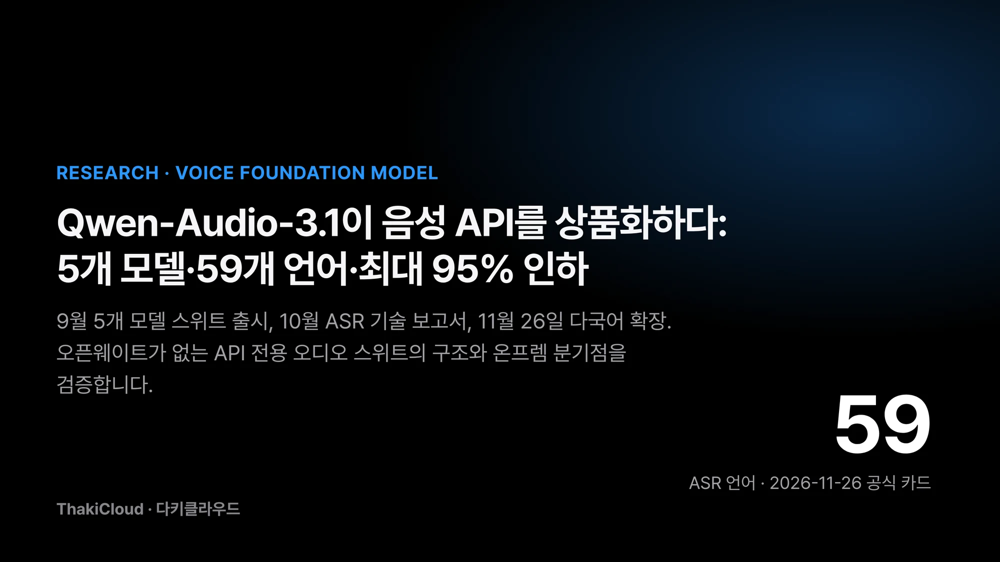
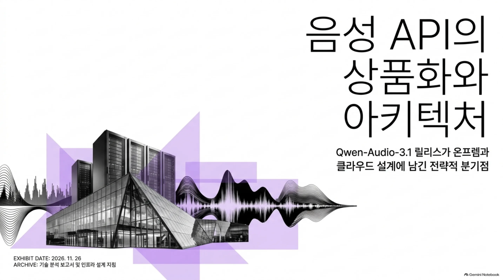
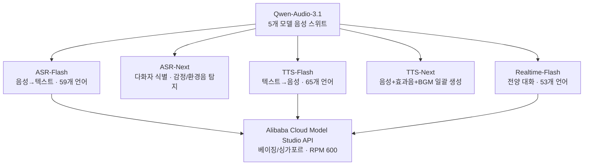
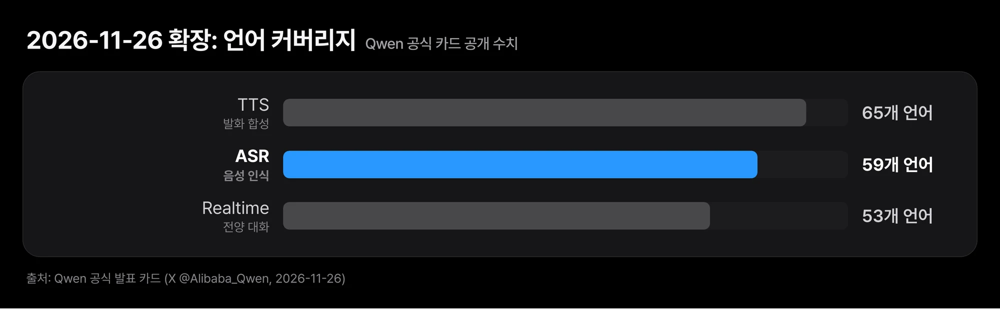
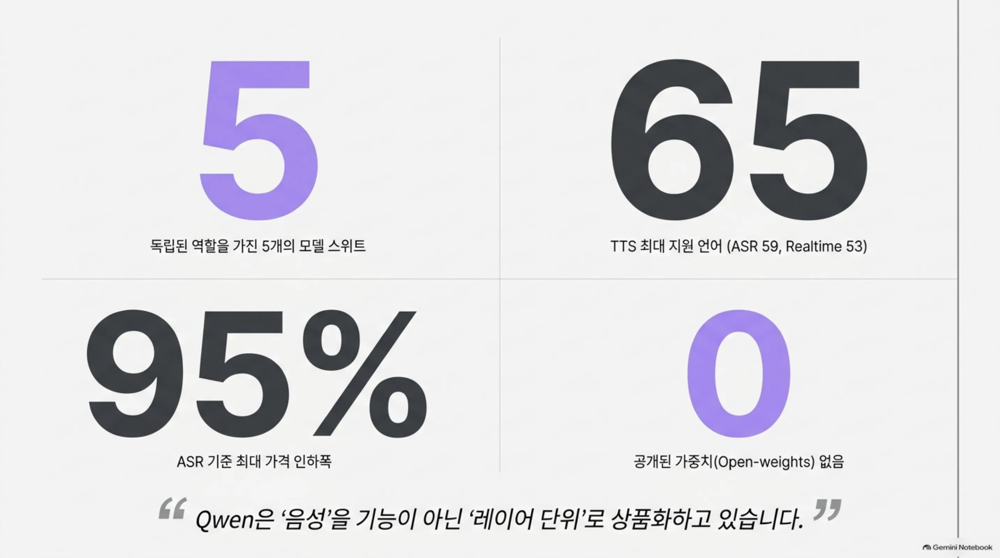
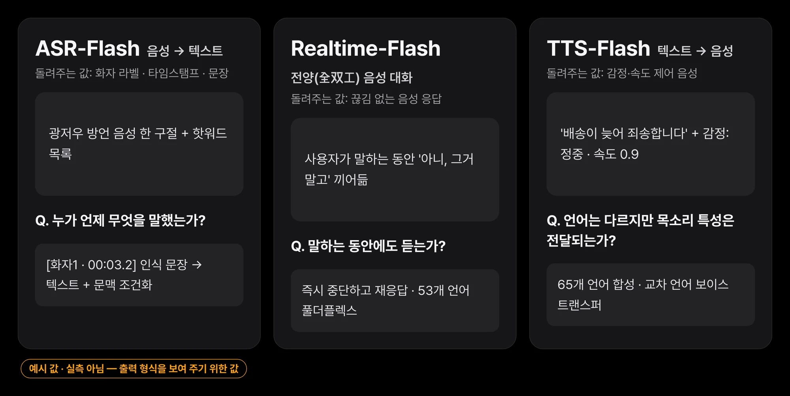
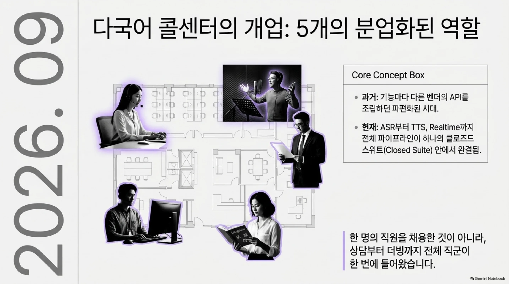
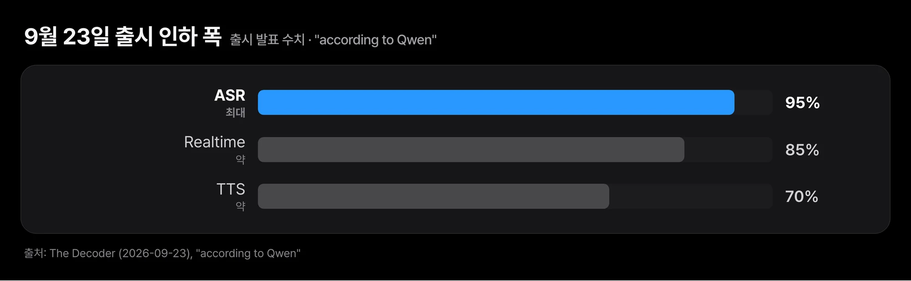
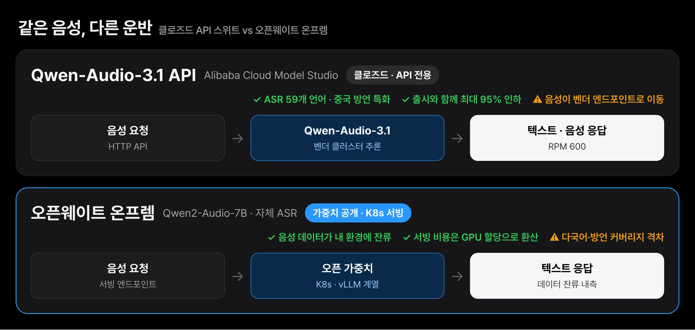
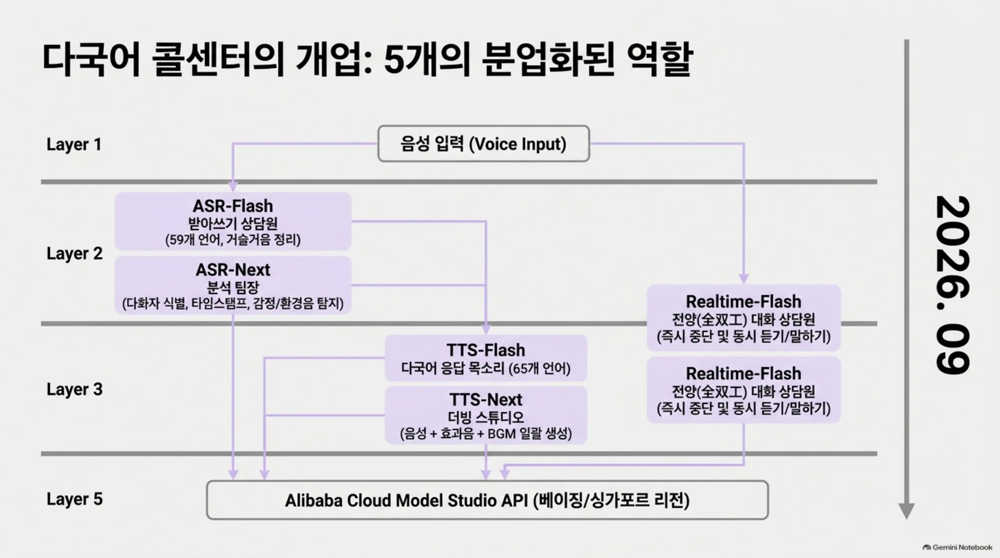

다국어 음성 기능(ASR·TTS·실시간 대화)을 제품이나 에이전트에 붙여야 하는 ML 엔지니어, 그리고 그 기능의 데이터가 어디를 지나갈지 결정해야 하는 플랫폼 팀을 위한 글입니다. Qwen이 2026년 11월 26일 Qwen-Audio-3.1의 다국어 기능 확장을 발표했습니다. ASR 59개 언어, TTS 65개 언어, Realtime 53개 언어이며, 중국 방언이 강조됐습니다.

핵심 결론을 먼저 씁니다. Qwen은 "음성"을 기능 단위가 아니라 레이어 단위로 상품화하는 중입니다. 5개 모델 스위트와 최대 95% 인하, 그리고 오늘의 커버리지 확장이 그 증거입니다. 다만 Qwen-Audio-3.1의 오픈웨이트는 존재하지 않습니다. 그래서 음성 기능의 결정은 음성 데이터가 어디를 지나가느냐에 따라 클라우드 API와 온프렘 오픈웨이트, 두 시장으로 갈라집니다.

이 글에서 확인할 것은 네 가지입니다. 9월 23일 출시된 5개 모델의 구조, 10월 20일 기술 보고서(arXiv 2610.28711)가 보여주는 ASR의 안쪽, 오늘 확장에서 공개된 수치와 공개되지 않은 것, 그리고 이 구조가 온프렘·소버린 음성 설계에 남기는 분기점입니다. 모든 수치는 11월 26일 기준으로 공식 발표·문서·검색 결과를 대조해 검증했습니다.

*Qwen-Audio-3.1: 5개 모델·ASR 59개 언어·출시와 함께 최대 95% 인하. 오픈웨이트 없는 API 전용 오디오 스위트의 구조를 읽습니다.*

## 쉽게 말하면

Qwen-Audio-3.1은 하나의 API 안에 '다국어 콜센터'를 지은 것과 같습니다. 직원이 5명이고, 각자의 역할이 분담되어 있습니다. ASR-Flash는 전화를 받아 내용을 받아쓰는 상담원입니다. 59개 언어를 알아듣고 거슬거음을 정리해서 문장으로 넘깁니다. ASR-Next는 팀장입니다. 누가 언제 무엇을 말했는지 타임스탬프와 함께 기록하고 감정과 환경음·기계 노이즈까지 잡아냅니다. TTS-Flash는 65개 언어로 응답하는 목소리입니다. 감정도 속도와 스타일도 조절됩니다. TTS-Next는 더빙 스튜디오로, 목소리와 효과음, 배경 음악을 한 번에 뽑습니다. Realtime-Flash는 말하면서 동시에 듣고, 고객이 끼어들면 즉시 중단하고 다시 답하는 상담원입니다. 53개 언어의 전양(全双工, full-duplex) 대화입니다.

이 콜센터는 9월 23일에 문을 열었고, 10월 20일에 운영 매뉴얼(기술 보고서)이 나왔으며, 오늘 11월 26일에 상담원의 언어 구사가 53~65개로 확장됐습니다. 중국 방언이 이번 확장의 강조점입니다. 한 가지 구조적 메모를 붙입니다. 이 콜센터는 벤더가 운영하는 클로즈드 API입니다. 전화선은 제3자의 건물을 지나갑니다. 이하 본문에서는 '콜센터' 비유를 그대로 씁니다.

## 9월 23일, 한 번에 나온 다섯 명의 역할

Qwen은 9월 23일 윈치(Yunqi, Apsara) 컨퍼런스에서 Qwen-Audio-3.1 라인업을 발표했습니다. 단일 모델이 아니라 ASR, ASR-Next, TTS, TTS-Next, Realtime 다섯 개 모델이 한 번에 나왔습니다. The Decoder는 이 발표를 "AI 음성 가격 최대 95% 인하와 함께 다섯 개 모델의 출시"로 보도했고 각 모델의 역할을 아래와 같이 정리했습니다.

| 모델 | 역할 | 검증된 기능 |
|---|---|---|
| ASR-Flash | 음성 → 텍스트 | 다국어·방언 인식, 거슬거음·반복 자동 정리 |
| ASR-Next | 음성 이해 | 다화자 식별 + 타임스탬프, 감정·환경음·기계 노이즈 탐지 |
| TTS-Flash | 텍스트 → 음성 | 다국어 합성, 교차 언어 보이스 트랜스퍼, 감정·속도·스타일 제어 |
| TTS-Next | 오디오 생성 | 언어 모델 + diffusion으로 음성·효과음·배경음 일괄 생성 |
| Realtime-Flash | 전양 대화 | 동시 말하기·듣기, 즉시 중단(interruption) |

콜센터 비유로 다시 보면, 한 직원을 채용한 것이 아니라 상담부터 더빙까지 전체 직군이 한 번에 들어온 것입니다. 이 차이가 중요합니다. 음성 기능을 하나씩 조립할 때마다 다른 벤더의 다른 API를 붙이던 구조에서, 한 스위트 안에 파이프라인이 완결된 것입니다.

*Qwen-Audio-3.1 스위트의 다섯 역할과 접근 경로. 모든 모델은 Alibaba Cloud Model Studio API로 제공됩니다(2026-11-26 공식 문서 기준).*

## 기술 보고서가 보여주는 ASR의 안쪽

10월 20일 arXiv에 등록된 "Qwen-Audio-3.1-ASR Technical Report"(2610.28711)는 ASR 쪽의 구조를 보여줍니다. 저자는 48명입니다. 보고서 시점의 커버리지는 30개 언어 + 중국 방언 16개입니다. 오늘 확장 전의 기준선이 되는 숫자입니다.

보고서에서 확인할 수 있는 기능은 다섯 갈래입니다. 첫째, 역사적 컨텍스트 조건화(historical-context conditioning)로 이전 턴의 내용이 현재 인식에 들어갑니다. 콜센터 상담원이 전화를 처음 받는 것이 아니라, 이전 통화까지 기억하는 것입니다. 둘째, 계층적 핫워드 커스텀화(hierarchical hotword customization)로 브랜드명과 고유명사 같은 단어를 위계별로 등록해 인식률을 끌어올립니다. 셋째, 전사 폴리싱(transcription polishing)으로 거슬거음과 반복을 정리된 문장으로 다듬어 냅니다. 넷째, diarization 출력입니다. 화자 라벨과 타임스탬프, 인식 텍스트를 함께 돌려주고, 턴 사이에서도 화자 라벨이 일치하며, 겹치는 말(overlapping speech)까지 표현합니다. 다섯째, ASR 밖으로의 확장입니다. 오디오·음성·음악 캡셔닝, 시간 grounding과 사운드 이벤트 탐지, 오디오 질의응답과 객관식 추론까지 동일한 모델군이 담당합니다.

"ASR"이라는 이름이 주는 범위를 넘어서는 지점이 이것입니다. 받아쓰기 기능이 아니라 오디오 이해 기능이 ASR API 안에 들어와 있습니다. 실무 관점에서 보면 고객 센터 통화를 전사하는 것, 회의록을 화자별로 나누는 것, 음성 명령의 고유명사를 정확히 잡는 것, 이 세 가지가 각각 다른 파이프라인으로 나뉘던 작업이 하나의 API 호출로 수렴합니다.

보고서가 명시하는 서비스 모드도 넷입니다. 비동기 파일 전사(asynchronous file transcription), 지연이 낮은 스트리밍(low-latency streaming), 대화형 음성 입력(interactive voice input), 그리고 비스트리밍 인식(non-streaming recognition)입니다. 배치 전사, 실시간 스트리밍, 대화형 입력을 같은 모델군 위에서 쓰는 구조입니다. 콜센터 비유로 치면 한 상담원이 전화 응대와 문자 전사, 기록 조회를 모두 맡는 셈입니다.

## 오늘(11/26)의 확장: 30개에서 59개 언어

오늘 발표된 것은 새 모델이 아니라 커버리지 확장입니다. 공식 발표 카드에 따르면 Realtime 53개 언어, ASR 59개 언어, TTS 65개 언어입니다. ASR은 10월 보고서 시점 30개 언어에서 두 배가 됐습니다. 트윗 본문은 "Especially for Chinese dialects"라고 강조하고 중국 방언이 이번 확장의 중심입니다.

*TTS 65, ASR 59, Realtime 53개 언어. ASR은 10월 기술 보고서 기준 30개 언어에서 두 배가 됐고, 중국 방언이 강조되었습니다.*

공개되지 않은 것도 명확히 짚어 둡니다. 오늘의 확장에 대한 벤치마크(WER·정확도 비교 수치)는 발표되지 않았습니다. 방언 목록도 공개되지 않았으며 Qwen이 어떤 방언을 커버하는지 명시하지 않았습니다. 방언 수는 2차 보도(aicoder) 기준 ASR 8개, TTS 6개, Realtime 6개[보도치]이며, 이 숫자 역시 공식 목록이 없습니다.

*오디오 스위트 세 코어가 돌려주는 값의 모양. 방언 음성과 핫워드 목록이 들어가면 화자 라벨·타임스탬프를 갖춘 텍스트가 나옵니다(값은 형식 예시).*

콜센터 비유로 다시 보면, 오늘 추가된 것은 새 직원이 아니라 기존 상담원의 언어 구사 범위입니다. 동일한 다섯 역할이 더 많은 언어를 다루게 됐습니다.

## 최대 95%: 인하가 만든 가격 구조

가격은 이번 스위트의 절반입니다. 9월 23일 출시와 함께 Qwen은 TTS 약 70%, Realtime 약 85%, ASR 최대 95% 가격 인하를 발표했습니다(The Decoder, "according to Qwen"). "최대(up to)"가 중요합니다. 95%는 인하 폭의 상한이며, 지속되는 가격 수준이 아닙니다.

*TTS 약 70%, Realtime 약 85%, ASR 최대 95% 인하. 95%는 인하 폭의 상한이며 지속되는 가격 수준이 아닙니다.*

현재 공식 목록 가격(Alibaba Cloud Model Studio 문서, 2026-11-26 확인)은 qwen-audio-3.1-asr-flash 기준 베이징 리전 입력 0.8 CNY / 출력 2.7 CNY, 1M 토큰당입니다. 싱가포르 리전은 1.094 / 3.427 CNY이고, RPM(분당 요청)은 600입니다. 문서에 따르면 이 모델은 고전 중국 시(ancient Chinese poetry) 전사에도 튜닝되어 있다고 합니다. 2차 보도 기준 달러 가격은 ASR-Flash $0.15 입력 / $0.47 출력, TTS-Flash $0.23 / $1.87, Realtime 오디오 입력 $0.93 / 텍스트+오디오 출력 $1.87, 1M 토큰당[보도치]입니다.

리전도 이분됩니다. 베이징과 싱가포르가 별도로 가격이 매겨져 있고 싱가포르가 베이징보다 토큰당 단가가 높은 편입니다. 리전 선택은 곧 데이터 이동 경로를 고르는 것입니다. 어느 리전이든 음성 요청은 벤더 클러스터로 들어가고 그 안에서 처리됩니다.

구조가 바뀌는 지점은 이겁니다. 음성 기능이 토큰 단가로 가격화되면서 음성 비용의 결정 변수는 "어떤 모델을 쓸 것인가"에서 "얼마나 많이 쓰는가 × 토큰 단가"로 이동합니다. 콜센터에서 전화 1분 단가가 계속 내려가면, 콜센터를 많이 돌리는 쪽이 이득을 보는 것과 같은 구조입니다.

## 가중치가 없는 스위트: 두 시장이 갈라지는 자리

2026-11-26 Hugging Face API를 직접 조회한 결과, Qwen 공식 조직에 Qwen-Audio-3.1 가중치 레포지토리는 없습니다. 공식 오픈웨이트 오디오 모델은 Qwen2-Audio-7B(-Instruct) 선에 머물러 있습니다. Qwen-Audio-3.1은 Alibaba Cloud Model Studio API로만 제공되는 클로즈드 스위트입니다.

이 사실 하나에 설계의 분기점이 서 있습니다.

*Qwen-Audio-3.1은 API 전용이고 공식 오픈웨이트는 Qwen2-Audio-7B 선까지입니다. 음성 데이터가 어디를 통과하느냐가 설계의 분기점입니다.*

첫째, 데이터 잔류(data residency)입니다. 음성이 베이징 또는 싱가포르 리전의 벤더 엔드포인트로 이동합니다. 둘째, 오프라인·지연입니다. 네트워크와 벤더 운영에 종속됩니다. 셋째, 소버린 요구입니다. 온프렘에서 클로즈드 API는 선택지에 없습니다. 오픈웨이트(Qwen2-Audio-7B 계열)나 자체 모델만이 온프렘 경로의 자산입니다.

사실의 구조를 읽으면, Qwen의 포지션은 "생태계 열기"가 아니라 "클라우드 매출"에 가깝습니다. 다섯 모델 스위트와 가격 인하는 벤더가 운영하는 콜센터의 점유율 전략입니다.

## Metis 관점: 두 시장에서 각자의 좌표

다키클라우드의 Metis(K8s 기반 AI 서빙 플랫폼) 관점에서 이 구조는 명확한 좌표를 줍니다.

클라우드 API 경로의 좌표는 "커버리지를 기준으로, 정확도를 내 데이터로 측정한다"입니다. qwen-audio-3.1-asr-flash의 커버리지(59개 언어 + 방언)와 단가(1M 토큰당)는 이미 공개됐습니다. 남는 것은 내 도메인 음성(고객센터 통화, 회의, 음성 명령)에서 WER가 얼마가 나오는지입니다. 핫워드와 컨텍스트 조건화 기능이 제공되는 만큼, 도메인 고유명사 인식은 별도 파이프라인 없이 API 옵션으로 조정 가능합니다.

온프렘 경로의 좌표는 "API의 커버리지를 기준으로, 내 자산의 커버리지 격차를 재단한다"입니다. Metis 위에서 서빙하는 오픈웨이트 음성 모델(Qwen2-Audio-7B 계열, 다키클라우드가 공개한 Thaki-ASR-KO-1.7B 등)은 데이터 잔류와 오프라인을 보장합니다. Qwen-Audio-3.1의 59개 언어는 그 격차의 기준선이 됩니다. "실제로 필요한 언어"가 59개 전체가 아니라 3~5개면, 온프렘 자산의 커버리지는 이미 충분한 것이 됩니다.

온프렘 경로에서는 비용의 모양도 달라집니다. 토큰 단가가 아니라 GPU 할당이 비용이 되며 음성 모델은 텍스트 추론과 같은 가속기 자원을 공유하기 때문에 부담은 "서버를 하나 더 사는 것"이 아니라 "기존 풀에서 얼마나 떼어 쓰는 것"의 문제입니다.

Paxis(에이전트 네이티브 클라우드) 관점에서는 비용 선이 달라집니다. 에이전트가 하루 N번 음성 API를 부르는 워크플로에서, 토큰 단가와 GPU 할당 비용은 서로 다른 곡선으로 늘기 때문입니다. 음성 비용은 "통화 1회당"이 아니라 "워크플로 1회당"으로 재야 합니다.

마지막으로 다국어 축입니다. 다키클라우드는 현재 ko/en/zh/ja/ar 다국어 TTS 비교 실험을 진행 중입니다. Qwen의 65개 언어 TTS가 이 지형에 들어온 것은 참고 데이터 포인트이지, 판정이 아닙니다. 자연성과 감정은 내 데이터에서 측정해야 하는 값이며, 벤더의 언어 수만으로는 결정되지 않습니다.

## 쓰기 전에 알아둘 네 가지

첫째, 모든 수치가 벤더 발표 기준입니다. 오늘의 다국어 확장에 대한 공개 벤치마크(WER·정확도)는 없으며, 방언 목록도 공개되지 않았습니다. 53/59/65는 "지원 선언"이지 "측정 결과"가 아닙니다.

둘째, 방언 강조는 중국 중심입니다. 방언 수(8/6/6)는 2차 보도 기준[보도치]이며, 한국어가 59개 언어·65개 언어 안에 포함되는지 여부는 별도로 검증해야 합니다.

셋째, 클로즈드 API의 대가입니다. 음성이 벤더 리전으로 이동하며, "최대 95%"는 출시 시점의 인하 폭 상한이지 가격 보장이 아닙니다. RPM 600 같은 스로틀도 운영 계획에 넣어야 하는 값입니다.

넷째, Realtime의 전양 품질은 벤더 주장입니다. 즉시 중단·재응답은 문서상 기능이며, 독립적으로 검증된 수치는 없습니다. 실서비스에 넣기 전에는 내 워크로드에서 지연과 끊김을 직접 측정할 필요가 있습니다.

## 끝으로

Qwen-Audio-3.1은 "API 우선 + 가격 인하" 전략으로 시장에 들어온 5개 모델 음성 스위트입니다. 오늘 다국어 확장(ASR 59, TTS 65, Realtime 53개 언어)으로 커버리지 선이 명확해졌지만, 가중치는 열리지 않았습니다. 그래서 이 발표를 "새 모델 출시"로 읽으면 과소평가하고, "오픈 소스 진전"으로 읽으면 과대평가합니다. 맞는 읽기는 "클라우드 음성 시장의 가격 구조 변경"입니다.

두 시장 중 어느 쪽이 맞는가는 "음성 기능"이 아니라 "음성 데이터" 질문입니다. 데이터가 밖으로 가도 되는 조직은 API 경로의 가격과 커버리지를 그대로 누립니다. 데이터가 밖으로 가서는 안 되는 조직은 오픈웨이트 자산의 커버리지를 다시 재야 합니다.

오늘 할 수 있는 첫 실험은 두 가지 중 하나입니다. 클라우드 경로를 쓰는 팀이라면, qwen-audio-3.1-asr-flash에 내 도메인 음성(통화·회의 10분 분량)을 넣어 WER을 측정하세요. 커버리지와 단가는 이미 알려져 있으므로, 남는 것은 정확도 하나뿐입니다. 온프렘 경로를 쓰는 팀이라면, Qwen2-Audio-7B 계열 또는 자체 ASR의 언어 커버리지를 재고, "실제로 필요한 언어 목록"과 대조하세요. 59개 언어라는 기준선이 그 격차를 보여 줍니다.

## 출처

- Qwen 공식 발표 트윗 (2026-11-26): https://x.com/Alibaba_Qwen/status/2125798914490249411
- Qwen-Audio-3.1-ASR Technical Report (arXiv 2610.28711, 2026-10-20): https://arxiv.org/abs/2610.28711
- Alibaba Cloud Model Studio 문서 (qwen-audio-3.1-asr-flash): https://help.aliyun.com/en/model-studio/qwen-audio-3-1-asr-flash
- The Decoder (2026-09-23, 다섯 모델 출시 + 가격 인하): https://the-decoder.com/alibaba-launches-qwen-audio-3-1-with-five-new-models-and-slashes-ai-audio-prices-by-up-to-95-percent/
- aicoder (2026-11-26, 다국어 확장 보도): https://aicoder.com/news/news-20261126-qwen-audio-3-1-multilingual-upgrade-asr-59-languages-tts-65-realtime-53-chinese-dialects-qwen-cloud
- Hugging Face Qwen 조직 모델 검색 (2026-11-26 직접 조회, Qwen-Audio-3.1 가중치 부재 확인): https://huggingface.co/Qwen
