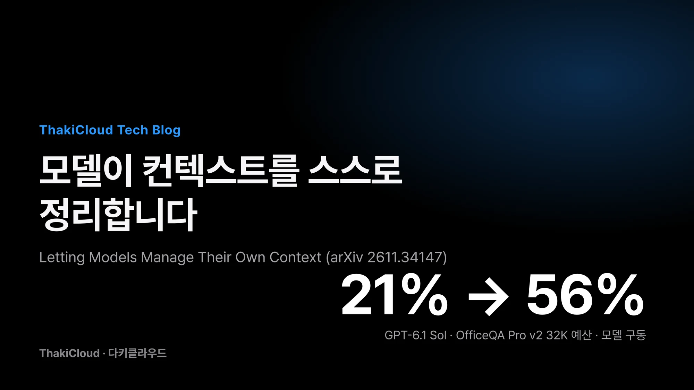
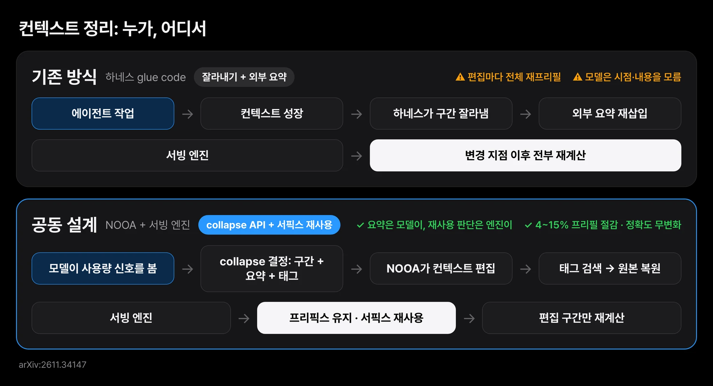
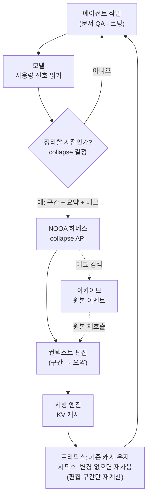
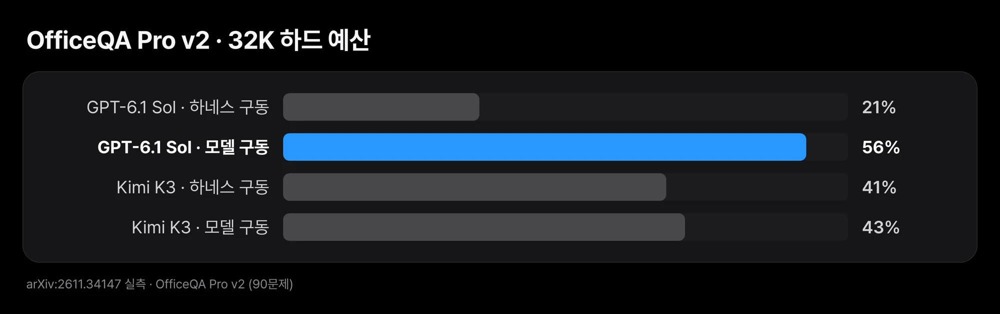
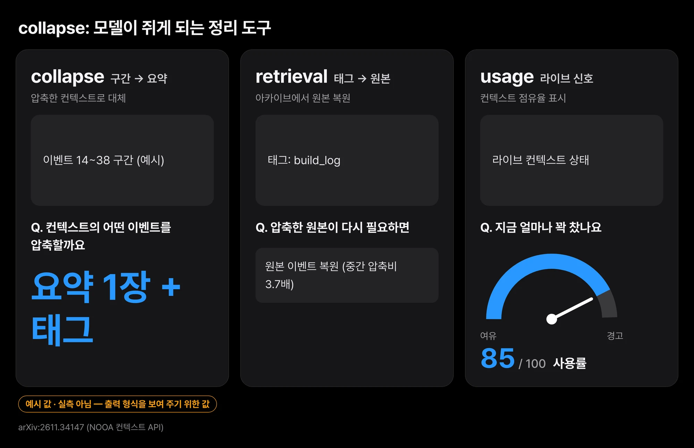

장기·다중 작업 에이전트를 GPU 클러스터에서 돌리면서 서빙 플랫폼을 운영하는 엔지니어, 혹은 에이전트 하네스를 유지보수하면서 컨텍스트를 누가 정리할지 결정해야 하는 분을 위한 글입니다. 에이전트 컨텍스트는 자꾸만 커지는 파일입니다. 정리를 안 하면 예산에 부딪혀 잘립니다. 정리를 하면 서빙 쪽에서 다시 읽는 데 비용이 듭니다. 이 글은 그 비용의 소유권을 어디에 두느냐를 다룹니다.

핵심 결론을 먼저 씁니다. NVIDIA의 포지션 리포트 Letting Models Manage Their Own Context: Where We Stand(arXiv 2611.34147, 2026-11-25 제출)는 컨텍스트 정리 결정을 모델 스스로 내리게 하는 통제 실험입니다. 헤드라인 수치는 둘입니다. GPT-6.1 Sol의 OfficeQA Pro v2 32K 예산 점수가 하네스 구동 21%에서 모델 구동 56%로 오른 것, 그리고 서빙 쪽 서픽스 KV 캐시 재사용이 정확도 변화 없이 요청당 프리필 연산을 4~15% 줄인 것입니다.

한 가지를 밝혀 둡니다. 이 논문은 모델 학습이라는 공동 설계의 핵심 주장을 아직 측정하지 않은 단계입니다. 측정된 수치는 도구를 먼저 주고 모델이 어떻게 행동하는지를 본 것뿐입니다. 본문에서는 그 공동 설계가 무엇인지, 네 개 모델의 정리 습관이 어떻게 다른지, 타이밍 가이던스의 효과가 어떤지, 서빙 쪽 수치가 어떤 조건에서 나옴을 차례로 다룹니다. 끝에는 ThakiCloud가 바로 가져올 수 있는 지점을 두 개 줍니다.

> 📄 **심층 리뷰 전문(DOCX)**: 이 논문의 상세 피어리뷰를 [Google Drive에서 다운로드](https://drive.google.com/file/d/1NpUQ851uvpm6OWAAJPfUv2P8PZQCnGcx/view)할 수 있습니다.

## 쉽게 말하면

에이전트 컨텍스트는 사무실의 문서 캐비닛과 같습니다. 기존 하네스는 캐비닛을 모델 대신 정리했습니다. 부서장이 통째로 서랍을 던져 버리거나(트렁케이션), 옆 방으로 옮겨 다시 분류하는 방식입니다(외부 요약). 그런데 캐비닛이 바뀔 때마다 독서실(서빙 쪽)은 처음부터 다 다시 읽어야 했습니다.

이 논문의 방식은 사무원(모델)에게 찢고 라벨을 붙이는 도구(collapse)를 주는 것입니다. 모델이 어느 서류 뭉치를 한 장짜리 요약으로 바꿀지, 라벨은 뭐로 붙일지 스스로 결정합니다. 나중에 필요하면 라벨로 원본을 다시 꺼내 볼 수 있습니다. 그리고 서버 쪽은 실제로 바뀐 페이지만 다시 읽습니다(서픽스 KV 재사용).

즉 이 논문은 사무원에게 서류 찢는 기계의 키를 주면 어떤 일이 일어나는지에 대한 통제 실험이고, 언제 찢을지도 가르쳐 주는 실험입니다.

## "컨텍스트 정리"는 그동안 하네스의 접착 코드였습니다

에이전트 컨텍스트 관리 연구는 대부분 모델의 루프 밖에서 왔습니다. MemGPT가 컨텍스트를 외부 메모리로 페이지링하고, Context-Folding이 고정한 지점에서 접고, SelfCompact가 외부 정책으로 요약합니다. SideQuest와 Cache Engineering for Agents는 서빙 쪽에서 캐시를 다룹니다. 공통점은 모델이 정리가 언제, 무엇에 대해 이루어졌는지를 알지 못한다는 것입니다. 모델은 바뀐 컨텍스트를 그냥 봅니다.

이 구조에는 서빙 쪽 비용이 붙어 있습니다. 컨텍스트가 편집되면 기존 프리픽스 캐시는 남지만, 바뀐 지점과 그 뒤는 다시 읽어야 합니다. 편집 자체가 비용인 셈입니다. 정리 정책이 하네스에 있으면 서빙 쪽은 편집의 내용을 모르고, 캐시도 편집을 모릅니다.

이 논문은 컨텍스트 관리를 세 층으로 나눕니다. 모델이 언제 무엇을 정리할지 결정하고, 하네스 NOOA(NVIDIA의 오픈소스 에이전트 하네스)가 collapse API와 사용량 신호를 제공하고, 엔진이 KV 캐시를 가능한 한 유지합니다. 이 세 층 분업이 공동 설계입니다.

*왼쪽은 하네스가 정리를 대행하는 기존 구조입니다. 편집은 서빙 쪽에서 전체 재프리필로 이어집니다. 오른쪽은 모델이 collapse을 결정하고 엔진이 서픽스 KV를 재사용하는 공동 설계 구조입니다.*

## 공동 설계: 모델이 시기와 내용을 정하고, 엔진이 캐시를 보존합니다

NOOA의 컨텍스트 API는 collapse이라는 한 작업 중심으로 이루어집니다. 모델이 이벤트의 구간을 지정하면, 그 구간은 요약으로 대체되고 원본은 아카이브로 넘어갑니다. 태그 기반 검색으로 아카이브의 원본을 다시 꺼낼 수 있습니다. 여기에 라이브 사용량 표시기가 캐비닛이 얼마나 꽉 찼는지 보여 주며, 타이밍 가이던스와 경고가 정리할 시점을 알려 줍니다.

엔진 쪽 기법은 서픽스 KV 캐시 재사용입니다. 편집 지점 앞의 프리픽스는 그대로이므로 기존처럼 캐시됩니다. 핵심은 편집 지점 이후의 텍스트(서픽스)가 그대로면 다시 계산하지 않는다는 것입니다. collapse이 중간 이벤트 구간을 요약을 바꾸는 작업이므로, 그 뒤의 긴 서픽스가 그대로인 경우가 흔합니다. 요약을 만드는 쪽은 모델이고, 캐시 안에서 요약을 만드는 쪽은 엔진이 아닙니다. 엔진은 재사용할 수 있는 KV를 고르는 일만 합니다.

## 추가 학습 없이, GPT-6.1 Sol이 21에서 56으로 갑니다

벤치는 OfficeQA Pro v2, 문서 기반 질의응답 90문제입니다. 컨텍스트 예산은 8K에서 512K까지 하드 리밋으로 고정하고, 넘어가면 폴백이 가장 오래된 이벤트를 버립니다. 실패 3회를 틀린 것으로 칩니다.

헤드라인 수치는 GPT-6.1 Sol의 32K 예산입니다. 하네스가 컨텍스트 관리를 구동하면 21%이고, 모델이 스스로 구동하면 56%입니다. 같은 예산에서 점수가 거의 3배입니다. Kimi K3도 양의 방향입니다. 32K에서 점수는 41%에서 43%로 오르고, 누적 입력 토큰이 6,200만에서 3,600만으로 41% 줄어듭니다. 64K에서는 점수 52%에서 57%, 토큰은 약 11% 적게 씁니다.

행동 사실로 읽을 수 있는 숫자도 있습니다. GPT와 Kimi, DeepSeek는 작업의 42~53%에서 컨텍스트 API를 사용했습니다. Claude Opus 5.5는 4%입니다. 모델은 정리를 하고 싶을 때만 정리 도구를 씁니다.

*32K 하드 예산에서 하네스가 컨텍스트를 관리하면(왼쪽 막대) GPT-6.1 Sol은 21%, Kimi K3는 41%입니다. 모델이 collapse을 스스로 결정하면(오른쪽 막대) 각각 56%와 43%입니다. 논문 실측.*

## 네 개 모델의 정리 습관은 완전히 다릅니다

컴팩션 한 번당 중간 압축비는 GPT 3.7배, Kimi 2.1배, DeepSeek 1.8배, Opus 1.5배입니다. 요약을 얼마나 빽빽이 쓰느냐가 모델의 성품 변수입니다.

압축 후에 아카이브의 원본을 다시 꺼내는 비율은 GPT 19%, Kimi 7%, DeepSeek 3%, Opus 14%입니다. GPT는 찢고 나서도 다시 들여보고, DeepSeek는 거의 다시 보지 않습니다.

64K 예산에서 첫 경고가 왔을 때의 행동이 더 재미 있습니다. GPT는 먼저 문서를 읽고 나서 압축하는 경우가 69%였습니다. DeepSeek는 히스토리를 들여다보고 나서 46%, Kimi는 바로 압축하는 경우가 49%였습니다. Opus는 상당수에서 아예 답부터 냅니다. 같은 도구를 쥐여 줘도 정리의 타이밍과 깊이가 모델마다 다릅니다. 하네스 설계자는 하나의 정리 정책을 가정하지 말고, 모델마다 측정해야 합니다.

*모델이 collapse에 넘기는 것은 이벤트 구간입니다. 돌려받는 것은 요약과 태그, 그리고 나중에 원본을 다시 꺼내는 검색 경로입니다. 예시 값이며 실측이 아닙니다.*

## "언제 정리할까"를 가르치지 않으면, 엉뚱한 때 정리합니다

이 논문은 85% 사용 시점 타이밍 지시를 주고 안 주고를 비교합니다. 지시를 주면 Kimi의 첫 컴팩션 중간 시점이 128K 예산에서 약 84%에서 29%로 앞당겨지고, DeepSeek는 256K에서 83%에서 40%로 앞당겨집니다. Opus는 지시를 주지 않아도 128K에서 중간 16%로, 스스로 훨씬 일찍 정리합니다.

지시를 안 준 경우에는 128K 이상에서 Kimi와 DeepSeek가 하네스 베이스라인보다 약 8점 낮습니다. GPT와 Opus는 그런 변화가 없습니다. 즉 중간급 모델에서는 가이던스가 편의 기능이 아니라 정확도의 일부입니다.

## 서빙 쪽은 더 쌉니다: 요청당 프리필 연산 4~15% 절감

서픽스 KV 재사용 프로토타입은 Qwen3.6-27B 모델, SGLang 엔진, 32K 컨텍스트 조건에서 MLE-bench Lite, OfficeQA Pro, DeepSWE 세 벤치로 측정했습니다. 결과는 기존 프리픽스 캐싱 대비 요청당 프리필 연산 4~15% 절감입니다. 정확도의 측정 가능한 변화는 없습니다.

절감이 가장 큰 곳은 OfficeQA Pro입니다. 편집 후 살아남는 서픽스가 평균 약 10K 토큰, 프롬프트의 60% 수준이라서입니다. 서픽스가 길수록 절감이 커집니다.

두 경계를 함께 읽어야 합니다. 이것은 프리필 연산 수치이고, 엔드투엔드 지연이나 비용 수치는 아닙니다. 또한 한 모델, 한 엔진, 세 벤치 조건이라 일반화 범위는 다음 단계의 문제입니다.

## ThakiCloud는 여기에서 가져갑니다

ThakiCloud의 ai-platform 서빙 계층(K8s와 Kueue 위에서 vLLM·SGLang을 돌리는 Metis)은 서픽스 재사용 수치와 직접 연결됩니다. 편집 후 서픽스가 남는 조건이 성립하는 것이 바로 에이전트 워크로드입니다. 컨텍스트를 많이 편집할수록 서빙 쪽 이득이 커집니다. 공유 GPU 클러스터에서 프리필 연산은 GPU-시간 청구서를 움직이는 항입니다. 4~15% 절감이 Metis 서빙 스택에서 재현되는지는 측정할 가치가 있는 질문입니다.

Paxis 쪽에서는 컨텍스트 예산이 일급 정책 리소스가 됩니다. Paxis는 Skills·Tools·Policies·Audit Logs를 일급 리소스로 다루고 있고, 이 논문의 collapse 타이밍 가이던스와 사용량 신호는 컨텍스트 정책의 제어면입니다. Paxis 오케스트레이션에서 각 에이전트에 컨텍스트 압력 신호를 주고, 정리 결정(무엇을, 언제, 왜)을 감사 로그에 기록하는 것은 기존 정책 게이트의 확장입니다. 모델별 사용률 4~53%라는 숫자는, 어떤 모델에 정리 도구를 맡길지 결정할 때의 참고 값입니다.

## 적용 전에 볼 네 가지

첫째, 표본이 작습니다. OfficeQA Pro v2는 90문제, MLE-bench Lite는 22경진입니다. 21에서 56이라는 차이가 크지만, 표본이 주는 오차도 큽니다.

둘째, 시뮬레이션된 압력입니다. 컨텍스트 예산을 줄이는 것은 긴 작업의 실제 압력 대용수입니다. 폴백(가장 오래된 이벤트 버리기) 자체가 점수에 영향을 줍니다.

셋째, 학습의 미지 경계입니다. 이 논문의 측정 수치는 전부 추가 학습 없는 모델에서 나왔습니다. 공동 설계의 본래 주장, 모델이 언제 무엇을 압축할지 학습시키는 것은 오픈 방향입니다.

넷째, 엔진 경계입니다. KV 재사용 프로토타입은 Qwen3.6-27B와 SGLang, 프리필 연산 측정뿐입니다. 다른 엔진으로의 이식은 측정되지 않았습니다.

## 끝으로

컨텍스트 정리 결정이 하네스의 접착 코드에서 모델의 도구가 되고, 편집될 때마다 무효화되던 KV 캐시가 부분적으로 재사용 가능해집니다. 두 공동 설계가 각각 21에서 56, 4에서 15%를 측정했습니다.

하네스 유지보너라면 첫 실험은 구현이 아니라 측정입니다. 돌리고 있는 모델이 collapse 도구를 실제로 쓰는 비율을 알아야 합니다. 사용률은 만들기에 앞서 알아야 할 숫자입니다. 서빙 플랫폼 엔지니어라면 내 워크로드에서 편집 후 서픽스가 얼마나 남는지 측정해 보세요. 그것은 프리필 비용을 그대로 보여주는 항입니다.

문서 캐비닛은 여전히 사무원 것이었습니다. 이 논문이 보여 준 것은, 서류 찢는 기계의 키를 사무원에게 주는 것이 이익이었고, 언제 찢을지 가르치면 더 이익이었던 것입니다. 다음 단계는 그 키를 쥐는 모델을 학습하는 것이고, 논문은 그것을 오픈 방향으로 두었습니다.

## 출처

- Devoto, Vem, Safavi, Kariyappa, Tseng, Furgale, Cabral (NVIDIA), "Letting Models Manage Their Own Context: Where We Stand", arXiv:2611.34147 (2026-11-25). https://arxiv.org/abs/2611.34147
- 논문 전체 텍스트: https://arxiv.org/html/2611.34147v1
- 발견 경로(트윗): https://x.com/hjguyhan/status/2126467297196077378

> 📄 **심층 리뷰 전문(DOCX)**: 이 논문의 상세 피어리뷰를 [Google Drive에서 다운로드](https://drive.google.com/file/d/1NpUQ851uvpm6OWAAJPfUv2P8PZQCnGcx/view)할 수 있습니다.
