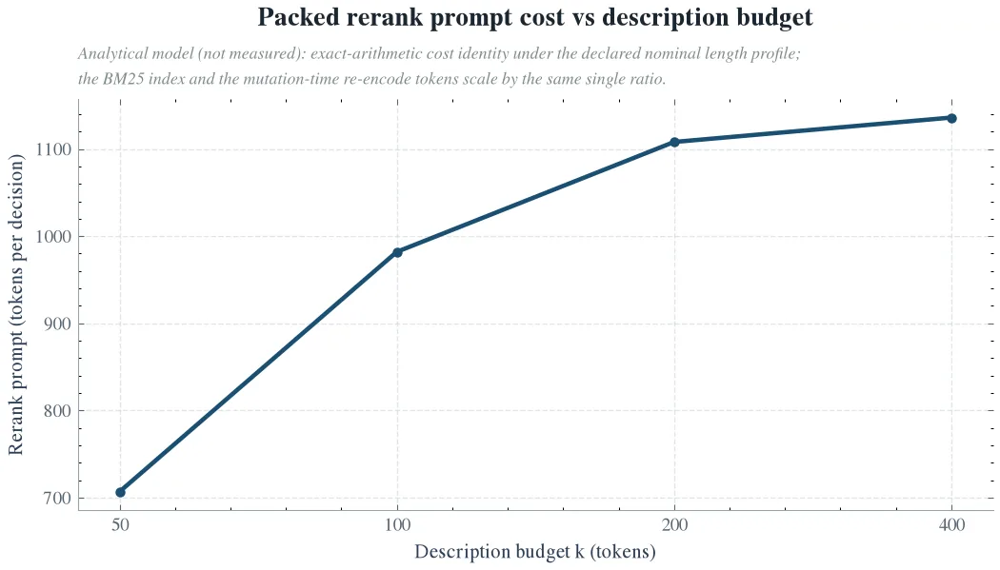
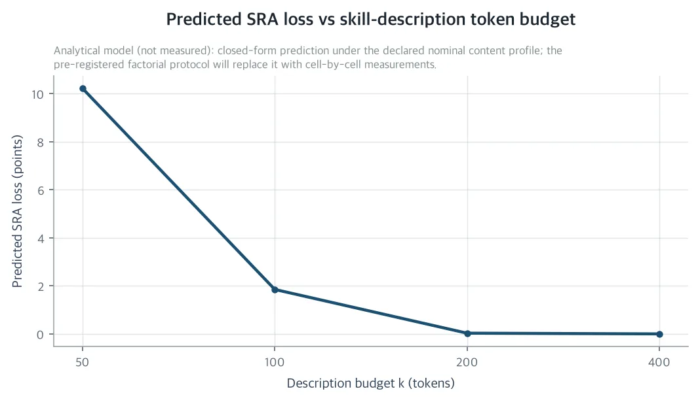
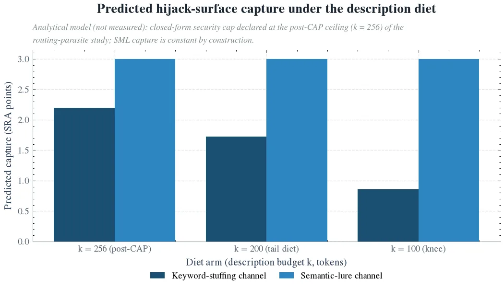

스킬 수천 개가 밤사이 스스로 진화하는 자기진화형 에이전트 하네스에서, BM25와 임베딩을 섞어 스킬을 골라주는 하이브리드 라우터를 돌리거나 그 구조를 고치려는 국내 클라우드·AI 엔지니어를 위한 글입니다. 라우터는 스킬을 이름과 설명 한 줄짜리 문자열로 읽고 그 설명은 레지스트리 쪽에서 라우터가 소비하는 유일한 텍스트이기 때문입니다. 이 논문은 그 설명 쪽에 닫힘 형태의 값을 씁니다. 스킬이 스스로를 얼마나 설명해야 라우터가 찾는지, 그 무릎이 어디에 있는지입니다.

핵심 결과는 선언된 공칭 전제 위에서 나옵니다. 설명을 첫 k 토큰까지 자르는 예산 팔 k=50/100/200/400/전체 가운데, 라우팅 품질이 2.0포인트 허용폭 안에 머무는 가장 싼 팔은 k*=100이라는 뜻입니다. 예측 SRA 손실은 1.85포인트이고 결정당 리랭크 프롬프트는 1,136.0에서 982.0으로 154.0토큰 줄어듭니다. BM25 인덱스, 변이 시 재인코딩, 리랭크 프롬프트 세 비용 대상은 모두 정확히 25/32 비율로 움직입니다. k=50은 10.22포인트로 허용폭 밖이고 k=400은 선언된 프로파일 위에서 정확한 no-op입니다. 부수 효과도 하나 있습니다. 다이어트는 키우면 커지는 공격 면을 정확히 k/256으로 캡 합니다.

읽기 전에 한 가지를 밝혀 둡니다. 이 논문은 선언된 전제 위에서 값을 세는 분석 논문이고 새 실측을 보고하지 않습니다. 품질 수치는 선언된 공칭 내용 프로파일 위의 닫힘 형태 예측이고 비용 항등식은 전제와 무관한 정확한 산술입니다. 팔 다섯 개를 달린 사전등록 프로토콜은 예측을 실측으로 바꿀 설계입니다. 본문에 든 그림 세 장은 분석 모델이 그린 것이며 실측 데이터가 아닙니다. ThakiCloud의 라우터 시리즈가 모델 쪽, 출력 쪽, 파이프라인 통행료, 쿼리 쪽을 차례로 정가했다면, 이 논문은 그 입력에서 남았던 한쪽, 스킬의 자기설명을 정가합니다.

## 문제: 라우터의 모든 단계는 값이 나왔고, 설명 쪽만 남았습니다

무인 에이전트 하네스의 모든 턴은 라우팅 결정으로 시작하는 것입니다. 이번 태스크 쿼리에 등록된 스킬 중 무엇을 주입할 것인가. 프로덕션 라우터는 하이브리드입니다. 어휘 쪽 Okapi BM25 레인과 밀집 cosine 레인이 각각 top-50을 찾아오고, 두 목록은 Reciprocal Rank Fusion(RRF, 상수 k_r=60)으로 융합됩니다. 후보가 BM25 6.0 이상 또는 cosine 0.60 이상으로 어느 쪽 게이트를 넘으면 주입됩니다.

레지스트리는 선언된 공칭 N=2,029개 스킬이고 밤사이 사이클로 자기진화하며 라우팅 품질은 동결된 63케이스 SRA 벤치(양성 45, 네이티브 10, 음성 8)로 점수화됩니다. 라우터가 스킬에서 읽는 텍스트는 이름과 설명이고 이름은 짧습니다. 선언된 공칭 이름 길이 16입니다. 그래서 라우팅의 레지스트리 쪽 품질은 사실상 설명 한 줄의 품질입니다.

시리즈는 이 라우터 단계를 하나씩 정가해 왔습니다. 밀집 레인의 모델 쪽(INT8 양자화, 백본 크기×양자화×차원의 세 축 공간), 출력 쪽(제시 폭 M=5, 근접 타이 브레이크), 파이프라인 통행료(결정당 1,440.3토큰), 그리고 입력의 쿼리 쪽(문장이 세우는 쿼리 상한)까지입니다. 값이 안 나온 것이 입력의 설명 쪽입니다. 스킬이 스스로를 얼마나 설명해야 라우터가 찾는지, 질문이 남은 곳입니다.

이 논문은 gatekeeper 연구를 인코더를 가로지른 명시적 업그레이드입니다. 그 연구가 라우터가 쓰는 모델을 압축했다면, 이 논문은 라우터가 읽는 텍스트를 압축합니다. 두 쪽의 섭동 대수는 같습니다. 양자화 오차와 잘라내기 오차는 모두 밀집 항을 통해서만 융합 점수에 도달하고 RRF는 랭킹 위치마다 같은 상수로 둘 다를 감쇠시키기 때문입니다. 라우터의 압축 허용도는 그래서 공유 예산이 됩니다. 그리고 이 논문은 쿼리 상한 연구의 거울축입니다. 쿼리 쪽이 의도에 대한 상한을 세운다면 설명 쪽은 최소 자기설명에 대한 바닥을 세우고 값을 만드는 방법은 같습니다. 닫힘 형태 내용 모델, 1차 섭동, 랭킹 안전성 진단, 선언된 공칭 비용 카드, 사전등록 팩토리얼 프로토콜입니다.

## 설계: 잘라도 값이 나가는 대상은 세 개이고, 비율은 하나입니다

다이어트 연산자는 단순합니다. 예산 k는 인덱싱되는 모든 문자열을 인덱싱 시점에 첫 k 토큰까지 자르는 접두 잘라내기 trunc_k입니다. BM25는 trunc_k(s)를 인덱싱하고 인코더는 trunc_k(s)를 임베딩하고 리랭크 리더는 trunc_k(s)를 패킹합니다. 팔은 k=50, 100, 200, 400, 전체입니다. 이름 길이 16은 50보다 작아 모든 팔에서 살아남으므로, 다이어트는 순수하게 설명 쪽에 작용합니다. 잘라내기는 문자열 산술이고 LLM 토큰을 하나도 쓰지 않아, 그 비용은 인덱스 쪽 대상과 내용 손실에만 있습니다.

선언된 길이 프로파일은 이전 시리즈의 두 장 카드를 맞추어 갑니다. 큐레이터 정규화된 유기적 문자열은 128토큰, CAP 이후 설명 상한은 256토큰이고 질량 분포는 128에 90%, 256에 10%로 선언됩니다. 기대 인덱싱 길이 E_k는 전체에서 140.8, k=200에서 135.2, k=100에서 110.0, k=50에서 55.0, k=400에서 140.8로 정확히 나옵니다. k=400이 전체와 같은 값입니다.

비용 항등식 정리는 다이어트가 움직이는 비용 대상을 정확히 세 개로 고릅니다. 밤사이 리랭크 입력 토큰 C_prompt = Q×(S_r + T_q + M×E_k), BM25 인덱싱 토큰 C_idx = N×E_k, 변이 시 재인코딩 토큰 C_enc = m×E_k입니다. 세 대상 모두 E_k에 선형이라 하나의 비율 E_k/E_전체로 요약됩니다. k=100에서 110.0/140.8, 정확히 25/32이고 k=50에서 55.0/140.8, 정확히 25/64입니다. 예산 토큰 하나당 경계 비용은 k<128 구간에서 밤 50,000토큰, 128≤k<256 구간에서 밤 5,000토큰입니다. 길이 꼬리 구간이 정확히 10배 싸거나, 그 구간을 자르면 전체 질량의 10%인 꼬리만 빠지기 때문입니다.

비용 카드는 셀프호스트드 H200(GPU 시간당 $2.00), 리랭크 스테이지(입력 토큰 100만당 $0.50), 밤사이 라우팅 결정 Q=10,000, 레지스트리 변이 m=50, 쿼리 길이 T_q=32, 리랭크 스캐폴딩 S_r=400(결정당, k 무관), 풀 폭 M=5, 선언된 밤사이 예산 $2,040입니다. 이 카드에서 결정당 리랭크 프롬프트는 전체 1,136.0토큰에서 k=200 1,108.0, k=100 982.0, k=50 707.0으로 줄고 BM25 인덱스는 285,683토큰에서 k=100에 223,190, k=50에 111,595로 줄며 밤 재인코딩은 7,040에서 5,500, 2,750으로 줄어듭니다.

*결정당 리랭크 프롬프트 토큰은 예산 k가 커질수록 오르고 유기적 질의 길이 128 근처에서 꺾임이 생기고 k=400에서 포화됩니다. k=400 팔은 선언된 프로파일 위에서 정확한 no-op입니다. 분석 모델의 닫힘 형태 계산이며 실측이 아닙니다.*

두 개의 정확한 사실도 여기서 잡습니다. 길이 정규화 불변 보조정리는, 균일 길이 유기적 질량 위에서 접두 잘라내기가 BM25 레인에 내용 손실 외에는 영향을 주지 않음을 줍니다. Okapi 정규화항 ell(|s|) = 1 - b + b×|s|/avgdl은 모든 질량 스킬의 길이를 k로, 평균 문서 길이도 k로 동시에 만들면서 정확히 1로 불변하거나, 잘리기 전후 모두 1입니다. 다이어트는 질량 위에서 보상 부스트를 사지 못하고 BM25 효과는 앵커 질량 손실뿐인 셈입니다. 포화 증인 명제는, k가 상한 256을 넘는 팔은 정확히 아무것도 하지 않음을 줍니다. min(400, 128)=128, min(400, 256)=256이므로 E_400 = E_전체이고 trunc_400 = 항등입니다. k=400 팔은 쿼리 상한 설계를 거꾸로 둔 것이라, 추가 비용 없이 위에서 상한을 인증하고 다이어트는 공칭 아래 팔 50/100/200으로 결정되는 것이다.

## 결과: 무릎은 k=100이고, k=50은 허용 밖의 값입니다

품질 쪽은 양자화 오차를 다룬 이전 연구와 같은 1차 형상으로 얽힙니다. 선언된 내용 프로파일은 앵커 우선 규약을 둡니다. 능력 앵커와 idf 가중 앵커 용어가 앞에 서므로, 유기적 질량 위에서 접두가 지탱하는 쿼리 관련 질량 분율 kappa는 k≥128에서 1.00, k=100에서 0.90, k=50에서 0.70이고 잘린 꼬리 질량은 쿼리 정렬도가 낮아 분율 phi=0.3로 선언됩니다. 골드 밀집 점수는 평균 0.66(게이트 0.60보다 여분 0.06)이고 골드 BM25 점수는 평균 9.0(게이트 6.0보다 여분 3.0)입니다. 위험 랭킹 위치의 인증 마진 CDF는 F(1.02)=0.01, F(5.10)=0.05, F(15.30)=0.25로 선언됩니다.

밀집 레인에서는 잘린 임베딩을, 전체 임베딩에서 잘린 쿼리 정렬 꼬리 질량을 뺀 것으로 둡니다. e(trunc_k s) ≒ e(s) - (1-kappa)×phi×v_rel(s). 1차 cosine 섭동 상한은 양자화 상한과 동일한 대수를 쓰고 오차 자리에 내용 손실을 두거나, sigma_D(k) ≤ (1-kappa_D(k))×phi×(1-c̄)인 셈입니다. 선언된 공칭에서 sigma_D(200) ≤ 0.00204, sigma_D(100) ≤ 0.0102, sigma_D(50) ≤ 0.0306이 정확히 나옵니다. 모든 팔이 선언된 평균에서 밀집 게이트를 넘으므로, 게이트 손실은 저마진 골드의 합 꼬리에서만 발생하기 때문. BM25 레인에서는 앵커 질량 kappa가 게이트를 지키는 조건을 쓰고 평균 9.0에서 kappa < 2/3일 때 처음 무너진다. k=50은 평균에서 0.3 BM25 단위로 살아남고 위험 집합은 s_L < 8.57인 골드의 선언된 꼬리(분율 0.12)이기 때문.

RRF 조합은 랭킹 시프트를 감쇠하는 것이다. 레인 점수 섭동 sigma가 랭킹을 움직일 수 있는 최대 위치는 J×sigma(J=500, top-50 목록이 선언된 0.1 점수 대역을 걸치므로)이고 RRF는 위치마다 delta_RRF = 1/(60×61) = 2.73×10^-4로 감쇠한다. 랭킹 안전성 마진 진단은, 인증 융합 마진이 m_k = delta_RRF×r(k) 이상인 모든 SRA 케이스에서 trunc_k가 랭킹-안전함을 준다. 위험 집합은 그 아래 케이스의 분율 F(r(k))이고 예측 랭킹 손실은 F×45×p_flip(p_flip=0.5 선언)이다.

무릎 규칙은 시리즈 규약인 셈. 예측 SRA 손실이 tol=2.0포인트 안에 있는 팔 중 가장 싼 팔이 무릎이고 팔도 임계도 허용폭도 사후에 고치지 않습니다. 벤치 케이스 하나는 100/63 ≒ 1.5873포인트입니다. 팔별 예측 손실은 두 채널로 나뉩니다. 랭킹 손실(위험 질량에 플립률 0.5를 대는 것)과 게이트 손실(두 레인 게이트를 모두 잃는 골드의 합 꼬리)입니다.

*닫힘 형태의 예측 SRA 손실은 설명 예산이 커질수록 급격히 내려가기도 합니다. 무릎 k=100은 1.85포인트로 2.0포인트 허용폭 안에 있고 k=50은 10.22포인트로 허용폭 밖으로 예측됩니다. 분석 모델이며 실측이 아닙니다.*

숫자는 다음과 같습니다. k=200은 0.03포인트(꼬리 골드의 4케이스에만 작용)이고 k=100은 랭킹 1.79 + 게이트 0.06 = 1.85포인트, k=50은 랭킹 8.93 + 게이트 1.29 = 10.22포인트입니다. 결정당 비용(전체/400: 1,136.0, 200: 1,108.0, 100: 982.0, 50: 707.0)을 대면, 허용폭 안 팔은 전체, 400, 200, 100이고 그 중 가장 싼 팔이 k*=100입니다. 다이어트는 그래서 두 단계입니다. 꼬리 다이어트 256→200은 예측 0.03포인트의 무료 보안 단계이고 헤드 다이어트 200→100은 값을 치르는 무릎입니다. 100→50 한 단계는 예측 8.37포인트를 더 쓰거나, 전체 허용폭의 4.2배입니다. 선언된 프로파일에서는 거부입니다.

공유 압축 예산 정리는 이 시리즈의 업그레이드를 한 줄로 줍니다. 모델 쪽 섭동(크기, 인덱스 양자화, 인덱스 차원)과 입력 쪽 섭동(설명 예산)은 같은 밀집 항을 통해 융합 점수에 도달하고 같은 delta_RRF로 감쇠됩니다. 라우터의 총 압축 허용도는 m_cert ≥ delta_RRF×J×(sigma_model + sigma_input)의 공유 예산이고 한쪽을 채우면 다른 쪽의 예산이 줄어듭니다. 마진 위에서 둘은 대체재입니다. gatekeeper가 모델 쪽 축 하나를, dense-share가 세 축을 얽었다면, 이 정리에서 입력 축까지 한 진단 아래로 모입니다.

규모 불변 부정리는, 무릎 규칙이 N에 불변임을 줍니다. 모든 비용 대상은 N 또는 Q에 선형이고 프로파일은 스킬당이라, 자기진화형 레지스트리는 C(k)를 재계산하고 플립 공의 인증 마진을 재검사하는 것만으로 측정 비용 없이 무릎을 재인증합니다. 무릎은 규칙이지, 변이마다 하는 실험이 아닙니다.

## 보안: 키우면 커지는 공격 면을, 예산으로 캡 합니다

설명은 라우팅 기생충의 공격 면이기도 합니다. 이전 연구가 형식화한 payload 없는 description-level 하이재킹은 두 채널로 나뉩니다. 용어 예산이 있는 키워워딩(KWS) 채널과 용어 예산이 필요 없는 시맨틱(SML) 채널입니다.

보안 캡 정리는 다이어트가 그 면에 정확히 어떻게 작용하는지 줍니다. 선언된 선형 커버리지 c(L) = (0.55/512)×L과 L'=256 상한에서의 KWS 캡처 2.2 SRA 포인트를 대면, k ≤ 256인 다이어트는 꼬리의 용어 예산을 k로 캡 하고 KWS 캡처는 정확히 c(k)/c(256) = k/256으로 쫙아집니다. k=200에서 1.72포인트, k*=100에서 0.86포인트(배율 25/64)가 남고 SML 캡처 3.0포인트는 어떤 k에서도 그대로입니다. 유혹에는 용어 예산이 필요 없기 때문입니다.

*다이어트는 예산에 비례해 키워워딩 채널의 예측 캡처를 줄이되, 시맨틱 채널은 모든 팔에서 3.0포인트로 그대로 둡니다. 분석 모델이며 실측이 아닙니다.*

결과는 세 개입니다. 첫째, KWS 채널에서 다이어트는 promotion 시점 LLM 비용이 제로인 유일한 구조적 레버입니다. CAP가 256 상한을 제로 가격에 사줬다면, 다이어트는 100 상한을 CAP의 제로 가격에 사거나, 예측 1.34포인트의 면을 추가 제거합니다. TLOCK이 마지막 0.4포인트를 밤 3.84k 토큰에 사는 것과 비교되는 지점입니다. 둘째, 게이트와 다이어트는 서로 다른 인터페이스, promotion 시점 대 인덱스 시점에서 승수적으로 작용합니다. CAP+AGREE 무릎의 잔여 0.5포인트에 다이어트(k=100)를 대면 0.5×25/64 ≒ 0.20포인트가 남거나, 5.8포인트 면의 예측 97% 제거입니다. 셋째, 큐레이터의 재작성은 구성상 길이를 키우므로, 경계가 없으면 커밋되는 공격 면이 밤마다 늘어납니다. 진화 인터페이스 자체가 공격 면이라는 이전 결과를 대면, 다이어트는 루프가 커밋할 수 있는 상위에 대한 상시 경계입니다.

정직한 범위는 채널 비대칭입니다. 다이어트는 예산이 있는 KWS 채널만 캡 하고 SML 채널은 게이트의 대상 그대로입니다. 두 제어가 함께 돌아야 합니다.

## 순서: 설명 바닥을 먼저 고치고, 쿼리 상한은 뒤에 봅니다

거울축 부정리는 두 레버의 값 지불 주기를 대조해 줍니다. 설명 쪽 레버는 인덱스 시점에 밤 m=50번 지불되고 쿼리 쪽 레버(쿼리 상한 연구의 결정당 LLM 레버)는 매 결정, 밤 Q=10,000번 지불됩니다. 상각 쐐기는 정확히 Q/m = 200배입니다. 앵커 우선 재작성과 잘라내기로 얻는 헤드 내용 개선 delta_kappa는, 같은 개선을 결정당 쿼리 부강화로 얻는 것의 밤 비용 대비 1/200 이하로 값을 치릅니다.

그래서 순서는 결정됩니다. 다이어트가 스트레치보다 앞서거나, 설명 바닥을 먼저 확보하고 문장이 가난한 진단이 구속되는 곳에만 쿼리 쪽에 씁니다. 두 레버는 대체재가 아니라 보완재입니다. 상한은 문장이 나를 수 있는 양을, 바닥은 라우터가 읽을 수 있는 양을 묶고 라우팅 품질은 min(상한, 바닥)에 함께 묶입니다.

앵커 우선 성과 부정리는 더 깊은 다이어트의 열쇠를 줍니다. 큐레이터가 헤드 우선 재작성으로 k=50 유지율 kappa(50)을 0.70에서 0.90까지 끌어올리면, k=50의 예측 손실은 10.22에서 1.85포인트로 내려가 허용폭 안에 들어오고 무릎은 결정당 707.0토큰(설명 성분의 60.9%, 정확히 39/64)의 k=50으로 움직입니다. 재작성 규약은 측정되는 큐레이션 KPI가 되거나, kappa_L(50), kappa_D(50) ≥ 0.90입니다.

## 사전등록 프로토콜: 예측 곡선이 실측으로 바뀌는 지점

프로토콜은 선언된 공칭을 기록값으로 바꾸고 팔 다섯 개를 동결 벤치 위에 달립니다. (i) 런 시작에 동결 스냅샷을 고정하고 N, 길이 프로파일, 내용 프로파일(kappa_L, kappa_D, phi, c̄, s̄_L, F)을 기록해 선언된 공칭을 대체합니다. (ii) 팔 다섯 개를 동결 벤치(45/10/8)에 달리고 Recall@5, Top-1, 게이트된 Recall@5, 환각률, k=5, 8의 음성 회피, available-only 변형을 SRA 종합으로 점수화합니다. (iii) 각 다이어트 팔에서 기생충 공격 수트(A0~A3 팔)를 달리고 KWS/SML 면 분리를 직접 측정해, 보안 캡 정리를 셀별로 검증합니다. (iv) tol=2.0포인트 안에 있는 실측 팔 사이에서 무릎 규칙을 적용하고 양쪽 테스트는 k=100 실측 손실이 허용 안에 있고 k=50 실측 손실이 허용을 넘는 것입니다. k=400이 no-op을 인증합니다. (v) 팔도 임계도 허용폭도 사후에 고치지 않거나, 표의 예측 열과 정리들은 사전등록된 가설입니다.

## 회사, 사회, 과학에 닿는 곳

회사가 얻는 것은 2,000개 이상 스킬 레지스트리의 원칙 기반 설명 길이 버짓입니다. 예측 무릎 k*=100으로 자르면 SRA 품질은 2.0포인트 허용 안에 머무고 패킹된 리랭크 프롬프트는 결정당 154.0토큰, 세 비용 대상 모두 정확히 25/32 줄어듭니다. 밤사이 토큰 청구는 변덕의 길이가 아니라 (k*, N, m)의 닫힘 형태가 되거나, 설명이 길어질수록 청구가 미끄러지지 않습니다.

사회가 얻는 것은 자율 턴당 단가 하락입니다. 무인 에이전트 운영의 단가가 내려가면 완전 자율 업무 자동화가 더 많은 팀과 가격대에 접목되고 같은 자동화 수준당 토큰·전력 소비가 줄어 에너지 발자국이 줄어듭니다. 레시피는 스스로 설명하는 레지스트리라면 어디서든 재실행됩니다.

과학에 남는 것은 라우터 입력의 설명 쪽, 미실측이던 축의 첫 값입니다. 쿼리 쪽 버짓의 거울축이고 라우터 압축 대수의 통일이 남거나 모델 쪽 양자화와 입력 쪽 잘라내기는 RRF 감쇠 공유 예산 아래 하나의 섭동 클래스입니다. 길이 정규화 불변, 포화 증인, 200배 상각 쐐기, promotion 비용 제로의 k/256 보안 캡까지, 재현 가능한 cost-quality 무릎 곡선이 자기진화형 대형 스킬 레지스트리 위에서 남습니다.

## 한계: 선언된 프로파일 위의 닫힘 형태 예측입니다

한계는 세 개입니다. 첫째, 선언된 공칭 프로파일입니다. 모든 품질 숫자는 선언된 내용 프로파일 위의 닫힘 형태 예측이지 측정이 아닙니다. 프로토콜이 프로파일을 캘리브레이션하고 기록값 위에서 무릎을 다시 유도합니다. 비용 항등식은 정확한 산술이라 프로파일과 무관하게 성립합니다.

둘째, 강한 잘라내기에서의 1차 모델입니다. k=50은 꼬리를 80.5%, 질량을 60.9% 잘라 강한 잘라내기 영역으로 들어가고 이전 문헌이 잘라내기가 거의 무해하지 않다고 찾은 지대(최소 70% 감소)입니다. k=50의 예측 10.22포인트는 하한이라, 허용 밖이라는 결론은 더 단단합니다. k=100 팔은 온건 영역(21.9%)이라, 그곳의 상한은 신뢰할 수 있는 쪽입니다.

셋째, 모델과 결합 범위입니다. 길이 정규화 불변은 큐레이터 정규화 질량에서만 정확하고 꼬리의 정규화항 이동은 2차로 선언되어 프로토콜에서 직접 측정됩니다. 벤치 케이스 하나가 1.5873포인트라 2.0포인트 허용은 약 1.26케이스이고 무릎 결정은 경계의 한 케이스에 민감합니다(프로토콜이 팔별 신뢰를 보고). 비용은 시리즈 메뉴 무릎 M=5에 선언되어 있고(재인증은 무료), 보안 캡은 이전 연구의 선형 커버리지 c(L)를 선언된 공칭으로 물려받습니다(프로토콜이 분리를 재측정). 거울축은 순차적이 아니라 공동 최적화입니다. 문장이 가난한 쿼리와 잘린 설명이 같은 케이스에서 겹치면 합쳐지고 프로토콜의 종합 점수화에서 보입니다.

논문 원문과 수반 자료는 Hugging Face 논문 상세 페이지에서 볼 수 있습니다. https://huggingface.co/datasets/thaki-AI/daily-paper-2026-11-28-skill-description-budget-routing

*본문의 모든 수치는 선언된 공칭 전제 위의 닫힘 형태 예측이거나, 인용 참고 문헌에 귀속되는 결과입니다. 정밀 값은 E_k: 전체 140.8 / 400 140.8 / 200 135.2 / 100 110.0 / 50 55.0, 결정당 리랭크 프롬프트 1,136.0 → 982.0(k=100, -154.0), BM25 인덱스 285,683 → 223,190, 밤 재인코딩 7,040 → 5,500, 비율 25/32(k=100)·25/64(k=50), 경계 비용 50,000(k<128) 대 5,000(128≤k<256) 토큰/밤, sigma_D ≤ 0.00204 / 0.0102 / 0.0306, 예측 SRA 손실 0.03(k=200) / 1.85(k=100) / 10.22(k=50), KWS 캡처 1.72(k=200) / 0.86(k=100), 게이트 잔여 × 25/64 대 0.20포인트, 상각 쐐기 200배, kappa(50) 0.70 → 0.90 시 707.0토큰/결정(39/64)까지입니다. 그림 세 장은 분석 모델의 닫힘 형태 계산이며 실측이 아닙니다. 팔 다섯 개의 사전등록 프로토콜은 이 논문에서 실행되지 않았고 실측값의 보고는 실행 시점에 이뤄집니다.*
