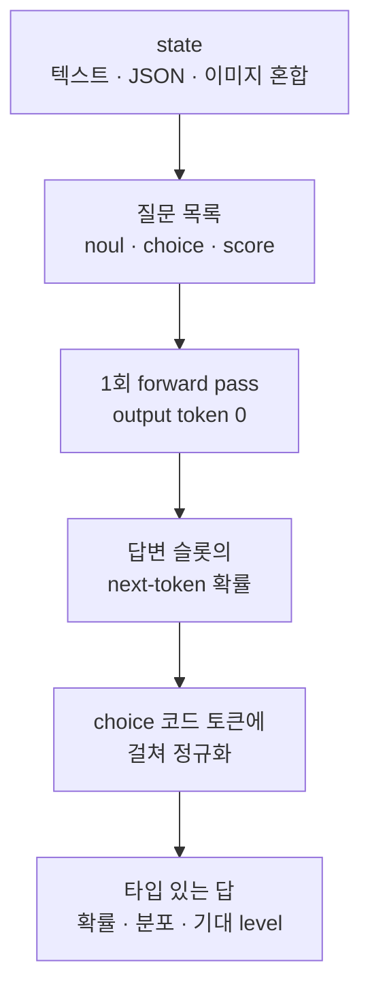

## 왜 읽어야 하나

에이전트·서비스 파이프라인에 "판단" 단계를 넣고 있는 엔지니어를 위해 씁니다. 라우팅, 트리아지, 가드레일, LLM-as-judge 점수화처럼 "답을 쓰는 것"이 아니라 "고르는 것"이 목적인 작업에 지금껏 쓰는 수단은 보통 작은 chat 모델을 호출해서 텍스트를 뽑고 파싱하는 방식이었습니다. 결론을 먼저 말합니다. **decision model은 그 파싱 단계를 모델 내부로 옮긴 다른 종(種)이고 d1-3B의 fine-tune은 "completion이 1개 토큰인 SFT"일 뿐이라 무료 GPU에서 30분 안에 끝납니다.** 이 글에서는 모델 아키텍처를 직접 내려받아 확인한 기록, 질문 스키마, 두 fine-tuning notebook(TRL, Unsloth)의 절차, 그리고 ThakiCloud 내부 S3 온보딩까지 싣습니다.

## 개요

Liquid AI의 DevRel 엔지니어 Leonie가 X에 올린 트윗이 화제가 됐습니다. "내 데이터로 decision model을 fine-tune하는 법"이라는 두 notebook으로, (1) 학습 데이터를 준비하는 법, (2) d1-3B를 자기 라벨로 fine-tune하는 법을 TRL과 Unsloth 두 경로로 씁니다.

decision model이라는 종 자체가 새로움에 가깝습니다. 인지과학의 system 1(빠르고 자동적인 판단)과 system 2(느리고 의식적인 추론)에 대응해, Liquid AI는 "판단만 빠르게 하는 모델"을 system one 모델이라 부릅니다. Jev, Laya, Clef 같은 라인업이 있고 d1-3B는 그중 오픈된 모델입니다. LLM이 system 2라면 decision model은 system 1. 질문을 던지면 답을 "쓰는" 대신 확률 분포로 "고르는" 모델입니다.

d1-3B 자체는 Liquid AI가 "system one" 모델이라 부르는 decision model 라인업의 오픈 모델입니다. Hugging Face 모델카드는 이 모델을 3B 이하 decision model 중 Decision Index 0.2.1에서 최고 점수(48.57)로 기록합니다. 12B의 Winnow(50.02) 아래, 36B의 Decider 35B-A3B(47.11)는 넘어서는 수치입니다. RTX 4090에서 한 판단에 8ms, 64개 state를 한 pass에 패킹하면 475개/초.

| 지표 | d1-3B |
|---|---|
| 파라미터 | 3.12B (베이스 LFM2.5-VL-3B) |
| 컨텍스트 | 32,768 토큰 |
| 출력 토큰 | 0 (single forward pass) |
| Decision Index 0.2.1 | 48.57 (10B 이하 최고) |
| 4090 지연 | 8ms/판단 (compile 시) |
| 라이선스 | lfm1.0 (custom) |

## decision model이란 무엇인가

chat 모델과 decision model의 차이는 "출력"에 있습니다. chat 모델은 토큰을 연속으로 생성합니다. d1-3B는 state(텍스트, JSON, 이미지, 혹은 혼합)와 질문 목록을 받아 **한 번의 forward pass**로 모든 질문에 답하고 output token은 0개입니다. 답은 "타입 있는" 값입니다. yes/no의 확률, 선택지별 확률 분포, ordered level의 기대값.

모델카드의 실제 사용 예제는 고객 응대 티켓 하나에 세 질문을 동시에 던지는 것입니다.

```python
import torch
from transformers import AutoModel

model = AutoModel.from_pretrained(
    "LiquidAI/d1-3B", trust_remote_code=True, dtype=torch.bfloat16
).to("cuda")

questions = {
    "refund": {
        "type": "noul",
        "instructions": "Is the customer asking for a refund?",
    },
    "team": {
        "type": "choice",
        "instructions": "Which team should handle this?",
        "criteria": {
            "billing": "Charges, refunds, invoices",
            "technical": "App or site faults",
            "fraud": "Suspected unauthorised use",
        },
    },
    "urgency": {
        "type": "score",
        "instructions": "How urgent is this?",
        "criteria": ["Can wait", "Today", "Blocking the customer now"],
    },
}

print(model.system_one(
    "I was charged twice this month, please refund one of them.", questions
))
```

질문은 세 가지 타입을 가집니다. `noul`은 yes/no 확률(P(yes))을, `choice`는 지정된 옵션 중 하나를 확률 분포와 함께, `score`는 2~10개의 ordered level에서 기대 level을 돌려줍니다. `criteria`에 각 옵션의 설명을 붙이는 것이 fine-tune의 핵심이고 이 스키마가 곧 학습 데이터의 형태입니다.

모델카드가 권하는 사용 자리는 여덟 개입니다. routing과 triage, moderation, intent와 topic 분류, extraction 체크, reranking, LLM-as-judge 점수화, agent guardrail, visual inspection. 이 목록의 공통점은 전부 "정답이 미리 존재하는" 작업이라는 점입니다. 새로운 텍스트를 만들어야 하는 자리가 아니라 주어진 옵션 중에서 고르는 자리. decision model은 그 자리에만 있을 때 빛을 발합니다.

여기서 "판단"이 어떻게 만들어지는지가 중요합니다. 모델이 텍스트를 쓰는 것이 아니라 답변 슬롯 위치의 next-token 확률을 choice 코드 토큰에 걸쳐 정규화해서 답으로 읽는 방식입니다. 그래서 generation 루프가 없고 출력 0 토큰이 가능하고 8ms가 나옵니다.

### 질문과 state의 흐름



*state와 질문이 한 번의 forward pass를 지나 타입 있는 답으로 수렴하는 경로*

## d1-3B 안에 무엇이 들어 있나

설치 전 가중치를 내려받아 config.json을 직접 읽었습니다. `trust_remote_code=True`가 필요한 이유는 모델이 자기 코드(`modeling_d1.py`, `D1Model`)를 함께 싣기 때문인데, 그 코드와 config가 보여 주는 구조는 다음과 같습니다.

- **베이스**: LFM2.5-VL-3B (3.1B vision-language). text backbone은 LFM2 계열 30층, hidden 2048, GQA(32 헤드 / 8 KV 헤드), vocab 128,000
- **하이브리드 레이어**: 30층 중 22층은 conv 재귀 레이어, 8층만 full attention(약 5층 간격). LFM2 특유의 conv+attention 섞기 구조로, 긴 state에서도 attention 비용이 선형으로만 뛰지 않습니다

conv 레이어가 이 모델 속도의 출처입니다. attention은 시퀀스가 길어질수록 제곱으로 비싸지지만 conv 재귀 레이어는 고정 윈도우(conv_L_cache 3)로 상태를 압축합니다. 22층이 conv, 8층만 attention이라는 배분은 "대부분의 계산은 재귀로, 중요한 연결만 attention으로"라는 설계 선택입니다. 그래서 32K 컨텍스트를 소화하면서도 4090에서 8ms가 나옵니다.
- **비전 인코더**: SigLIP2 NaFlex 400M. 이미지 1장이 64~256 토큰으로 압축되고 텍스트·JSON·이미지가 같은 state로 들어갑니다
- **다국어**: 16개 언어(ar·zh·en·fr·de·hi·id·it·ja·ko·pl·pt·ru·es·th·vi)
- **컨텍스트**: 32,768 토큰
- **dtype**: bfloat16, transformers 5.14.1 기준으로 기록됨

모델카드의 성능 표도 decision 관점에서 읽을 가치가 있습니다. SQuAD 2.0을 85.3, MASSIVE intent를 87.3, BoolQ를 86.7, XNLI를 85.0으로 "판단 문제로" 풀어낸 결과인데 Decider 4B와 체급이 다른 모델입니다. 이미지 벤치마크 11개 평균은 74.1로 베이스 모델(73.9)과 동급이며 이미지를 빼면 45.1로 떨어져 답이 실제로 이미지에서 나온다는 검증도 함께 싣습니다.

속도 표는 엣지 배포 관점에서 더 인상적입니다. Apple M5 Pro에서 30ms, NVIDIA Jetson AGX Thor에서 16ms, Jetson Orin Nano에서도 50ms. 64개 state를 한 pass에 패킹하면 Thor가 262개/초, Orin Nano가 38개/초를 냅니다. 데이터센터 GPU가 아니라 기기에 붙이는 inference 카드에서 "판단"을 실시간으로 돌릴 수 있다는 것은, decision model이 chat 모델과 다른 용도의 하드웨어를 의미한다는 뜻입니다.

## 내 데이터로 fine-tune하기

Leonie의 두 notebook은 `Liquid4All/cookbook` 저장소의 `finetuning/notebooks/`에 있습니다.

- **TRL 경로**: `sft_for_decision_models_with_trl.ipynb`
- **Unsloth 경로**: 같은 폴더의 companion notebook

두 경로의 절차는 동일합니다. 차이는 설치 스택과 속도에 있습니다.

### 1단계. 데이터 준비

학습 데이터의 한 줄은 (state, 질문 스키마, 라벨)입니다. 고객 응대 예로 쓰면 티켓 본문이 state이고 질문은 위에서 본 `team` choice 스키마이며 라벨은 "billing"입니다. Decision Index 스키마의 `criteria`에 자기 도메인 옵션과 설명을 쓰는 것이 전부이며 TRL 경로에서는 completion이 choice 코드 1개 토큰이 되는 형태라 SFTTrainer의 표준 데이터 처리로 들어갑니다.

핵심은 양의 많고 적음이 아니라 **옵션 설명의 품질**입니다. `criteria`의 설명이 애매하면 모델도 애매하게 답하고 calibration까지 함께 흐트러집니다.

예를 들어 billing/technical/fraud 세 옵션을 fine-tune할 때, "billing: 요금·환불·인보이스 관련"이라는 한 줄 설명은 티켓이 "앱에서 결제 화면이 하얗게 뜹니다"라고 쓰였을 때 technical과 billing 사이에서 확률을 분산시킵니다. 옵션 설명에 판정 기준(어떤 표현이 이 쪽으로 가는지)을 한두 문장 더 넣어 주는 것, 그리고 경계 사례를 데이터에 섞어 주는 것이 fine-tune 품질의 대부분을 차지합니다.

### 2단계. fine-tune (TRL 경로)

```bash
pip install "transformers>=5.14" torch torchvision pillow
```

모델카드가 요구하는 설치 한 줄입니다. notebook 내부에서는 d1-3B를 base로 LoRA를 얹어 SFT를 돌리고 무료 GPU(24GB급)에서 30분 안팎으로 끝난다고 Leonie가 밝힙니다. 3.1B 모델이 bf16로 6GB 남짓이라 LoRA만 트레인하면 24GB에 충분히 들어맞습니다.

TRL 경로가 특히 깔끔한 이유는 모델이 chat 템플릿을 자기 코드로 싣기 때문입니다. `trust_remote_code=True`로 로드하면 토크나이저와 템플릿이 d1 전용 포맷으로 처리되고, SFTTrainer에게 넘기는 것은 (state, 질문, 라벨) 세 쌍뿐입니다. 별개의 포매타 변환 스크립트가 없다는 뜻이고, 이게 "30분"의 비결이기도 합니다.

### 3단계. fine-tune (Unsloth 경로)

Unsloth 경로는 4bit + LoRA 조합으로 더 적은 VRAM에서 같은 과정을 반복합니다. 다만 주의할 점이 하나 있습니다. Unsloth 문서의 "Train your own Decision Model" 항목은 d1 계열이 아니라 **자기 LLM(Qwen 계열 등)에 decision head를 붙이는 별개 기능**을 다룹니다. d1-3B를 fine-tune하는 것은 cookbook의 notebook이 정답이고 둘을 혼동하면 스택이 엇갈립니다.

### 4단계. 검증

fine-tune 후 모델은 여전히 `system_one` API 그대로입니다. 자기 도메인 테스트셋에 (state, 질문)을 넣고 choice 확률 분포가 기대 라벨에 매겨지는지, confidence가 구분되는지만 확인하면 됩니다. d1-3B가 "calibrated"를 표방하는 모델이라, 확률 값의 신뢰성은 일반 chat 모델보다 점검이 쉽습니다.

점검의 구체적 방법은 ROC 곡선이 아니라 **확률 구간의 분리도**입니다. "분명히 billing"인 티켓이 0.9를 받고 "분명히 technical"인 티켓이 0.1을 받는지가 중요하고, 0.5 근처의 회색지대가 넓다면 옵션 설명이나 데이터를 다시 봐야 합니다. chat 모델은 회신 텍스트를 읽어야 하지만 decision model은 숫자 하나를 보면 되므로 regression 점검이 훨씬 쌉니다.

### 직접 재현 상태 (정직하게)

fine-tune 자체는 아직 돌리지 않았습니다. recipe는 Colab/무료 GPU 기준이라, 우리 클러스터에서 돌리려면 transformers 5.14.1 pin과 d1 커스텀 모델링 코드 로드 경로를 잡는 별도 GPU 잡이 필요합니다. 대신 온보딩은 완료했습니다. 가중치 15개 파일(6.27GB)을 ThakiCloud의 dev S3 스토어(`objects3-dev.thakicloud.net`, `ai-platform/global/models/liquidai/d1-3B/`)로 올려 검증했고 config 인스펙션도 그 파일로 수행했습니다. fine-tune 재현은 잡으로 분리해 진행합니다.

## ThakiCloud 제품 적용 시사점

### Paxis 렌즈(에이전트)

에이전트 루프에서 가장 비싼 비용은 "모든 판단을 큰 모델이 텍스트로 쓰는" 구조에서 옵니다. routing, triage, guardrail, judge 점수화는 전부 "고르는" 작업이라 decision model이 딱 맞습니다. d1-3B가 4090에서 8ms, 패킹 시 475개/초를 낼 수 있다는 것은, Paxis의 워크플로우에서 "전 단계 gate"를 모델 호출 1회로 줄이면서 지연은 ms 단위로 유지할 수 있다는 뜻입니다. 에이전트가 10번의 도구를 부르기 전에 티켓 1건을 판정하는 데 chat 모델로 한 번 생성하는 것보다 d1로 한 번 pass하는 것이 더 싸고 답이 파싱 없는 타입 값이라 downstream이 안전합니다.

구체적으로 guardrail 자리를 생각해 보겠습니다. 에이전트가 결제 API를 호출하기 직전에 "이 호출이 안전인가"를 d1에 넘기면, noul 한 줄(P(yes))이 policy 게이트가 됩니다. 8ms 추가 지연으로 모든 외부 호출에 판단 레이어를 얹는 셈인데, 이 비용은 chat 모델로 같은 판단을 한 번 생성하는 것의 몇 분의 일입니다. Paxis의 정책 게이트+감사로그 구조에서 decision model이 게이트 판정기 역할로 들어가는 자리가 바로 이것입니다.

### ai-platform 렌즈(서빙)

3.1B bf16은 단일 GPU의 1/3 정도 VRAM을 쓰므로, Telox의 GPUaaS에서 고객 전용 게이트웨이로 서빙하거나 온프렘 엣지(모델카드는 Jetson AGX Thor 262개/초, Orin Nano 38개/초를 기록)로 내리는 둘 다 가능합니다. 단, 라이선스가 lfm1.0(custom)이라는 점만은 배포 전에 반드시 확인해야 합니다. Apache 계열이 아니므로 상업 재배포 조건을 라이선스 텍스트로 확인해야 하며 우리 플랫폼은 고객 온프렘 케이스에서 이 부분을 먼저 확인하는 절차를 권합니다.

## 한계 및 반론

네 가지를 짚습니다.

1. **라이선스.** lfm1.0은 custom 라이선스입니다. "오픈웨이트"이되 Apache 2.0과는 다른 계약이고 fine-tune 모델의 재배포 조건이 원 라이선스 그대로 이어지는지 확인이 필요합니다.
2. **출력 0이 강점이자 경계.** 자유로운 텍스트를 내줘야 하는 작업(요약, 생성, 대화)에는 쓸 수 없습니다. 판단만 하는 자리입니다.
3. **컨텍스트 32K.** state가 긴 문서 전체인 작업에서는 chunking이나 외부 RAG가 앞에 필요합니다.
4. **calibration은 scorer 의존.** Decision Index 점수는 공식 scorer로 나온 값이고, 자기 도메인에서 확률 값이 실제로 잘 보정됐는지 테스트셋으로 재확인해야 합니다.

## 정리

decision model은 "작은 chat 모델 + 파싱"을 "한 pass의 타입 있는 출력"으로 바꾼 설계입니다. d1-3B는 그 설계의 현재 최고 스펙(10B 이하 Decision Index 1위, 8ms, 32K, 16 언어)을 오픈웨이트로 내놓은 모델이고, fine-tune은 completion이 1 토큰인 SFT라 데이터 준비가 전부입니다. 에이전트 루프의 gate 자리가 있다면, 이번 주 Colab에서 cookbook notebook을 돌려 보는 것이 가장 싼 실험입니다.

순서대로 하면 이렇게 됩니다. (1) gate 자리의 옵션과 판정 기준을 `criteria`로 한 문장씩 쓰기. (2) 경계 사례 50~100개를 (state, 라벨)로 모으기. (3) TRL 경로로 fine-tune 한 번. (4) 확률 분리도로 검증. 하루 안에 끝나는 실험이고, 통과하면 다음 단계는 우리 클러스터 온보딩과 guardrail 게이트 배선입니다. 우리 쪽 온보딩은 dev S3까지 완료했고, fine-tune 재현과 lfm1.0 라이선스 확인은 다음 잡으로 이어갑니다.

### 출처

- [LiquidAI/d1-3B 모델카드 (Hugging Face)](https://huggingface.co/LiquidAI/d1-3B)
- [Open d1 블로그 (Liquid AI)](https://www.liquid.ai/blog/open-d1)
- [sft_for_decision_models_with_trl.ipynb (Liquid4All cookbook)](https://github.com/Liquid4All/cookbook/blob/main/finetuning/notebooks/sft_for_decision_models_with_trl.ipynb)
- [Train your own Decision Model with Unsloth (Unsloth docs)](https://unsloth.ai/docs/new/train-your-own-decision-model-with-unsloth)
- [AGI Hunt tutorial write-up](https://agihunt.info/en/p/1a1439b1e278d5f049ff1a6d4d6)
