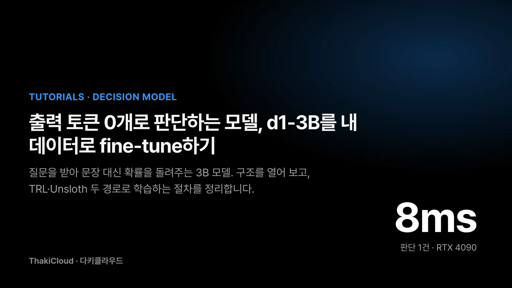
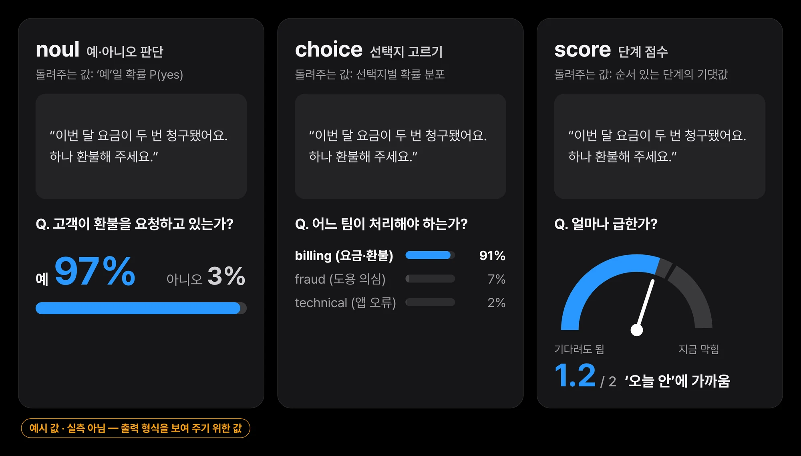
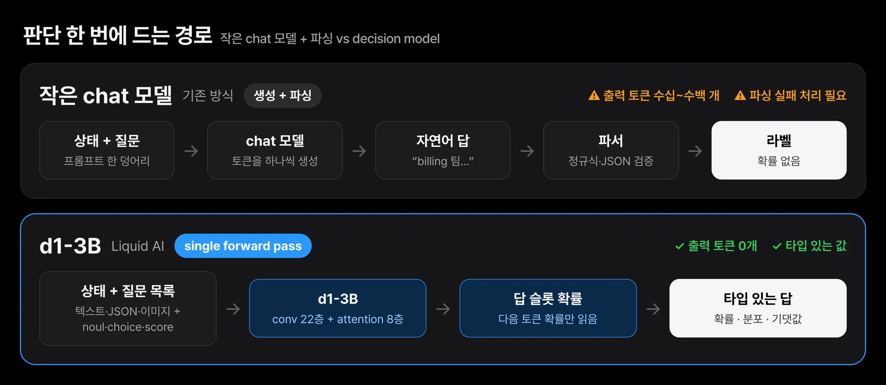
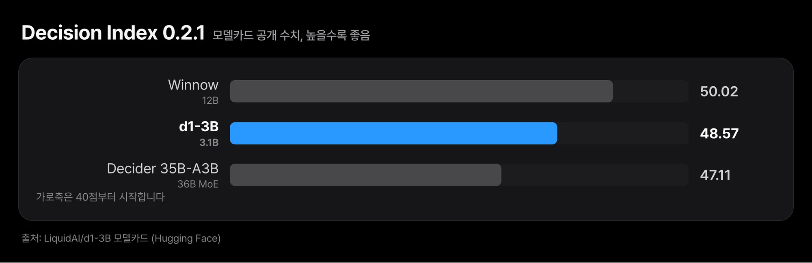

고객 문의를 어느 팀에 넘길지 정하는 일, 에이전트가 다음에 부를 도구를 고르는 일, 결제 API를 부르기 전에 이 호출이 안전한지 확인하는 일. 서비스 안에는 긴 답변보다 짧은 판단이 필요한 자리가 많습니다. 지금까지는 이런 자리에 작은 chat 모델을 붙이고 모델이 쓴 문장을 다시 파싱해서 라벨을 꺼냈습니다.

Liquid AI가 공개한 d1-3B는 이 자리를 위해 만든 모델입니다. 문장을 쓰지 않고 질문마다 확률을 바로 돌려줍니다. 출력 토큰은 0개이고, RTX 4090에서 판단 1건에 8ms가 걸립니다. 학습도 가볍습니다. 답이 토큰 1개라서 무료 GPU에서 30분 안팎이면 내 라벨로 fine-tune할 수 있습니다.

이 글에서는 d1-3B가 돌려주는 값의 모양부터 보고 모델 안을 열어 본 뒤 TRL과 Unsloth 두 경로로 fine-tune하는 절차를 정리합니다.

## 문장 대신 확률을 돌려주는 세 가지 질문

d1-3B에 넘기는 입력은 두 가지입니다. 판단할 대상인 **상태**(텍스트, JSON, 이미지를 섞어도 됩니다)와 **질문 목록**입니다. 질문은 세 타입 중 하나로 씁니다.


*같은 문의 한 건에 세 질문을 한 번에 던질 수 있습니다. 그림의 값은 형식을 보여 주는 예시이고 실측이 아닙니다.*

noul은 예·아니오 질문이고 '예'일 확률을 돌려줍니다. choice는 선택지를 고르는 질문이고 선택지마다 확률을 돌려줍니다. score는 '기다려도 됨 → 오늘 안 → 지금 막힘'처럼 순서가 있는 단계 가운데 어디쯤인지를 기댓값으로 돌려줍니다.

값이 숫자로 오기 때문에 서비스 코드에 바로 이어 붙일 수 있습니다. billing 확률이 0.9를 넘으면 요금팀으로 보내고 0.5 근처면 사람에게 넘기는 식입니다. 파서도, 파싱 실패 처리도 필요 없습니다.

모델카드의 예제를 그대로 옮기면 이렇습니다.

```python
import torch
from transformers import AutoModel

model = AutoModel.from_pretrained(
    "LiquidAI/d1-3B", trust_remote_code=True, dtype=torch.bfloat16
).to("cuda")

questions = {
    "refund": {"type": "noul", "instructions": "Is the customer asking for a refund?"},
    "team": {
        "type": "choice",
        "instructions": "Which team should handle this?",
        "criteria": {
            "billing": "Charges, refunds, invoices",
            "technical": "App or site faults",
            "fraud": "Suspected unauthorised use",
        },
    },
    "urgency": {
        "type": "score",
        "instructions": "How urgent is this?",
        "criteria": ["Can wait", "Today", "Blocking the customer now"],
    },
}

print(model.system_one(
    "I was charged twice this month, please refund one of them.", questions
))
```

`criteria`에 쓴 설명이 곧 선택지입니다. 나중에 fine-tune할 때도 이 스키마가 학습 데이터의 모양이 됩니다.

## 문장을 쓰지 않으니 파서가 사라진다

chat 모델로 같은 판단을 하면 경로가 길어집니다. 모델이 "billing 팀입니다…" 같은 문장을 토큰 하나씩 쓰면 그 문장을 정규식이나 JSON 검증으로 다시 읽어 라벨을 꺼냅니다. 꺼낸 라벨에는 확률이 없어서 얼마나 확신하는지도 알 수 없습니다.


*위는 chat 모델이 답을 문장으로 쓰고 다시 파싱하는 경로, 아래는 d1-3B가 모델을 한 번 통과시키고 답 자리의 확률만 읽는 경로입니다.*

d1-3B는 모델을 한 번만 통과시킵니다(single forward pass). 그리고 답이 들어갈 자리에서 다음 토큰이 무엇일지에 대한 확률을 읽어 선택지 토큰끼리 다시 정규화해 답으로 씁니다. 생성 루프가 없으니 출력 토큰이 0개이고, 그래서 8ms가 나옵니다.

모델 구조도 속도 쪽으로 기울어 있습니다. 가중치를 내려받아 `config.json`을 직접 읽어 보니 텍스트 부분은 30층인데, 그중 22층이 짧은 창만 보는 합성곱(conv) 층이고 전체 문맥을 보는 attention 층은 8층뿐이었습니다. attention은 입력이 길어질수록 비용이 제곱으로 늘지만 conv 층은 그렇지 않습니다. 32,768토큰 문맥을 받으면서도 빠른 이유입니다.

| 항목 | d1-3B |
|---|---|
| 기반 모델 | LFM2.5-VL-3B (3.1B, 비전·언어) |
| 층 구성 | 30층 = conv 22층 + attention 8층 |
| 이미지 인코더 | SigLIP2 NaFlex 400M (이미지 1장 → 64~256토큰) |
| 문맥 길이 | 32,768토큰 |
| 언어 | 16개 (한국어 포함) |
| 라이선스 | lfm1.0 (custom, Apache 계열 아님) |

## 3B로 36B MoE보다 높은 판단 점수

판단 성능은 Decision Index로 잽니다. 모델카드가 공개한 0.2.1 점수에서 d1-3B는 48.57점입니다. 12B인 Winnow(50.02점)보다 1.5점 낮고, 36B MoE인 Decider 35B-A3B(47.11점)보다는 높습니다.


*Decision Index 0.2.1, 모델카드 공개 수치. 가로축은 40점부터 시작합니다.*

속도는 기기에 따라 이렇게 달라집니다. 모델카드가 밝힌 판단 1건 지연을 실제 속도로 재생해 보면 차이가 눈에 들어옵니다.

<figure class="fig-video"><video src="/assets/images/d1-3b-decision-model-finetune-fig-race.mp4" poster="/assets/images/d1-3b-decision-model-finetune-fig-race.webp" autoplay muted loop playsinline preload="metadata" aria-label="기기 네 대에서 판단 1건 지연을 실제 속도로 재생한 애니메이션"></video><figcaption>RTX 4090 8ms, Jetson AGX Thor 16ms, Apple M5 Pro 30ms, Jetson Orin Nano 50ms(모델카드 수치)를 8초 동안 실제 속도로 재생했습니다. 요청을 하나씩 처리할 때의 값이고, 64건을 한 번에 묶으면 4090에서 초당 475건까지 올라갑니다.</figcaption></figure>

엣지 보드에서도 판단 1건이 50ms 안에 끝난다는 점이 눈에 띕니다. 공장 카메라나 매장 단말처럼 데이터센터 밖에 있는 기기에 판단 모델을 바로 붙일 수 있다는 뜻입니다.

## 내 데이터로 fine-tune하는 네 단계

Liquid AI가 공개한 노트북 두 개(`Liquid4All/cookbook`의 `finetuning/notebooks/`)가 각각 TRL 경로와 Unsloth 경로를 다룹니다. 절차는 같고 설치 스택과 메모리 사용량만 다릅니다.

**1단계, 데이터 준비.** 학습 데이터 한 줄은 (상태, 질문 스키마, 정답 라벨)입니다. 양보다 중요한 것은 선택지 설명의 품질입니다. "billing: 요금·환불"이라고만 쓰면 "앱 결제 화면이 하얗게 떠요" 같은 문의에서 billing과 technical 사이로 확률이 갈립니다. 설명에 어떤 표현이 이쪽으로 오는지 한두 문장을 더 쓰고 이런 경계 사례를 데이터에 섞는 것이 품질의 대부분을 정합니다.

**2단계, TRL로 학습.** `pip install "transformers>=5.14" torch torchvision pillow` 뒤 노트북을 돌리면 d1-3B 위에 LoRA를 얹어 SFT를 합니다. bf16 가중치가 6GB 남짓이라 24GB GPU에 충분히 들어가고, 노트북 작성자는 30분 안팎으로 끝난다고 밝혔습니다. 모델이 자기 채팅 템플릿을 코드로 싣고 있어 데이터 변환 스크립트를 따로 쓰지 않아도 됩니다.

**3단계, 또는 Unsloth로 학습.** 4bit와 LoRA를 묶어 더 작은 GPU에서 같은 과정을 돌립니다. 한 가지 헷갈리기 쉬운 점이 있습니다. Unsloth 문서의 "Train your own Decision Model"은 d1을 학습하는 글이 아니라 Qwen 같은 다른 LLM에 판단용 head를 붙이는 별도 기능입니다. d1-3B를 학습하려면 cookbook 노트북을 따라야 합니다.

**4단계, 검증.** 학습 뒤에도 호출 방식은 `system_one` 그대로입니다. 내 테스트셋에서 볼 것은 확률이 잘 갈리는가입니다. 분명한 billing 문의가 0.9 근처, 분명한 technical 문의가 0.1 근처에 모이면 잘된 것이고, 0.5 근처에 몰린 문의가 많으면 선택지 설명이나 데이터를 다시 봐야 합니다.

우리는 아직 fine-tune을 직접 돌리지 않았습니다. 가중치 15개 파일(6.27GB)을 사내 dev S3에 올려 구조를 확인한 데까지 했고, 클러스터에서 학습을 재현하는 일은 별도 잡으로 진행합니다.

## Paxis에서는 정책 게이트 자리에 들어갑니다

다키클라우드의 에이전트 플랫폼 Paxis는 에이전트가 외부 도구를 부르기 전에 정책 게이트를 거치게 합니다. 이 게이트 판정을 chat 모델로 하면 호출마다 문장 생성 비용과 파싱 실패 위험이 붙습니다. d1-3B를 넣으면 "이 결제 호출이 정책에 맞는가?"가 noul 질문 하나가 되고, 그 확률이 그대로 게이트 기준값과 비교됩니다. 판정이 숫자로 남기 때문에 감사 로그에도 바로 적을 수 있습니다.

서빙 쪽에서는 3.1B bf16이 GPU 메모리를 적게 써서 Telox GPU 클라우드의 고객 전용 게이트웨이로 띄울 수도 있고 고객 현장의 엣지 장비에 내릴 수도 있습니다. 다만 배포 전에 lfm1.0 라이선스의 상업 재배포 조건은 원문으로 꼭 확인해야 합니다.

## 쓰기 전에 알아둘 네 가지

첫째, 라이선스가 lfm1.0이라는 별도 계약입니다. fine-tune한 모델을 배포할 때도 원 라이선스 조건이 그대로 따라오는지 확인해야 합니다. 둘째, 문장을 쓰지 않는 것이 장점이자 한계입니다. 요약이나 대화처럼 글을 만들어야 하는 일에는 쓸 수 없습니다. 셋째, 문맥이 32K라서 긴 문서 전체를 판단하려면 앞단에 분할이나 검색이 필요합니다. 넷째, 확률이 잘 맞춰져 있다는 주장(calibration)은 공식 벤치마크 기준입니다. 내 도메인에서는 테스트셋으로 다시 확인해야 합니다.

## 끝으로

판단 자리에 chat 모델을 붙이던 구조를 d1-3B로 바꾸면 파서가 사라지고 지연은 ms 단위로 내려가며 판단이 확률로 남습니다. 가장 싼 첫 실험은 이렇습니다. 판단 자리 하나를 골라 선택지 설명을 한 문장씩 쓰고 경계 사례 50~100개에 라벨을 단 다음 cookbook의 TRL 노트북으로 한 번 학습한 뒤 확률이 잘 갈리는지 보는 것입니다. 하루면 끝납니다.

### 출처

- [LiquidAI/d1-3B 모델카드 (Hugging Face)](https://huggingface.co/LiquidAI/d1-3B)
- [Open d1 블로그 (Liquid AI)](https://www.liquid.ai/blog/open-d1)
- [sft_for_decision_models_with_trl.ipynb (Liquid4All cookbook)](https://github.com/Liquid4All/cookbook/blob/main/finetuning/notebooks/sft_for_decision_models_with_trl.ipynb)
- [Train your own Decision Model with Unsloth (Unsloth docs)](https://unsloth.ai/docs/new/train-your-own-decision-model-with-unsloth)
- [AGI Hunt 튜토리얼 정리](https://agihunt.info/en/p/1a1439b1e278d5f049ff1a6d4d6)
