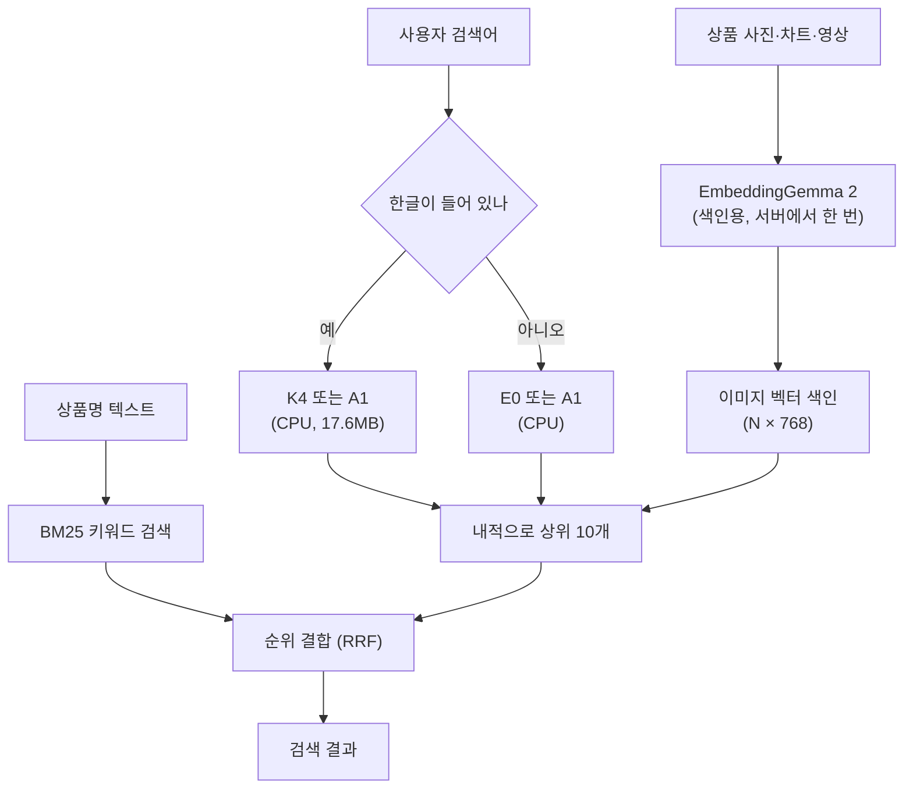

## 왜 읽어야 하나

이미지나 영상을 텍스트로 찾는 검색을 만드는데 EmbeddingGemma 2 원본(약 1.5GB)이 배포하기에 무겁다면 이 글이 맞습니다. 결론부터 말하면 일을 둘로 나누는 게 핵심입니다. 이미지 색인은 서버에서 EmbeddingGemma 2로 한 번만 만들고 사용자가 입력하는 검색어는 17.6MB짜리 질의 인코더가 CPU에서 벡터로 바꿉니다. 색인 모델의 다운로드 크기만 줄이고 싶다면 550MB 양자화 모델을 쓰면 됩니다.


*색인은 크게 한 번, 검색은 작게 여러 번 하는 구성입니다.*

다키클라우드는 이 구성을 위해 Hugging Face에 저장소 네 개를 공개했습니다. 아래에서 어떤 상황에 어떤 저장소를 고르는지, 어떻게 실행하는지, 어디까지 확인됐고 어디부터는 확인되지 않았는지를 차례로 설명합니다. 새 학습이나 새 벤치마크는 없습니다. 모든 숫자는 각 모델 카드에 공개된 값입니다.

## 개요: 네 저장소의 역할

[EmbeddingGemma 2](/tech-blog/ko/owm/embeddinggemma-2-multimodal-embedding/)는 텍스트, 이미지, 오디오, 영상을 하나의 768차원 공간에 넣는 임베딩 모델입니다. 텍스트로 이미지를 찾으려면 두 가지가 필요합니다. 하나는 이미지를 벡터로 바꾸는 **색인용 모델**이고, 다른 하나는 검색어를 같은 공간의 벡터로 바꾸는 **검색용 모델**입니다. 네 저장소는 이 두 역할로 나뉩니다.

| 저장소 | 역할 | 크기 | 언제 쓰나 |
|---|---|---|---|
| [`eg2-w6-text-w4-media`](https://huggingface.co/ThakiCloud/eg2-w6-text-w4-media) | 색인용 (텍스트 6비트, 이미지·오디오 4비트) | 550,244,021 B | 이미지·영상 임베딩을 작은 다운로드로 만들 때 |
| [`eg2-mixed-bit-550mb`](https://huggingface.co/ThakiCloud/eg2-mixed-bit-550mb) | 색인용 (행렬마다 4/6/8비트) | 549,949,165 B | 위와 같은 용도, 비트 배분만 다름 |
| [`eg2-tiny-query-a1`](https://huggingface.co/ThakiCloud/eg2-tiny-query-a1) | 검색용, 한국어·영어 | 17,597,714 B | 차트·앱 화면 이미지 색인을 검색할 때 |
| [`eg2-tiny-query-commerce-ko`](https://huggingface.co/ThakiCloud/eg2-tiny-query-commerce-ko) | 검색용, 한국어 K4 + 영어 E0 | 32,971,443 B (인코더 2개) | 상품 이미지 색인을 한국어로 검색할 때 |

Commerce 저장소의 권장 버전은 **K4**입니다. `main`이 K4이고, 이전 버전은 `k3`, `k2` 리비전으로 남아 있습니다. 네 저장소와 관련 논문은 [EmbeddingGemma 2 Edge 컬렉션](https://huggingface.co/collections/ThakiCloud/embeddinggemma-2-edge-quantization-6ac5ffaa9257f8357645fff2)에 모아 두었습니다.

## 이 구성은 무엇인가

검색 시스템에서 이미지 색인은 자주 바뀌지 않습니다. 상품 사진이나 차트는 한 번 벡터로 만들어 두면 끝입니다. 반면 검색어는 요청마다 새로 들어옵니다. 그래서 무거운 모델은 색인 쪽에만 두고, 검색어 쪽에는 작은 모델을 두면 효율이 좋습니다.



A1과 K4는 TinyCLIP Text-3M 텍스트 타워에 256→768 선형층을 붙인 구조입니다. EmbeddingGemma 2의 질의 벡터와 이미지 벡터를 따라 하도록 증류했습니다. 가중치는 행 단위 INT8입니다. 출력이 EmbeddingGemma 2의 이미지 공간에 맞춰져 있어서, **이미 만들어 둔 EmbeddingGemma 2 이미지 색인을 다시 만들지 않고 그대로 검색**할 수 있습니다.

550MB 모델 두 개는 반대쪽, 즉 색인을 만드는 EmbeddingGemma 2 자체를 줄인 것입니다. 원본 BF16 저장소(1,525,810,123 B)의 36% 크기입니다. 다만 줄어드는 것은 디스크와 다운로드뿐입니다. 로더가 불러올 때 모든 행렬을 BF16으로 되돌리므로 메모리와 속도는 원본과 같습니다.

## 설치 및 실행

### 1단계: 이미지 색인 한 번 만들기

검색용 인코더를 쓸 계획이라면 색인은 **원본 `google/embeddinggemma-2`**로 만듭니다. A1과 K4는 원본이 만든 이미지 벡터에 맞춰 학습했습니다. 양자화 모델이 만든 이미지 벡터와 함께 쓰는 경우는 시험하지 않았습니다. 각 저장소의 `example_search.py`가 색인 생성까지 해 줍니다.

```bash
pip install "sentence-transformers[image]>=6.1.0" huggingface_hub
python example_search.py build --images ./products --index index.npz
```

색인을 만들 때만 `sentence-transformers[image]`가 필요하고 검색할 때는 필요 없습니다. 이미지 벡터는 이미지 하나만 넣어(`{"image": PIL.Image}`) 만들고 L2 정규화합니다.

### 2단계: 작은 질의 인코더로 검색하기

상품 이미지 색인을 한국어로 검색하는 코드는 다음과 같습니다. CPU로 충분합니다. 필요한 패키지는 `torch`, `transformers`, `safetensors`, `huggingface_hub`, `numpy`입니다.

```python
import sys
import numpy as np
from huggingface_hub import snapshot_download

repo = snapshot_download("ThakiCloud/eg2-tiny-query-commerce-ko")  # main = K4
sys.path.insert(0, repo)
from commerce_query import CommerceQueryEncoder

enc = CommerceQueryEncoder.from_pretrained(repo)   # 한글이면 K4, 아니면 E0
q = enc.encode(["무선 블루투스 이어폰 화이트", "stainless steel water bottle"])

image_vectors = np.load("image_vectors.npy")       # (N, 768), L2 정규화된 EG2 이미지 벡터
top10 = np.argsort(-(q @ image_vectors.T), axis=1)[:, :10]
```

기본 동작은 한글이 들어간 검색어를 K4로, 나머지를 E0로 보내는 자동 분기입니다. 한 인코더를 강제하려면 `route="ko"` 또는 `route="en"`을 줍니다. 차트나 앱 화면 색인이라면 저장소만 `eg2-tiny-query-a1`로 바꾸고 `A1QueryEncoder`를 씁니다. A1은 인코더 하나가 한국어와 영어를 모두 받습니다.

### 3단계: 상품명은 BM25, 설명형 검색은 모델

Commerce 예제는 모델의 상위 10개를 내 상품명으로 만든 BM25 색인과 합칠 수도 있습니다. `catalog.jsonl`에 이미지 경로와 상품명·브랜드·속성 텍스트를 한 줄씩 넣으면 됩니다.

```bash
python example_search.py search --index index.npz --query "여성 겨울 롱패딩 블랙"
python example_search.py search --index index.npz --catalog catalog.jsonl --query "나이키 러닝화"
```

어느 쪽을 쓸지는 검색어 종류가 정합니다. 사용자가 상품명을 그대로 치는 경우라면 BM25가 이미 거의 완벽합니다. 한국어 상품명 889개 질의에서 BM25만 썼을 때 R@1은 0.911, R@10은 0.993이었습니다. 여기에 K4를 합치면 R@10은 그대로인 반면 R@1이 0.724로 떨어집니다. 반대로 상품 이름을 쓰지 않는 설명형 검색어에서는 BM25가 R@10 0.290에 그쳤고, K4 단독은 0.652였습니다. 카탈로그에 상품명 텍스트가 있으면 이름 검색은 BM25에 맡기고, 설명형 검색과 텍스트가 없는 이미지 검색에 모델을 쓰는 것이 맞습니다.

## 확인된 성능

모든 숫자는 각 카드에서 가져왔습니다. 구간은 질의 묶음 단위 부트스트랩 95% 구간입니다. 학습 시드는 하나라서 이 구간은 질의 표본의 흔들림만 반영합니다.

**550MB 색인 모델.** 한 번만 연 봉인 평가에서 텍스트→이미지 2,113개, 텍스트→영상 1,252개 질의로 쟀습니다. 원본 BF16의 R@1이 이미지 0.3213, 영상 0.2732일 때 균일 6비트 모델은 0.3218과 0.2676, 혼합 비트 모델은 0.3204와 0.2636이었습니다. 두 모델 모두 사전에 정한 허용 폭(BF16 R@1의 10%) 안에 들어 비열등으로 판정됐습니다. 둘 중 어느 쪽이 낫다고는 말할 수 없습니다. 두 550MB 모델끼리의 검정은 미리 등록하지 않았고, 개발 데이터에서 보였던 혼합 비트의 영상 우위도 봉인 평가에서 재현되지 않았습니다. 특별한 이유가 없다면 구조가 단순한 균일 6비트 쪽을 먼저 써 보는 것을 권합니다.

**A1, 차트 검색.** 학습과 모델 선택에서 뺀 차트 게시처 그룹으로 한 번 시험했습니다. OCR+BM25만 쓰면 R@10이 0.9473이었습니다. 여기에 A1을 순위 결합하면 0.9727로 올랐습니다(+0.025, 구간 [+0.015, +0.033]). 하지만 A1 단독은 0.7617로 OCR+BM25보다 낮고, 결합하면 R@1이 0.733에서 0.705로 떨어집니다. 그러니 A1은 한국어 차트에서 키워드 검색의 상위 10개를 넓히는 보조 장치로 써야 하고, 단독 검색기나 첫 번째 결과만 보여 주는 화면에는 맞지 않습니다. 영어 앱 화면 검색(RICO 2,364개 질의)에서는 영어 전용 전신 모델과 R@10이 같은 수준(0.4522 대 0.4492)이라 한국어를 더해도 영어가 손상되지 않았습니다.

**K4, 한국어 상품 검색.** 2만 7,309개 ABO 개발 상품 이미지 풀에서 한국어 상품명 R@10은 E0 0.368에서 K4 0.711로 올랐습니다(+0.343). 설명형 합성 질의에서는 0.652로 교사 모델(0.663)에 근접했습니다. 다만 이 합성 질의는 학습 데이터와 같은 생성기로 만든 것이라 실제 사용자 검색어에서의 개선 근거는 아닙니다. 영어 검색어는 기본 분기에서 E0로 가므로 영어 결과는 이전과 같습니다.

설치 확인도 했습니다. 깨끗한 환경에서 공개 파일을 받아 ABO 상품 200개로 색인을 만들고 한국어 상품명으로 검색했더니 R@1 0.68, R@10 0.955가 나왔습니다. 풀이 작아서 품질 지표가 아니라 파일이 제대로 받아지고 검색까지 도는지를 확인한 숫자입니다.

## 다키클라우드 제품 적용 시사점

이 구성은 다키클라우드 AI 플랫폼이 온프렘과 엣지에서 검색을 서빙하는 방식과 맞닿아 있습니다. 이미지 색인 생성은 GPU가 있는 서버에서 배치 작업으로 한 번 돌리고 질의 인코딩은 GPU 없이 CPU에서 처리합니다. 검색어 처리용 GPU를 상주시키지 않아도 되므로 서빙 비용이 내려가고, 17.6MB 인코더는 망이 분리된 환경에도 쉽게 들고 갈 수 있습니다. 4비트 EmbeddingGemma 2를 표준 vLLM으로 서빙하는 방법은 [이전 글](/tech-blog/ko/llmops/eg2q-vllm-plugin-serving/)에 정리했습니다.

저희는 이 모델들을 사내 GPU 큐에서 학습했습니다. 평가 기준은 점수를 보기 전에 정했고 봉인 평가는 한 번만 열었습니다. 카드의 "주장하지 않는 것" 절이 긴 이유도 같습니다. 고객이 자기 데이터로 다시 재 볼 때 같은 결론이 나와야 하기 때문입니다.

## 한계 및 반론

- **색인 모델과 검색 모델을 섞을 때.** A1과 K4는 원본 EmbeddingGemma 2 이미지 벡터로만 확인했습니다. 550MB 모델로 만든 색인과 함께 쓰는 경우는 시험하지 않았습니다. 같은 이유로 서빙 스택도 섞지 않아야 합니다. 원본 BF16을 vLLM으로 서빙했을 때 sentence-transformers 대비 이미지 질의의 17.5%에서 1위가 바뀌었습니다.
- **550MB 모델이 다루지 않는 것.** 오디오는 봉인 오디오 세트가 독립성 감사를 통과하지 못해 평가하지 못했습니다. 텍스트끼리의 검색도 재지 않았습니다. 메모리 절감과 속도 향상은 없습니다.
- **K4의 근거 범위.** 사람이 직접 쓴 한국어 쇼핑 검색어로는 평가하지 않았습니다. 16토큰 이하의 아주 짧은 상품명 35개에서는 개선이 없었습니다. K4를 강제로 영어에 쓰면 영어 키워드 검색 R@10이 소폭 떨어집니다(−0.010).
- **첫 번째 결과의 정확도.** 두 질의 인코더 모두 정답을 상위 10개 안에 넣도록 만든 모델입니다. 1위 하나만 보여 주는 화면이라면 BM25나 교사 모델이 더 낫습니다.
- **학습 반복.** 버전마다 학습을 한 번씩만 했으므로 시드에 따른 흔들림은 모릅니다. 기기별 지연 시간과 메모리도 재지 않았습니다.

## 정리

EmbeddingGemma 2로 이미지·영상 검색을 만든다면 색인과 검색을 분리하는 것이 출발점입니다. 색인은 서버에서 한 번 만들고 다운로드 크기가 부담이면 550MB 모델(균일 6비트를 먼저)을 씁니다. 그 색인을 한국어로 검색해야 하면 질의 쪽에 작은 인코더를 둡니다. 차트와 앱 화면은 A1을 OCR+BM25와 함께, 상품 이미지는 K4를 씁니다. 다만 작은 인코더를 쓸 거라면 색인은 원본 EmbeddingGemma 2로 만들어야 합니다. 상품명을 그대로 치는 검색은 BM25에 맡기고, 모델은 이름이 없는 설명형 검색과 텍스트가 없는 이미지 검색에 씁니다.

시작은 Commerce 저장소의 `example_search.py`로 가진 이미지 수백 장에 색인을 만들고, 실제 검색어 몇 개를 넣어 보는 것입니다. 숫자는 각 저장소 카드에, 모델 목록은 [컬렉션](https://huggingface.co/collections/ThakiCloud/embeddinggemma-2-edge-quantization-6ac5ffaa9257f8357645fff2)에 있습니다.
