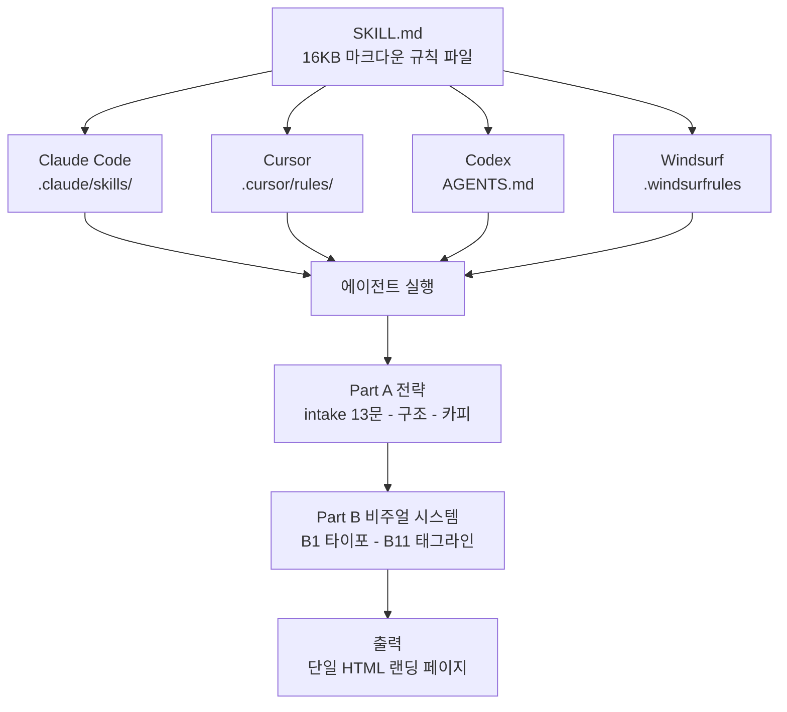

## 왜 읽어야 하나

Claude Code나 Cursor로 랜딩 페이지를 뽑는데 결과물이 항상 "알고리즘이 만든 템플릿"처럼 나와서, 팀의 디자인 기준을 에이전트가 지킬 수 있게 파일을 만들고 싶은 개발자나 디자이너라면 이 글을 읽으면 됩니다. 결론부터 말하면, 8년 차 프로덕트 디자이너가 공개한 16KB 마크다운 파일 하나로 에이전트가 만드는 랜딩 페이지의 디자인 결정자 6개(이징 곡선, 히딩 그라디언트, 680px 히어로 캡, 버튼 패딩, 타이포 스케일, 스페이싱 토큰)를 전부 잠글 수 있었고, 스킬이 없는 arm에서는 "Acme" 같은 플레이스홀더 브랜드와 스케일 밖 폰트 6종, 타이틀케이스 헤딩 2건이 나왔습니다.


*스킬 파일이 결정하는 것은 메커니즘이 아니라 값입니다.*

## 개요

10월 24일, 프로덕트 디자이너 Elaya(@elayadesigns)가 트윗으로 "지난 2개월간 모든 랜딩 페이지를 Higgsfield, Claude, Cursor와 커스텀 AI 디자이너 스킬로 만들었다"며 스킬 레포를 공개했습니다. 트윗에 붙은 영상은 그 결과물들입니다. 8년 차 프로덕트 디자이너이자 slopscan.co 개발자인 저자는, 디자인의 방향을 정하는 게 아니라 디자인의 규칙을 파일로 만들어 에이전트가 따르게 하는 쪽으로 일을 옮겼습니다. Higgsfield는 영상 생성 크리에이티브 플랫폼이고, 이 조합에서 Higgsfield는 비주얼 에셋을, Claude와 Cursor는 코드를, 커스텀 스킬은 그 사이를 잇는 디자인 규칙을 맡습니다.

공개된 레포는 [elayadesign/ai-design-skills](https://github.com/elayadesign/ai-design-skills)입니다. MIT 라이선스에, 스킬이 두 개 들어 있습니다. 하나는 랜딩 페이지를 만드는 `landing-page-design`(16.5KB)이고, 다른 하나는 정적인 디자인을 쇼케이스 애니메이션으로 바꾸는 `design-to-motion`(39.1KB)입니다. 레포는 2026년 7월 말에 만들어졌고, `design-to-motion`은 이번 공개 당일(10월 25일) 추가된 커밋입니다.

## 이 스킬 시스템은 무엇인가

파일 형식은 단순합니다. frontmatter(이름과 설명)와 본문을 가진 마크다운 한 개. Claude Code의 스킬, Cursor의 규칙 파일, Codex의 AGENTS.md, Windsurf의 .windsurfrules, Cline의 .clinerules 어느 쪽에나 그대로 넣을 수 있습니다. 설치 경로별로 한 번에 보려면 아래가 전부입니다.

| 도구 | 설치 경로 |
|---|---|
| Claude Code | `.claude/skills/<skill-name>/` |
| Cursor | `.cursor/rules/<skill-name>.md` |
| Codex | `AGENTS.md` |
| Windsurf | `.windsurfrules` |
| Cline | `.clinerules` |
| Claude.ai (단말기 없음) | Project에 파일 업로드 |

`landing-page-design`의 내부 구조를 보면, **Part A는 전략**이고 **Part B는 "협상이 불가능한" 비주얼 시스템**입니다. Part A는 intake 13문(주요 액션이 하나, 대상이 누구, 전환의 정의, ICP, 상위 3개 반대 의견, 증거 포인트, 브랜드 톤 등)으로 시작해 페이지 구조와 카피를 정합니다. A2는 페이지를 12개 섹션으로 고정합니다. 폴드 위에는 헤드라인(성과+대상), 서브헤드라인, CTA, 증거 신호 1개, 히어로 비주얼이 들어가고, 중반에는 문제-해결, 결과 중심 혜택 3~5개, 3단계 작동 방식, 사회적 증거, B11 태그라인이, 하단에는 FAQ 6~12문, 리스크 리버설, 상단과 동일한 마지막 CTA가 들어갑니다. A3는 레이아웃을 A(클래식 히어로)부터 D(비교 페이지)까지 4종으로 나눠 "하나를 고르고 이유를 말하라"고 요구합니다. Part B는 B1부터 B11까지 11개 섹션이고, 각각이 코드로 검증 가능한 구체적인 값을 씁니다.

- **B1 타이포**: 허용 폰트 4종(Geist, Manrope, Geist Mono, Poppins), 금지 폰트 5종(Inter, Roboto, Arial, Open Sans, Helvetica), 사이트당 1가지 타이포페밀리, 폰트 사이즈는 Tailwind 기본 스케일(12~128px)에서만.
- **B2 스페이싱**: 허용 값 13개(0, 2, 4, 8, 12, 16, 24, 32, 40, 48, 64, 80, 96px)이며, 그 사이나 바깥의 값은 사용할 수 없습니다.
- **B3 코너 라디우스**: Tailwind 값만. 중첩 공식: 내부 형식과 외부 형식의 간격이 32px 미만이면 `내부 라디우스 = 외부 라디우스 - 간격`, 결과가 2px 이하면 사각형.
- **B5 히어로**: 라이트 테마 히딩 그라디언트 `#000000 - #666666`(그라디언트가 허용되는 유일한 위치), 히딩과 서브히딩 max-width 680px.
- **B6 아이콘**: Phosphor, Solar, Iconamoon만. Material Icons/Symbols 금지.
- **B7 모션**: 이징은 `cubic-bezier(0.32, 0.72, 0, 1)` 하나만. `window.addEventListener('scroll')` 사용 금지.
- **B8 콘텐츠 리얼리즘**: 금칙어 목록(Lorem Ipsum, John Doe, Acme, Nexus, SmartFlow, 99.99%, Elevate, Seamless, Unleash, Next Gen, Game changer, Delve, Tapestry, In the world of), "반듯한 가짜 숫자" 금지, 센텐스케이스 헤딩, 능동 태.
- **B10 출하 요건**: 스킵 링크, 404, favicon, og 태그, 시맨틱 HTML, 폼 검증 등.
- **B11 태그라인 리빌**: 페이지 하단에 큰 글씨 태그라인 섹션을 별도 모멘트로 넣어야 하고, 워드별 IntersectionObserver로 읽는 순서에 따라 한 단어씩 활성화. 초기 투명도는 기본 텍스트의 25~35%.

스킬은 작업 순서까지 고정합니다. 코드를 쓰기 전에 7가지를 먼저 제시해야 합니다. 페이지 아웃라인, 히어로 카피, 혜택, 작동 방식, FAQ, SEO, 레이아웃 추천입니다. 이 7가지를 넘기고 나서야 섹션별 빌드가 시작됩니다.


*규칙 파일이 5개 도구의 설치 경로로 갈라져, 같은 에이전트 실행에 공통 비주얼 시스템을 공급합니다.*

두 번째 스킬 `design-to-motion`은 Figma 프레임이나 스크린샷을 "픽셀 동일한 HTML 복제 + 로딩 안무 + 모든 비주얼이 자기 일을 연기하는 무한 루프"로 바꾼 뒤 MP4와 GIF를 내보내는 3부 구조(정밀도, 모션 시스템, 녹화/내보내기)입니다. 1부에 주목할 점이 있습니다. 움직이는 것을 만들기 전에, 재구성한 정지 화면이 소스와 구별할 수 없게 만들어야 한다는 것. "쇼케이스 애니메이션은 재디자인이 아니다. 시청자는 정확히 그 디자인을, 그리고 그것이 살아있다는 것을 보아야 한다"는 문장이 파일 앞에 있습니다. 배경 레이어는 "sacred"(손대면 안 되는 레이어)로 표기하고, 정지 화면 검수(A7)가 통과하기 전에는 아무것도 인코딩하지 못하게 묶어둔 것입니다. 트윗에 붙은 랜딩 페이지 영상들이 바로 이 스킬의 산출물입니다. 모션 규칙 일부는 emilkowalski/skills 등 MIT 라이선스 3개 레포에서 가져왔다고 크레딧을 명시하고 있습니다. 기존 사이트를 리모델링할 때 쓰는 동반 스킬(`redesign-existing-projects`)도 별도로 공개되어 있습니다.

## 설치

Claude Code 기준으로 실제 설치 명령은 이렇습니다.

```bash
git clone https://github.com/elayadesign/ai-design-skills.git /tmp/ai-design-skills
cp -r /tmp/ai-design-skills/skills/landing-page-design .claude/skills/
```

그 다음 "랜딩 페이지 만들어줘"라고 평어 그대로 요청하면 됩니다. 파일 앞부분의 frontmatter description이 트리거 조건을 기술하고 있어서, 에이전트가 디자인 판단이 필요한 순간 이 파일을 참조합니다. 커서에서 쓰려면 SKILL.md 하나를 `.cursor/rules/`로 내려받는 것뿐입니다.

README의 "Make it yours" 섹션이 이 시스템의 철학입니다. 모든 스킬의 디자인 값(폰트, 색, 스페이싱, 모션)은 파일 하단의 한 섹션에 모인다고 합니다. 포크해서 그 섹션만 수정하면 스킬 나머지가 자동으로 따라온다는 것입니다. 디자인 시스템이 아니라 디자인 시스템의 디폴트값이 파일이고, 팀의 것은 그걸 바꾸는 것입니다.

## 실제 실험 결과

"마크다운 규칙 파일을 넣으면 에이전트가 따라 하는가"는 확인이 필요한 주장입니다. 그래서 두 arm을 돌렸습니다. 같은 브리프(Metis 서버리스 추론 엔드포인트 랜딩 페이지, 영어, 단일 파일 HTML, 외부 요청 금지)로, 한 arm에는 스킬 파일을 먼저 읽고 적용하게 하고, 다른 arm에는 스킬·규칙 문서·외부 소스 참조를 전부 금지하고 판단만으로 만들게 했습니다.

브리프는 스킬의 intake 13문에 답을 미리 채운 형태입니다. 주요 액션(무료 트라이얼 시작), ICP(자체 GPU 플릿을 운영하기 싫은 ML 엔지니어/플랫폼 팀), 상위 3개 반대 의견(서빙 지연, 데이터 위치, 토큰 단가), 증거 포인트(공개 데모, 10분 내 엔드포인트, 멀티테넌트 K8s)까지. 스킬이 "답이 없으면 가정하고 한 줄로 써서 계속해라"고 하는 대로, agent는 intake에서 막히지 않고 빌드했습니다. 두 arm 모두 7단계 plan.md를 먼저 내게 했고, 그 다음 HTML을 씁니다. 실행은 sonnet 서브에이전트였고, wall-clock은 스킬 arm 12.1분(727초), 컨트롤 arm 9.5분(568초)이었습니다.

산출물은 스킬 arm 44,440바이트/900줄/h2 섹션 8개, 컨트롤 arm 30,627바이트/649줄/h2 7개입니다. 둘 다 단일 파일, 외부 요청 0, 스킵 링크와 footer 링크, og 태그, email 검증이 있습니다. 차이점은 아래입니다.

**품질 게이트(코드가 판정)**: 금칙어 히트, 스케일 밖 폰트 사이즈 수, 타이틀케이스 헤딩 수, 본문 느낌표 수. 스킬 arm은 0-0-0-0입니다. 컨트롤 arm은 2-6-2-0이었습니다. "Acme"가 2번 나왔고(스킬 B8이 명시적으로 금지하는 플레이스홀더 브랜드), 폰트 22, 28, 34, 40, 44, 56px 이렇게 6종이 Tailwind 스케일 밖이고, "Stop renting GPUs. Start shipping models." 같은 타이틀케이스 헤딩이 2개였습니다.

**스킬 서명(디자이너가 정한 6개 결정자)**: 스킬 arm은 정해진 이징 곡선, 히딩 그라디언트, 680px 히어로 캡, 버튼 패딩 8/12px, 타이포 스케일 전체 준수, 스페이싱 토큰 전체 준수, 6개 전부 존재. 컨트롤 arm은 0개였습니다.


*왼쪽: 스킬이 없으면 전형 슬롭 10건. 오른쪽: 디자이너의 6개 결정자는 스킬이 있을 때만 전부 1입니다.*

흥미로운 발견이 세 개 있습니다.

**첫째, 메커니즘은 모델이 알아서 만듭니다.** 컨트롤 arm은 스킬 없이도 "워드별 IntersectionObserver 태그라인 리빌"을 만들었습니다. 스킬 B11이 요구하는 구조 그 자체입니다. 차이가 나는 곳은 값입니다. 컨트롤은 초기 투명도 0.16, `ease`, 워드당 70ms 스태거. 스킬은 25~35% 밴드, `cubic-bezier(0.32, 0.72, 0, 1)`, 뷰포트 중앙 트리거 라인. 즉 스킬 파일이 해내는 일은 "이 효과를 만들게 하는" 게 아니라 "값을 디자이너의 것으로 고정하는" 것입니다.

**둘째, 스킬은 사실을 통제하지 못합니다.** 스킬 arm의 페이지에는 "9m 41s", "$38.42", "2,411,806 tokens" 같은 수치가 있는데, 이는 브리프에 없던 값입니다. B8 규칙이 "반듯한 가짜 숫자 금지, 유기적 데이터 사용"을 요구하기 때문에, 증거가 부재한 곳에 모델은 그럴듯해 보이는 가짜 수치를 채웁니다. canonical 도메인도 `thakicloud.net`으로 스스로 추론했습니다. 디자인 규칙 파일은 디자인을 잠그고, 사실은 브리프가 잠궈야 합니다.

**셋째, 스킬은 물리 한계에서 정직하게 이탈합니다.** B10 출하 요건 중 "브랜디드 404 페이지"와 "쿠키 동의"는 단일 파일 실험에서는 충족이 불가능한 항목입니다. 스킬 arm은 둘 다 제외하고, 그 이유를 HTML 주석에 남겼습니다. B3 중첩 라디우스 공식의 실제 적용도 확인했습니다. 히어로 모크업의 16px 카드 안에 24px 간격으로 들어가는 내부 패널: 공식은 16 - 24가 2 미만이라 내부 형식을 사각형으로 두라고 하는데, 페이지의 주석이 정확히 그 계산을 써서 사각 패널을 만들었습니다. 규칙을 해석하는 게 아니라 대입하는 것입니다.

검증 주: 스킬 arm은 샌드박스 내 스킬 파일 읽기가 거부되어, 같은 main 브랜치 파일을 raw.githubusercontent.com에서 가져와 적용했습니다. 적용된 규칙값(스케일, 스페이싱, 이징, B3 공식, B5 그라디언트, B6 아이콘 집합)을 로컬 클론 원본과 항목별로 교차 대조했으며, 전부가 일치했습니다. 하나의 투명성 주: 실험 브리프 자체가 스킬의 Output format에서 파생된 것이라, "레이아웃 A~D를 고르고 이유를 말하라" 같은 계획 단계 규칙은 두 arm에게 모두 전해졌습니다. A/B 차이가 나온 곳은 계획이 아니라 HTML의 디자인 값입니다.

## ThakiCloud 제품 적용 시사점

이 실험은 Paxis 관점에서 두 가지를 보여줍니다.

첫째, **디자인 시스템은 16KB 마크다운 파일이 되면서 에이전트 일급 리소스가 됩니다.** ThakiCloud의 Paxis는 에이전트 플랫폼에서 스킬을 일급 리소스로 취급합니다. 960개 이상의 스킬을 BM25로 선택해 격리 샌드박스에서 실행하고, 모든 행동을 정책 게이트와 감사 로그로 통과시킵니다. `landing-page-design`이 Paxis 스킬 하네스에 올려지는 순간, "우리의 랜딩 페이지는 이렇게 생긴다"는 팀 기준이 개인 노트북의 .claude/skills 폴더를 넘어 조직 자산이 되고, 에이전트 실행 결과에 일관되게 적용됩니다.

둘째, **디자인 준수 판정은 LLM이 아니라 코드가 해야 합니다.** 이 실험의 게이트는 전부가 정규식과 HTML 파서였습니다. 금칙어 히트 수, 스케일 밖 폰트 수, 타이틀케이스 헤딩 수, 이징 곡선 존재 여부. "이 페이지가 우리 디자인 시스템에 맞나?"라는 질문에 LLM 판정은 실험마다 흔들리지만, 코드 판정은 0과 10이 그대로 기록됩니다. 게이트 결과는 매 실행마다 JSON 한 줄로 남고, 그것이 쌓이면 디자인 준수 이력이 됩니다. 에이전트가 어떤 규칙을 어겼는지, 언제 고쳤는지를 소급해 볼 수 있는 감사 로그입니다. Paxis의 정책 게이트가 에이전트 행동에 적용되는 방식과 동일한 구조이고, "비주얼 컴플라이언스"를 그 범주로 넓히는 것은 자연스러운 확장입니다. 실험 산출물(게이트 스크립트와 A/B 페이지)은 팀 내 디자인 스킬 파일 검증 훅의 출발점이 될 수 있습니다.

## 한계 및 반론

실험 규모는 1회, 제품 1개(Metis), 언어 1개(영어)입니다. "2개월간 랜딩 페이지 다수"라는 원작자의 경험은 사례보고일 뿐이며, 이 실험이 그 주장을 검증하는 것은 아닙니다. 스킬의 미학(라이트, minimal editorial)이 특정 방향에 최적화되어 있어서, 다크 글래스나 플레이풀 3D 방향의 페이지에는 "Make it yours" 섹션을 수정해야 적용됩니다. B8의 "반듯한 숫자 금지"는 증거가 없는 페이지에서 유기적 가짜 데이터 생성을 부추길 수 있고, 실제로 관찰됐습니다. 단일 랜딩 페이지 기준이라, 컴포넌트 라이브러리 수준의 재사용(디자인 토큰, 스테이트 매트릭스)까지 커버하는지는 이 실험의 범위 밖입니다. 그리고 컨트롤 arm의 "슬롭" 가운데 일부(타이틀케이스 헤딩 등)는 스킬 기준이 아니라면 합법적인 스타일 선택일 수 있습니다. 게이트 판정은 "이 스킬의 기준 위반"이지 "나쁜 디자인"의 보편적 정의가 아닙니다.

## 정리

에이전트 출력의 디자인을 잠그는 단위입니다. 프롬프트가 아니라 규칙 파일입니다. 그리고 그 규칙 파일이 실제로 잠그는 것은 메커니즘이 아니라 값입니다. 워드별 리빌 같은 메커니즘은 스킬이 없어도 모델이 만들어 냅니다. 이징 곡선 하나, 히어로 max-width 680px, 버튼 패딩 8/12px을 "우리의 것"으로 고정하는 것은 규칙 파일의 몫입니다.

다음 행동은 이것입니다. 팀의 AI 생성 UI가 템플릿처럼 보인다면, 가장 아끼는 디자인 결정자 6개를 골라(허용 폰트, 스페이싱 토큰, 라디우스, 이징, 금칙어, 출하 체크리스트) 마크다운 한 파일로 쓰고, 준수 여부는 LLM이 아니라 코드로 판정하십시오. 16KB면 충분했습니다.
