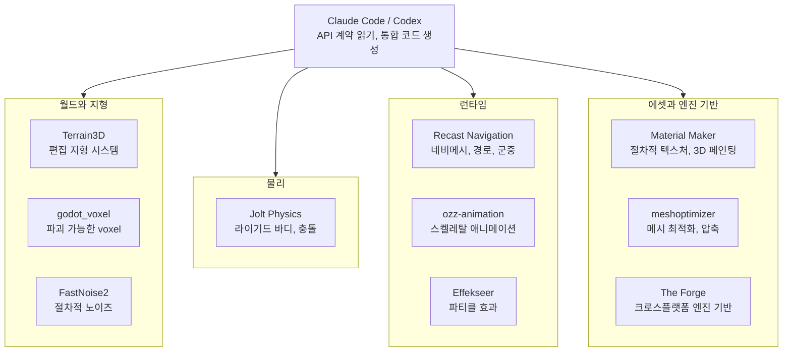

## 왜 읽어야 하나

Claude Code나 Codex로 게임 프로토타입을 만들거나, 에이전트에게 어떤 성숙한 라이브러리를 줘야 할지 고르는 개발자라면 이 글을 읽으면 됩니다. 결론부터 말하면, 바이럴된 트윗(좋아요 4,200개)에 든 "insane repos" 10개는 GitHub API로 일일히 검증한 결과 전부 실재했고, 그중 하나인 meshoptimizer를 실제로 빌드·실행해 "이걸 조합하면 AAA급 시스템이 된다"는 주장이 성립한다는 숫자를 얻었습니다. 핵심은 라이브러리 자체가 아니라, API 계약(헤더 파일과 문서)을 에이전트에 주고 통합 코드를 나오게 한다는 패턴입니다.


*API 계약을 읽는 에이전트가 조립하는 모듈형 게임 시스템.*

## 개요

10월 29일, 개발자 @heyrimsha가 트윗으로 "GitHub is a goldmine for game developers"라며 "Claude Code와 Codex로 AAA 스타일 게임을 만들 때 도움이 되는 10개 레포"를 공개했습니다. 10월 30일 기준 이 트윗은 좋아요 4,200개, 리트윗 367개입니다.

이 목록의 포인트는 마지막 문장에 있습니다. "Give Claude Code or Codex the relevant docs and ask it to help integrate the systems your project needs." 즉 에이전트가 물리 엔진을 처음부터 쓰게 하는 것이 아니라, 이미 AAA급으로 검증된 라이브러리의 문서를 읽고 통합 코드를 나오게 하라는 것입니다. 이 주장이 마케팅 수사가 아니라 실제로 성립하는지 확인하기 위해, 10개 레포를 GitHub REST API로 전부 측정하고 그중 하나(meshoptimizer)를 샌드박스에 실제 빌드해 실행했습니다.

## 이 기술은 무엇인가

10개 레포는 게임 시스템 관점에서 네 그룹으로 나뉩니다. 월드와 지형, 물리, 런타임(이동·애니메이션·효과), 에셋과 엔진 기반입니다. 각각이 담당하는 영역을 먼저 짚고, 아래 표에 실측 수치를 둡니다.

**물리.** Jolt Physics(jrouwe/JoltPhysics)는 멀티코어 라이기드 바디 물리와 충돌 감지 라이브러리입니다. C++로 쓰였으며, GitHub 설명에 Horizon Forbidden West와 Death Stranding 2 사용이 명시되어 있습니다. 목록 내 별 수(11,947개)가 가장 크고, "신뢰감 있는 물리적 상호작용"을 게임에 넣는 역할을 합니다.

**월드와 지형.** Terrain3D(TokisanGames/Terrain3D)는 Godot 4용 고성능 편집 지형 시스템입니다. C++ GDExtension로, 트윗에 첨부된 README 캡처에 따르면 64x64m부터 65.5km 단위로 확장되는 지역, 최대 32개 텍스처 레이어, 지형 메시 10단계 LOD, 식생 인스턴싱과 heightmap(HTerrain, Gaea, World Creator, Unity, Unreal 등) 임포트를 지원합니다. godot_voxel(Zylann/godot_voxel)은 Godot 엔진의 voxel 모듈로, 플레이어가 파괴 가능한 세계(동굴, 터널, 오버행)와 탐색에 따른 지형 스트리밍을 담당합니다. FastNoise2(Auburn/FastNoise2)는 SIMD, C++17, 템플릿 기반의 노드 그래프 방식 모듈라이즈 노이즈 생성 라이브러리로, 절차적 지형과 텍스처 생성의 원료가 됩니다.

**런타임.** Recast Navigation(recastnavigation/recastnavigation)는 GitHub 설명이 "Industry-standard navigation-mesh toolset"인 내비게이션 표준입니다. 적과 NPC의 레벨 내 이동, 네비게이션 메시 생성, 경로 계산, 충돌 회피가 있는 군중 시뮬레이션까지 다룹니다. ozz-animation(guillaumeblanc/ozz-animation)은 오픈소스 C++ 스켈레탈 애니메이션 라이브러리이자 툴셋으로, 캐릭터 애니메이션의 로딩·재생·블렌딩을 담당합니다. Effekseer(effekseer/Effekseer)는 C 기반 파티클 효과 라이브러리로, 폭발·마법·전투·환경 효과를 만들고 2D 애니메이션으로 내보내거나 3D 효과를 엔진에 통합합니다.

**에셋과 엔진 기반.** Material Maker(RodZill4/material-maker)는 Godot 기반의 절차적 텍스처 저작과 3D 모델 페인팅 도구입니다. 트윗의 README 캡처에 따르면 Godot의 GraphEdit 노드를 기반으로 텍스처와 브러시를 서로 연결된 노드로 표현하며, itch.io와 Steam을 통해 배포되며, Windows에서는 scoop install material-maker로 설치할 수 있습니다. meshoptimizer(zeux/meshoptimizer)는 "메시를 더 작고 렌더링이 빠르도록 만드는 최적화 라이브러리"로, 정밀한 모델이 성능을 무너뜨리는 문제를 최적화·간소화·압축으로 풉니다. The Forge(ConfettiFX/The-Forge)는 커스텀 엔진을 만들 때 쓸 크로스플랫폼 프레임워크로, Windows·Steam Deck(네이티브)·레이트레이싱·macOS/iOS·Android·XBOX·PS4·PS5·Switch·Quest 2를 공식 설명에 나열합니다.

실무에서 고르는 기준은 "어떤 엔진 위에서 쓰느냐"입니다. Godot 프로젝트라면 Terrain3D, Material Maker, godot_voxel이 애드온으로 바로 붙고, 나머지 C++ 라이브러리도 GDExtension으로 감싸면 됩니다. 언리얼·유나이티드 또는 커스텀 엔진이라면 Godot 애드온 3개는 제외하고, Jolt·Recast·ozz·meshoptimizer·FastNoise2·Effekseer 중 필요한 조각을 헤더 하나로 포함해 쓰면 됩니다. The Forge는 엔진을 새로 만들겠다고 결정한 경우에만 의미가 있는, 목록에서 가장 큰 결정을 요구하는 항목입니다.



이 10개는 두 축으로 갈립니다. Godot 생태계에 즉석에서 붙는 애드온 3개(Terrain3D, Material Maker, godot_voxel)와, 엔진을 가리지 않는 스탠드얼론 C++ 6개(Jolt, Recast, ozz, meshoptimizer, FastNoise2, Effekseer)입니다. 후자는 언리얼·유나이티드든 커스텀 엔진이든 헤더 하나만 포함하면 링크 대상이 되므로, 에이전트가 "우리 엔진에 이걸 어떻게 붙이나"를 추론할 여지가 많습니다. The Forge는 이 중에서도 한 단계 위, 곧 엔진 자체가 아니라 엔진의 뼈대(그래픽 인프라, 리소스 로딩, 애니메이션 시스템)를 주는 프레임워크입니다. 그래서 이 목록은 "하나의 엔진"이 아니라 "시스템 부품 상"에 가깝고, 프로젝트가 어떤 엔진 위에서 돌아가느냐에 따라 필요한 조각이 달라집니다.

## 설치 및 통합

통합 경로는 Godot 애드온과 스탠드얼론 C++ 라이브러리로 둘로 갈립니다.

**Godot 생태계(Terrain3D, Material Maker, godot_voxel).** 애드온형입니다. 레포를 프로젝트의 addons/ 디렉터리에 클론하거나 AssetLib에서 임포트해 에디터에서 활성화하면 됩니다. Material Maker는 애드온이 아니라 독립 앱으로도 배포되므로, Windows에서는 scoop install material-maker로 설치할 수 있습니다(README 실측).

**스탠드얼론 C++ 라이브러리(Jolt, Recast, ozz, meshoptimizer, FastNoise2, Effekseer).** third_party/에 클론해 링크합니다. 대부분 CMake 또는 Makefile을 제공하고, 제공하지 않는 것이라도 단일 번역 단위(self-contained TU)로 빌드되는 경우가 많습니다. meshoptimizer의 src/simplifier.cpp가 그 예로, Makefile의 simplifyfuzz 타깃이 이 단일 파일만으로 빌드하는 것을 실험에서 확인했습니다.

샌드박스에서 캡처한 실제 명령입니다.

```bash
git clone --depth 1 https://github.com/zeux/meshoptimizer.git
# src/simplifier.cpp는 self-contained (Makefile 근거)
clang++ -O2 -std=c++11 -Irepo/src mysimplify.cpp repo/src/simplifier.cpp -o mysimplify
```

**에이전트에 넘길 때.** 트윗의 핵심 지시인 "relevant docs를 줘라"를 실무로 번역하면, 에이전트에게 (1) API 계약 = 헤더 파일, (2) 빌드 규칙 = Makefile/CMake, (3) 수용 기준 = 목표 수치(정점 수, 에러 예산, 프레임 타임)를 함께 주는 것입니다. 예를 들어, "src/meshoptimizer.h의 meshopt_simplify 시그니처와 Makefile을 읽고, .obj 에셋을 읽어 원래 삼각형 수의 50%로 simplify하고 에러 예산 0.001로 정점 수와 에러를 출력하는 드라이버를 작성하라"는 프롬프트로 다음 절의 meshoptimizer 드라이버(약 40줄)를 실제로 작성해 실행했습니다. 에이전트가 API를 추측하지 않고 헤더를 읽어서 시그니처에 맞는 코드를 만든다는 점이 이 패턴의 본질입니다.

이 패턴을 게임 프로젝트에 옮기면 세 단계가 됩니다. 먼저 시스템 선별. 프로젝트가 물리·이동·애니메이션·효과 중 무엇을 요구하는지 정하고, 이 목록에서 해당 조각 1~2개를 고릅니다. 예를 들어 3D 탑다운 액션이면 Jolt(물리)와 Recast(이동)이고, 지형 편집기가 필요하면 Terrain3D를 더합니다. 그다음 에이전트에게 그 조각의 헤더와 Makefile을 읽게 하고, "우리 엔진의 어떤 호출 지점에 어떻게 끼워 넣을지" 통합 계획을 먼저 내게 합니다. 마지막은 수용 기준을 수치로 주는 것입니다. "물리 시뮬레이션이 60fps에서 프레임 버짓 4ms 이내", "네비메시가 1000개 에이전트 경로 탐색을 1ms 이내"처럼. 에이전트가 코드를 쓰고, 그 수치로 통과했는지 측정하는 루프가 한 바퀴 도는 동안, 사람이 할 일은 수치 설정과 최종 플레이테스트만 남습니다. 이 글의 meshoptimizer 실험은 정확히 그 루프의 한 바퀴를 그대로 재현한 것입니다.

## 실제 실험 결과

### GitHub API 실측 (2026-10-30)

10개 레포를 GitHub REST API의 /repos/{owner}/{name}으로 전부 조회했습니다. 10개 모두 실재하며 총 별 55,723개입니다.

| 레포 | 별 | 포크 | 오픈 이슈 | 언어 | 라이선스 | 마지막 push |
|---|---|---|---|---|---|---|
| jrouwe/JoltPhysics | 11,947 | 980 | 12 | C++ | MIT | 2026-10-29 |
| TokisanGames/Terrain3D | 4,561 | 338 | 90 | C++ | MIT | 2026-10-30 |
| RodZill4/material-maker | 6,134 | 404 | 298 | GDScript | MIT | 2026-10-25 |
| effekseer/Effekseer | 1,918 | 302 | 89 | C | MIT | 2026-10-29 |
| Zylann/godot_voxel | 4,043 | 375 | 252 | C++ | MIT | 2026-10-01 |
| recastnavigation/recastnavigation | 8,069 | 1,832 | 147 | C++ | Zlib | 2026-02-27 |
| guillaumeblanc/ozz-animation | 3,052 | 357 | 29 | C++ | NOASSERTION | 2026-08-01 |
| ConfettiFX/The-Forge | 5,761 | 588 | 15 | C++ | Apache-2.0 | 2026-08-27 |
| zeux/meshoptimizer | 8,717 | 740 | 8 | C++ | MIT | 2026-10-14 |
| Auburn/FastNoise2 | 1,521 | 161 | 45 | C++ | MIT | 2026-10-28 |

특기할 실측 두 건입니다. 첫 번째, ozz-animation의 라이선스가 NOASSERTION입니다. GitHub이 표준 SPDX 식별자로 분류하지 못했다는 뜻으로, 상용 게임에 쓰기 전 라이선스 원문 확인이 필요합니다. 두 번째, recastnavigation의 마지막 push가 2026-02-27로 약 8개월 전입니다. "최근 활성" 목록에서 제외되는 유일한 레포이지만, 설명이 industry-standard인 만큼 개발 둔화가 표준성 저하를 뜻하진 않습니다.

### meshoptimizer 실제 실행

샌드박스에서 드라이버를 빌드해, 변위 노이즈를 가한 UV 스퍼(102,720 정점, 204,800 삼각형) 메시에 meshopt_simplify를 실행했습니다. target_index_count를 원래의 50%, 에러 예산을 0.001로 지정했습니다.

| 지표 | 실행 전 | 실행 후 |
|---|---|---|
| 정점 | 102,720 | 51,378 |
| 삼각형 | 204,800 | 102,400 |
| 파일 크기 | 7,011 KB | 3,498 KB |

target 50%를 정확히 맞췄고(102,400 삼각형), result_error는 0.000126로 예산(0.001)의 8분의 1이었습니다. 실행 시간은 17.2ms, 파일 크기는 50.1% 감소했습니다.


부수 관찰 하나. 현재 meshoptimizer 레포에는 단독 simplify CLI가 없어 tools/에 fuzz/bench 도구만 있고, 라이브러리 API에 직접 호처하는 드라이버를 써야 합니다. 에이전트가 Makefile과 소스를 읽어서 "CLI가 사라졌다"는 사실을 알아채고 API로 적응하는 과정 자체가, 이 글의 주제를 보여주는 좋은 예입니다.

## ThakiCloud 제품 적용 시사점

이 트윗의 패턴, "성숙한 라이브러리의 API 계약을 코딩 에이전트에 주어 통합 코드를 만든다"는 것은 다키클라우드의 Paxis가 엔터프라이즈 워크플로에 적용하는 실행 모델과 동일합니다. Paxis는 Skills, Tools, Policies, Audit Logs를 일급 리소스로 다루는 Agent-Native Cloud입니다. 에이전트가 대상 라이브러리 문서를 검색하는 것(skill), 격리 샌드박스에서 빌드를 실행하는 것(sandbox), 모든 행동을 정책 게이트와 감사 로그를 통과하는 것은 게임 통합과 기업도메인 통합에서 차이가 없습니다.

게임 컨텍스트에서 특히 의미 있는 것은 "통합 전 라이선스 검증"을 정책 게이트로 만들 수 있다는 점입니다. 이번 글에서 10개 레포의 라이선스를 실측했는데, ozz-animation의 NOASSERTION이 바로 정책 게이트가 플래그를 걸어 사람에게 넘겨야 하는 유형의 항목입니다. 물리·네비메시·파티클·애니메이션처럼 전문성이 높은 시스템일수록, 에이전트가 API 계약을 읽는 것이 처음부터 생성하는 것보다 가치가 큽니다. Paxis는 이 패턴을 금융·공급망 같은 기업도메인의 성숙 도메인 라이브러리에 동일하게 적용합니다.

## 한계 및 반론

첫째, 트윗의 "AAA-style"은 마케팅 언어입니다. 이 10개 라이브러리가 주는 것은 "엔진의 시스템 부품"(물리, 네비메시, 파티클, 애니메이션)이지, AAA 타이틀의 아트 디렉션·게임 디자인·제작 품질이 아닙니다.

둘째, 10개 전부 C++/GDScript 시스템 라이브러리입니다. Godot로 2D 캐주얼 게임을 만든다면 대부분 불필요합니다. 프로젝트별 선별이 필요하고, 10개를 에이전트에 한꺼번에 주면 컨텍스트가 부풀고 통합이 모호해져 오히려 역효과입니다.

셋째, "에이전트가 통합 코드를 쓴다"는 "에이전트가 검증을 끝낸다"는 뜻이 아닙니다. 물리(충돌이 자연스러운가)와 네비메시(벽을 피하는가)의 수용 테스트는 사람이나 플레이테스트가 합니다. 에이전트의 가치는 "문서 읽기, 접합 코드 작성" 시간을 압축하는 데 있고, 플레이테스트를 대체하지 않습니다.

넷째, ozz-animation의 NOASSERTION 라이선스와 recastnavigation의 둔화된 개발 속도는 상용 활용의 실질적 주의사항입니다.

다섯째, 이 목록은 2026년 10월 29일 시점의 스냅샷입니다. 게임 시스템 라이브러리는 API가 자주 바뀌지 않지만, Godot 버전 호환성과 빌드 환경 의존은 프로젝트 시작 시점에 다시 확인해야 합니다. 특히 Godot 애드온 3개는 Godot 4.x의 어떤 minor 버전에서 테스트됐는지가 설치 전 확인 사항입니다.

## 정리

바이럴된 트윗의 10개 레포를 전부 실재로 검증했고(10/10, 총 별 55,723, 90일 내 활성 9개), 그중 meshoptimizer를 실제로 빌드·실행해 정점 50% 감소, 에러 예산의 8분의 1, 17.2ms라는 숫자를 남겼습니다. ozz-animation의 NOASSERTION과 recastnavigation의 8개월 전 마지막 push라는 주의 신호 두 개도 같은 실측에서 나왔습니다.

핵심 테이크어웨이는 하나입니다. Claude Code나 Codex로 게임을 만들 때의 열쇠는 "에이전트가 엔진을 쓰게 하는 것"이 아니라, "서브시스템 라이브러리 선별, 라이선스 검증, 헤더 파일(API 계약)과 수용 기준을 에이전트에 주는 것"입니다. 프로토타입을 시작하기 전에 이 목록에서 프로젝트에 맞는 2~3개 레포를 고르고, 먼저 라이선스 원문을 확인하세요.

## 출처

- @heyrimsha 트윗 (2026-10-29): https://x.com/heyrimsha/status/2115738391467946090
- GitHub 레포: [JoltPhysics](https://github.com/jrouwe/JoltPhysics) · [Terrain3D](https://github.com/TokisanGames/Terrain3D) · [material-maker](https://github.com/RodZill4/material-maker) · [Effekseer](https://github.com/effekseer/Effekseer) · [godot_voxel](https://github.com/Zylann/godot_voxel) · [recastnavigation](https://github.com/recastnavigation/recastnavigation) · [ozz-animation](https://github.com/guillaumeblanc/ozz-animation) · [The-Forge](https://github.com/ConfettiFX/The-Forge) · [meshoptimizer](https://github.com/zeux/meshoptimizer) · [FastNoise2](https://github.com/Auburn/FastNoise2)
- 실측 데이터: 2026-10-30 GitHub REST API 10건 조회, meshoptimizer 드라이버 실제 빌드·실행 결과
