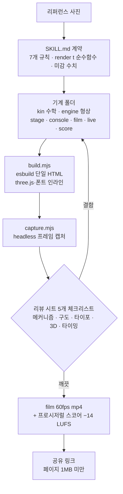

## 왜 읽어야 하나

Claude Code나 다른 코딩 에이전트로 시각 산출물을 만들거나, 에이전트가 읽을 스킬 계약(SKILL.md)을 설계하는 개발자라면 이 글을 읽으면 됩니다. 결론부터 말하면, Elvar의 'teardown'이 주는 가치는 3D 시뮬레이터 그 자체보다, "리퍼런스 사진에서 시뮬레이터, 영상까지"라는 워크플로를 실행 가능한 계약 한 통으로 압축했고 검증 단계로 '비디오는 보지 않고 프레임만 본다'는 리뷰 루프를 코드로 강제하는 패턴입니다. 이 패턴은 3D가 아닌 다른 생산 도메인에도 그대로 옮길 수 있습니다.


*매뉴얼(SKILL.md)을 읽는 노동자(Claude)가 조립하는 엔진.*

## 쉽게 말하면

teardown은 기계 3D 시뮬레이터 만드는 과정의 정비 수리 매뉴얼입니다.

지금까지 "이 엔진이 어떻게 움직이는지"를 하나의 웹페이지로 보여주는 산출물은 3D 아티스트(모형), 프로그래머(인터랙션), 모션 디자이너(카메라), 사운드 디자이너(음악)가 나눠서 해야 하는 일이었습니다. teardown은 그 네 개의 일을 하나의 매뉴얼로 묶습니다. SKILL.md가 매뉴얼이고 Claude가 그 매뉴얼을 따라 일하는 노동자입니다. 매뉴얼에는 무엇이 들어 있냐면, 기계별로 파일이 맡는 역할(수학, 형상, 렌더, 사운드)부터 완성을 선언하기 전에 프레임 시트를 읽어야 한다는 검사 절차까지입니다.

이 비유를 마지막까지 씁니다. 설치 섹션은 매뉴얼을 노동자에게 건네는 단계고 실험 섹션은 노동자가 실제로 한 일이며 한계 섹션은 이 매뉴얼의 전제 조건입니다.

## 개요

2026년 10월 30일, AI 영상·바이브 코딩 크리에이터 Elvar(@elvar_official, 팔로워 약 3.7만)가 트윗으로 "I just packed my whole 3D workflow into one Claude skill"이라고 올렸습니다. 같은 트윗에는 "i gave opus 5.5 one reference picture and said: build me a full teardown of this, every part in code"라는 구절이 있습니다. 리퍼런스 사진 한 장을 Opus 5.5에 주고 기계의 모든 부품을 코드로 만들라는 지시 한 마디면 충분했다는 주장입니다.

10월 31일 기준 트윗 지표는 좋아요 2,519개, 리트윗 283개, 조회 163,225회, 북마크 2,835개입니다(실시간 변동 수치, 확인 시점 스냅샷). 트윗에는 V8 시뮬레이터가 돌아가는 24초 영상이 붙어 있습니다. 이 글의 대상은 그 영상이 아니라, 영상을 만들어 낸 워크플로입니다. 트윗에 첨부된 가이드(제목 "How I Turn Any Machine Into a 3D Simulator You Can Take Apart")는 스킬 이름이 'teardown'이고 무료이며 MIT 라이선스라고 밝힙니다. 같은 가이드에는 "이런 V8 시뮬레이터 하나가 X에서 379만 뷰를 기록했다"는 주장도 나옵니다.

산출물 목록은 visual-learning.app에 공개되어 있습니다. 표어는 "40 machines, opened up"이고 구동형 시뮬레이터 7개(로봇 해파리, 육족 보행 로봇, 지렁이 땅굴 기계, 스트랜드비스트, V8 엔진, 세스나 337 랜딩기어, 로봇 벌)와 단계 클릭형 기계 40개(DJI 드론, 애플워치, 에스프레소 머신 등)가 올라와 있습니다. 참고로 트윗은 "2일 만에 7개"를, 가이드는 "6개"를 말합니다. 가이드 작성 시점에 6개였고 이후 7개로 늘어난 시점 차이입니다.

이 글에서는 그 스킬을 실제로 받아서, 번들 빌드와 리뷰 루프 캡처까지 샌드박스에서 실행하고 나온 수치를 그대로 적었습니다.

## 이 기술/도구는 무엇인가

teardown은 Claude Code 스킬입니다. 스킬은 SKILL.md 한 통과 실행 파일로 구성되고 SKILL.md의 프론트마터 description이 트리거 역할을 합니다. teardown의 description은 실제 기계나 메커니즘(엔진, 랜딩기어, 보행 링케이지, 펌프, 기어박스)의 인터랙티브 3D 시뮬레이터를 하나의 오프라인 HTML 페이지로 만들라는 지시로 시작하고, 누가 기계 원리를 묻거나 시뮬레이터·컷어웨이·익스플로디드 뷰를 원할 때 쓰라는 조건으로 끝납니다.

리포에는 기계 3종이 예제로 들어 있습니다.

- **v8**: 글래스 라이너를 단 크로스플레인 V8. 실린더 안에서 연소가 보이고 밸브가 캠을 따라 열립니다. 8개 피스톤은 정확히 슬라이더 크랭크 수식으로 움직이고 점화 순서 1-8-4-3-6-5-7-2가 실린더 선택기입니다.
- **cessna**: 세스나 337의 메인 랜딩기어. 자유도 하나(스트로크 0..1)가 전체 메커니즘을 포징합니다. 201mm 래크가 tooth 32개의 피니언(module 4mm)을 정확히 180도 돌립니다.
- **strandbeest**: Theo Jansen의 스트랜드비스트. 크랭크샤프트 하나로 다리 20개를 걷게 합니다. Jansen의 링크 길이 11개에서 원 교차로 각 마디를 풉니다. 솔버는 67줄입니다.

기계마다 폴더가 세 개입니다. `-shared`(기계 자체), `-film`(녹화된 투어), `-live`(사용자가 직접 조작하는 페이지). 그 안의 파일도 역할로 나뉩니다.

| 파일 | 역할 |
|---|---|
| `kin.js` 류 | 수학. 실제 치수, 입력 하나(크랭크각·스트로크·바람)로 모든 포즈와 계기값. three.js 금지 |
| `engine.js` 류 | 형상. 회전체 부품, 튜브, 인스턴스 링케지를 코드로 생성. `update(input)`이 포징 |
| `stage.js` | 스튜디오·조명·그림자·포스트(GTAO, 블룸). `frame(state, cam)`이 한 프레임을 그립니다 |
| `console.js` | 오버레이. 1600x900 CSS 레이아웃의 패널·차트·콜아웃. 프레임 state에서 다시 그립니다 |
| `film.js` | 연사자의 동작 스크립트(SCRIPT) + `render(t)`. 순수 시간 함수 |
| `live.js` | 버튼·슬라이더·오비트·키. 아무 입력 없으면 25초 후 자동 투어로 커서가 함께 움직입니다 |
| `score.py` | 영화 타임라인 위의 사운드 |

SKILL.md의 핵심은 "Rules that decide whether it works" 7개 조항입니다.

1. **리퍼런스로 시작해야 합니다.** 상상으로는 시작하지 않습니다. 사진, 설명서의 컷어웨이 도면, 실제 영상. "문장만으로 발명한 기계는 매번 제너릭하게 나온다"
2. **실제 숫자, 소스 하나.** 보어·스트로크·치수를 먼저 구합니다. 화면의 모든 계기가 부품을 포징하는 것과 같은 함수를 읽어야 화면이 움직임과 어긋나지 않습니다.
3. **입력 하나가 전부를 주동합니다.** 키프레임은 금지입니다. film, live, 사운드가 절대 어긋나지 않습니다.
4. **일을 하는 부품이 열려야 합니다.** 아이솔레이션, 컷어웨이, X레이. 안쪽으로 들어가는 카메라는 궤도 10번보다 낫습니다.
5. **밝은 스튜디오, 액센트 하나.** 연한 배경이 피드에서 읽히고 액센트는 지금 변하는 부품을 표시합니다.
6. **카메라는 메커니즘에 맞춰 고릅니다.** 평면 링케이지를 정면으로 보면 격자로 뭉개집니다.
7. **충돌은 숫자로 고칩니다.** 파라미터 블록에서 크기·위치를 바꾸고 카메라로 숨기지 않습니다.

SKILL.md는 이 규칙들을 손계산으로 보여줍니다. Cessna의 경우 치수 32개 × 모듈 4mm가 피치원지름 128mm가 되고, 그 반주장이 곧 랜딩기어의 스트로크 201mm입니다. 화면의 숫자가 움직임과 어긋나지 않으려면, 움직임의 소스인 함수를 먼저 손으로 검증하라는 뜻입니다.

`render(t)` 계약도 명시되어 있습니다. 임의의 t에서 프레임을 처음부터 그려야 하는 순수 함수로, `Math.random`(시드 기반 rng만 허용)·`Date`·프레임 간 상태 반전을 금지합니다. 프레임 0은 섬네일이라 기계가 이미 보여야 하고 모든 비트(이벤트 시각)는 `timeline.json`에 초 단위로 들어가 사운드가 같은 파일을 읽습니다.

리뷰 루프는 이 스킬의 가장 특징적인 부분입니다. 원문은 "You cannot watch the video; you can look at frames. Never report a machine as done without reading sheets of the current render."입니다. 절차는 5단계. `--stills beats`로 타임라인 비트마다 타일 한 장씩 뽑아(0.3초 뒤, `t=` 라벨) 전체를 체크리스트로 읽고 문제가 보이면 `--stills every:0.2`로 전환 구간을 확대하고 수정 후 빌드하고 1단계로 돌아갑니다. "한 바퀴 전체를 돌리고 아무것도 찾지 못했을 때" 멈추고 최종엔 인코더가 실제로 쓴 프레임을 시트로 뽑아 그것도 읽습니다. 체크리스트는 메커니즘(닿아야 할 부품이 닿고 숫자가 포즈와 일치), 구도(프레임당 초점 하나, 60px 이내는 빈 공간), 타이포(클립 없음, 폰 크기에서 핵심 계기값이 읽힌다), 3D(블룸이 디테일을 먹고 near-white 표면이 화백), 타이밍(상태당 1초 + 3단어 초과분 1단어에 0.25초)의 다섯 가지입니다.

사운드도 코드로 찍습니다. `sfx/`가 순수 Python(48kHz, 표준 라이브러리만)으로 모든 소리를 합성하고 영화의 timeline.json을 읽기 때문에 사운드가 절대 어긋나지 않습니다. 마스터링은 −14 LUFS, true peak −2 dBFS 이하로 자동입니다. 원칙은 "Accent, never narrate"입니다. 연속 움직임은 침묵을 유지하고 톤 소리는 키 하나씩만 씁니다.

미감조차 숫자로 고정되어 있습니다. 등장 이징 `cubic-bezier(0.16, 1, 0.3, 1)`, 퇴장은 반 길이에 `cubic-bezier(0.6, 0, 0.9, 0.35)`, 기계가 뷰포트의 60-70%를 채우고 1080 캔버스에서 라벨은 34px 미만으로 내려가지 않습니다.

라이브 페이지 규칙도 별도 절로 묶여 있습니다. 대표 조항은 통합 GPU에서 테스트해야 한다는 것입니다. 데스크톱 카드에서 60fps인 페이지가 노트북 내장 그래픽에서는 15fps까지 빠질 수 있다는 전제입니다. 예제들은 품질 티어(TIERS)를 내장해 AO를 끄거나 픽셀 비율과 그림자 맵 크기를 낮추고, 패널을 홀수 프레임에 다시 그립니다. "비싼 셰더를 먼저 찾아라"는 지시도 있습니다. 정점당 5번 계산되는 displacement 하나만 모든 티어 합보다 비쌀 수 있다는 경고입니다. 킷은 `kit/warm.js`로 첫 프레임 전에 모든 셰더 프로그램을 병렬 컴파일해, 페이지가 처음 그려질 때 멈추는 일을 없앱니다.

SKILL.md 말미에는 "three.js traps the examples already hit"로 실제 부딪힌 함정 5개도 적혀 있습니다. `smoothstep(a, b, x)`가 a > b면 Windows ANGLE/D3D에서 0을 반환한다는 점, 바닥 바로 위의 ShadowMaterial가 포스트 처리 렌더 타깃에서 심도 테스트를 잃어 polygonOffset이 필요하다는 점, 거울 매핑을 땅에 놓은 쿼드가 백페이스 컬링당해 DoubleSide가 필요하다는 점, NaN 픽셀 하나면 블룸을 통해 프레임 전체가 흑색이 되어 pow() 밑수 클램프가 필요하다는 점, 컷어웨이된 모델의 GTAO가 클리핑 평면과 같은 normalMaterial를 요구하지 않으면 잘린 반이 옅은 고스트로 돌아온다는 점입니다.

빌드와 캡처의 흐름은 아래 그림입니다.



출처는 whaleyxbt/claude-motion(MIT)에서 가져온 킷(프레임 캡처, sfx 엔진, 리뷰 규칙)과 Freesound CC0 샘플입니다.

## 설치 및 통합

설치는 첨부 가이드에 적힌 한 줄입니다.

```bash
npx skills add elvarofficial/teardown -g -a claude-code
```

수동으로 하면 클론 후 초기화 두 단계입니다. 요구 사항은 Node.js 20+(우리 실측은 v22.22.3), 영상용 ffmpeg, 사운드용 Python 3(표준 라이브러리만).

```bash
git clone https://github.com/elvarofficial/teardown
cd teardown
npm install              # 실측 2.4초, 0 취약점
npx playwright install chromium
```

빌드는 esbuild 기반이며 기계 하나당 오프라인 단일 HTML을 생성합니다.

```bash
node sims/build.mjs v8-live   # → teardown-out/dist/v8-live.html
node sims/build.mjs           # 예제 6개 전부
```

새 기계를 만들 때는 가장 가까운 예제를 복사합니다. SKILL_DIR 바깥의 기계는 폴더에 `main.js`만 두고 킷을 이름으로 가져옵니다.

```js
import {runSim} from 'teardown-kit/runtime.js';
```

## 실제 실험 결과

모든 수치는 샌드박스에서 캡처한 것입니다. 실험은 세 단계, 번들 빌드, 리뷰 시트 캡처, 영화 캡처(미실행)였습니다.

**1단계, 번들 빌드.** `v8-live` 하나를 빌드하는데 56ms, 산출물 825,413바이트(약 806KB)였습니다. 예제 6개를 한 번에 빌드한 전체 소요는 295ms입니다.

| 번들 | 바이트 | KB |
|---|---:|---:|
| cessna-live | 818,256 | 799 |
| strandbeest-live | 817,798 | 799 |
| v8-live | 825,413 | 806 |
| cessna-film | 824,056 | 805 |
| strandbeest-film | 823,262 | 804 |
| v8-film | 830,650 | 811 |

6개 전부 1MB 미만입니다. SKILL.md가 링크 크롤러(X, Slack)는 HTML에서 셰어 카드를 읽고 15MB 페이지는 포기한다고 경고하는 1MB 규칙이, 예제 그대로 성립한다는 뜻입니다.

**2단계, 리뷰 시트 캡처.** 여기서 첫 시도는 실패했습니다. headless Chromium이 WebGL 컨텍스트를 만들지 못했고 오류 원문은 ANGLE의 Vulkan 폴백(SwiftShader)에서 `BindToCurrentSequence failed`였습니다. three.js 렌더러가 컨텍스트 생성에 실패해 `SIM.ready`가 60초 타임아웃을 맞고 rc=1로 끝났습니다. paths.mjs의 기본 GPU 플래그(`--force_high_performance_gpu` 등)는 이 환경에서 먹지 않았습니다.

두 번째 시도는 `CHROMIUM` 환경 변수(경로 오버라이드 지점)로 `--enable-unsafe-swiftshader`를 붙인 래퍼 스크립트를 가리켜 재시도했습니다. 성공. 캡처가 보고한 GPU는 ANGLE(SwiftShader), 소프트웨어 렌더링이었습니다. 시트 1장은 15.8초에 나왔고 산출물은 시트 115,705바이트와 풀 프레임 1장 479,237바이트였습니다.


*리뷰 시트로 뽑아본 v8-live. 화면의 모든 계기가 크랭크각 함수를 직접 읽는다는 "실제 숫자, 소스 하나" 규칙이 그대로 보입니다(실측 캡처).*

**3단계, 영화(mp4) 캡처는 실행하지 않았습니다.** v8 film의 timeline.json은 `{"duration": 26}`입니다. 26초 × 60fps면 1,560프레임이고 SwiftShader 소프트웨어 렌더에서는 10분을 넘길 것으로 추정해 로컬에서 돌리지 않았습니다. SKILL.md의 명령 체인은 `capture.mjs` → `run_sfx.py` → `ffmpeg` 믹스 → `wave.mjs` 검증입니다. `run_sfx.py`가 `score.py`를 실행해 timeline.json의 시각만 읽고 소리를 합성하고, `wave.mjs`가 최종 mp4의 파형을 같은 timeline과 대조합니다. 화면과 사운드가 같은 파일을 읽는 한 어긋날 수 없다는 전제 위에 서 있는 체인이고, 우리가 실제로 밟은 구간은 2단계까지입니다.

이 실험이 남긴 실용적 결론은 하나입니다. 이 스킬의 캡처는 GPU가 있는 머신을 전제하고 소프트웨어 렌더 환경에서는 명시적 플래그 없이는 아예 WebGL 컨텍스트가 뜨지 않습니다. SKILL.md도 "캡처가 소프트웨어 렌더러를 보고 있으면 paths.mjs의 GPU 플래그가 먹지 않은 것"이라고 스스로 경고합니다.

## ThakiCloud 제품 적용 시사점

Paxis 렌즈에서 보면, teardown은 스킬 하네스 설계의 좋은 사례입니다. 세 가지가 있습니다.

첫째, 멀티툴 워크플로의 단일 스킬 압축입니다. 수학(라이브러리 없는 순수 JS), 형상(three.js), 렌더, 헤드리스 캡처(Playwright), 사운드(Python), QA(체크리스트)까지 여섯 도메인이 스킬 한 통 안에 역할별로 파일로 분리되어 있습니다. "하나의 기계, 하나의 페이지"라는 산출물 계약이 앞단을 붙잡고 파일별 역할표가 뒷단을 붙잡습니다. Paxis가 스킬·도구·정책을 일급 리소스로 다루는 것과 같은 구조입니다.

둘째, SKILL.md가 참고문이 아니라 실행 계약이라는 점입니다. "라벨 34px 미만 금지", "퇴장 이징은 `cubic-bezier(0.6, 0, 0.9, 0.35)`", "상태당 홀드 1초 + 초과 단어당 0.25초"처럼 미감까지 숫자로 적혀 있는 한, 에이전트는 매번 판단하지 않고 규칙을 적용합니다. 정책 게이트가 판정하는 것과 같은 원리입니다.

셋째, 리뷰 루프입니다. "본인이 만들었다고 보고하는 것"을 증거(프레임 시트)로 대체합니다. 에이전트가 "됐습니다"라고 말하는 대신, 5개 체크리스트를 시트 위에서 읽고 한 바퀴 아무것도 못 찾을 때까지 다시 돌립니다. 산출물이 아니라 자기보고를 신뢰하지 않는다는 점에서, Paxis의 감사로그 관점과 같은 방향입니다.

ai-platform 렌즈에서 보면, 헤드리스 렌더 + 60fps 영화 내보내기는 브라우저와 CPU에 집중되는 배치 워크로드입니다. 우리 실측이 바로 근거입니다. 소프트웨어 렌더에서는 시트 1장이 15.8초, 영화는 10분 초과로 추정되어 로컬 워크스테이션에서 포기한 것입니다. 이런 워크로드는 워크스테이션이 아니라 컴퓨트 큐(GPU 노드)에 올리는 게 자연스러운 배치이고 Kueue 잡으로 돌리는 구조에 그대로 맞습니다.

## 한계 및 반론

3라운드 렌더-사진 대조와 리뷰 루프의 품질은 판단하는 모델의 역량에 비례합니다. Elvar는 Opus 5.5를 썼고 "checklist를 읽고 결함을 찾는 일"은 모델 등급이 낮아질수록 놓치는 수가 늘어납니다. 검증 비용도 마찬가지입니다.

이 시뮬레이터는 물리 시뮬레이션이 아닙니다. visual-learning.app은 "화면의 모든 숫자가 부품을 움직이는 것과 같은 공식에서 옵니다"라고 설명합니다. 치수와 공식은 실제이지만, 이 모델은 강체 동역학이나 힘의 해석을 포함하지 않는 kinematic 코드 모델입니다. 실제 물리를 원한다면 다른 엔진이 필요합니다.

이식성도 한계입니다. 기본 플래그가 소프트웨어 렌더 환경에서 WebGL 컨텍스트를 못 만든 것은 우리 머신이 증거입니다. GPU 머신을 전제하는 스킬이 맞고 GPU가 없는 곳에서 쓰려면 명시적 우회(우리의 SwiftShader 래퍼)가 필요합니다. 영화 캡처는 그 우회 위에서조차 시간 문제가 됩니다.

1MB 제한은 기계의 복잡도를 옥죄는 상한입니다. 무거운 모델은 페이지 옆 파일로 빼내야 하고 이는 "한 페이지에 전부"라는 스킬의 전제를 스스로 완화하는 조항입니다.

프로젝트도 어립니다. 단일 커밋, 별 128개(10월 31일 기준), 예제 3종. 트윗 지표와 "7개/6개" 수치도 시점별 스냅샷이며 실시간으로 변합니다.

## 정리

teardown에서 배울 것은 three.js가 아닙니다. 정비 수리 매뉴얼이라는 비유를 닫겠습니다. 이 스킬이 보여준 것은, 생산 과정이 (1) 파일별 역할과 숫자로 정의된 계약, (2) 그 계약의 검사 절차, (3) 자기보고 대신 증거를 요구하는 루프로 묶이면, 그 과정이 하나의 에이전트에게 전달 가능해진다는 것입니다.

팀의 반복 공정에도 이 질문을 걸어볼 수 있습니다. 우리 공정의 "매뉴얼"은 어디에 있고 "검사 절차"는 매뉴얼 안에 있는가, "됐습니다"의 판정은 자기보고인가 증거인가. 세 질문에 답이 선명한 팀은 teardown의 구조를 그대로 가져갈 수 있습니다.

다음 행동은 간단합니다. `npx skills add elvarofficial/teardown`로 설치하고 설명하고 싶은 기계 하나를 골라 리퍼런스 사진과 함께 넘기는 것입니다.

워크플로는 모델이 아니라 스킬에 있는 것입니다.

## 출처

- Elvar, [원본 트윗](https://x.com/elvar_official/status/2116192984299344372) (2026-10-30)
- 첨부 가이드 (X Article): "How I Turn Any Machine Into a 3D Simulator You Can Take Apart"
- [elvarofficial/teardown](https://github.com/elvarofficial/teardown) (MIT, 128 stars / 22 forks, 10월 31일 기준)
- [visual-learning.app](https://visual-learning.app) (표어 "40 machines, opened up")
- 기반 킷: [whaleyxbt/claude-motion](https://github.com/whaleyxbt/claude-motion) (MIT)
