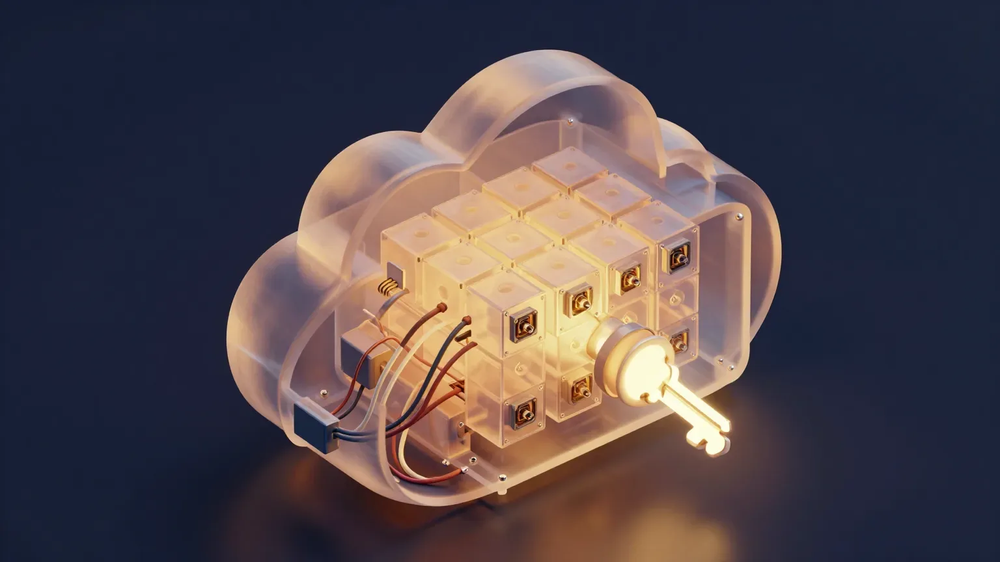
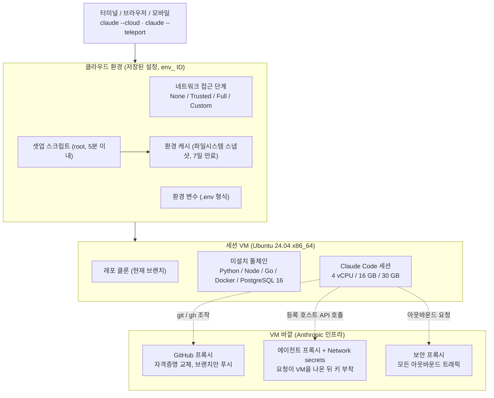

## 왜 읽어야 하나

Claude Code를 로컬에서 돌리다가 긴 작업을 클라우드에 넘기고 싶은 개발자, 혹은 에이전트 실행 환경을 어디로 표준화할지 정하는 팀 리더라면 이 글은 그 결정용입니다. 결론부터 둡니다. 2026년 11월 초 Anthropic은 "레포를 클라우드 세션에서 돌리게 하는 것"을 에이전트가 스스로 필요한 의존성·네트워크 접근·API 키를 파악해 환경을 저장하는 자동 세팅으로 바꾸었습니다. 기능 자체보다 밑의 설계가 중요합니다. 실행 환경이 일급 리소스가 되고, 자격증명은 VM에 들어오지 않고, 캐시는 약 7일 만료되는 파일시스템 스냅샷입니다. 쓰지 않더라도 참고할 가치가 있는 사례입니다.

*클라우드 세션의 VM과 환경, 그리고 VM 밖에서 자격증명을 다루는 프록시 관계를 형상화했습니다.*

## 개요

11월 6일, Anthropic 개발자 계정 ClaudeDevs가 Pro·Max·Ultra 플랜의 Claude Code 클라우드 세션에서 레포를 돌리기를 더 쉽게 만들었다고 발표했습니다([발표 리트윗](https://x.com/hjguyhan/status/2118845765212265845)). 트윗의 핵심은 Claude가 레포에 필요한 의존성과 네트워크 접근, API 키를 파악해 환경을 저장하는 것입니다. 클라우드 세션 자체는 새것이 아닙니다. Pro·Max·Ultra·Team과 Enterprise 프리미엄 시트를 대상으로 GA(일반 가용) 상태였고 세션은 내 머신이 아니라 Anthropic이 관리하는 인프라에서 도는 Claude Code 세션입니다. 노트북을 닫아도 계속 돌아가고 브라우저·모바일·데스크톱·터미널 어디서든 들여다보고 방향을 수정할 수 있습니다. 클라우드 VM에 대한 별도 과금은 없으며, 플랜 사용량 한도와 나머지 Claude Code 사용과 함께 셈됩니다.

이번에 바뀐 것은 세션 아래 "환경(environment)" 층입니다. 클라우드 환경은 세션의 네트워크 접근, 환경 변수, 셋업 스크립트를 정하는 저장된 설정이고 발표 기능은 이 설정을 Claude가 알아서 채우는 것입니다. 이전 글 [Claude Code로 AAA급 게임 만들기](https://thakicloud.com/tech-blog/ko/tutorials/claude-code-aaa-game-repos/)가 API 계약(헤더와 문서)을 읽는 에이전트 패턴을 다뤘다면, 이번에는 에이전트 자신의 실행 환경이 대상입니다.

## 이 기능은 무엇인가

### 실행 샌드박스

각 클라우드 세션은 새로운 가상 머신을 받습니다. 호스트 운영체제와 아키텍처와 무관하게 Ubuntu 24.04 x86_64입니다. 리소스 상한은 대략 4 vCPU, 16 GB RAM, 30 GB 디스크이며 문서는 이 수치가 "시간에 따라 바뀔 수 있다"고 적어 둡니다. 큰 빌드나 메모리 집약 테스트는 VM이 멈추게 할 수 있습니다. 공통 툴체인은 미리 들어 있습니다. Python 3.x 계열(pip, poetry, uv, black, mypy, pytest, ruff), Node.js 20·21·22(npm, yarn, pnpm, bun, eslint, prettier), Ruby 3.1~3.3, PHP 8.3, OpenJDK 21(Maven, Gradle), Go, Rust, C/C++(GCC, Clang, cmake, ninja, conan), Docker, PostgreSQL 16, Redis 7.0, Chrome for Testing, 그리고 git·gh·jq·yq·ripgrep·tmux 같은 유틸리티입니다. 세션 안에서 Claude에게 `check-tools` 명령을 실행하게 하면 대부분 버전이 나옵니다.

### 무엇이 넘어오는지

VM은 레포의 새로운 클론입니다. 레포에 커밋한 것은 있고 내 머신에만 설치하거나 설정한 것은 없습니다. 레포의 `CLAUDE.md`, `.claude/settings.json`, `.mcp.json`, `.claude/rules/`와 `.claude/` 아래 스킬·에이전트·커맨드는 클론의 일부이므로 전부 넘어옵니다. 반면 사용자 레벨 `~/.claude/CLAUDE.md`와 사용자 스코프 MCP 서버, 사용자 설정에서 켠 플러그인은 넘어오지 않습니다. 레포 설정의 `enabledPlugins`로 선언한 플러그인도 클라우드 세션에선 설치되지 않으며, AWS SSO 같은 인터랙티브 인증은 브라우저 로그인 자체가 불가능해 지원되지 않습니다. 조직 정책은 서버 매니지드 설정으로 따로 도착합니다.

### 네트워크: 4단계와 두 프록시

각 환경은 네 가지 네트워크 접근 단계 중 하나를 씁니다. `None`은 아웃바운드 연결이 전혀 없습니다. `Trusted`가 기본값으로, 패키지 레지스트리·GitHub·클라우드 SDK를 아우르는 허용 목록만 통과합니다. `Full`은 모든 도메인, `Custom`은 직접 올린 목록입니다. 어느 단계든 아웃바우트 트래픽 전체가 악용 방지를 위한 보안 프록시를 지나고 GitHub 조작은 별도의 GitHub 프록시로 갑니다.

GitHub 프록시가 자격증명 설계의 핵심입니다. 실제 GitHub 자격증명은 Anthropic 서버에서 암호화돼 보관되고 세션 VM에는 들어오지 않습니다. VM 안 git 클라이언트는 스코프된 자격증명을 쓰고 프록시가 그것을 검증한 뒤 실제 토큰으로 바꿔 출력을 시킵니다. 푸시는 브랜치로만 허용되고 태그 푸시와 브랜치 삭제는 거부됩니다. GraphQL 엔드포인트 요청은 REST 폴백을 알려 주는 403으로 막혀, `gh pr`과 `gh issue`가 동작하지 않는 대신 `gh api repos/{owner}/{repo}/...`가 동작합니다. 레포 범위도 세션에 첨부된 레포로 제한됩니다.

Network secrets는 VM 밖에서 자격증명을 다루는 두 번째 장치입니다. API 키나 토큰을 환경에 등록하고 적용할 호스트를 지정하면, 에이전트 프록시가 요청이 세션 VM을 나온 뒤 그 호스트의 요청에 키를 붙입니다. 키는 세션의 환경 변수에도, 어떤 파일에도 나타나지 않습니다. 문서는 시크릿도 받지 않는 요청까지 목록으로 줍니다. GitHub(GitHub 프록시가 담당), Anthropic API, 공개 패키지 레지스트리, 셋업 스크립트 요청, Claude Code 텔레메트리입니다. 환경 변수는 사용하는 누구에게나 읽힐 수 있어, 여기에 시크릿을 넣지 말라고 명시적으로 경고합니다.

### 셋업 스크립트와 환경 캐시

셋업 스크립트는 새 세션 시작 시 Claude Code가 뜨기 전에 root 권한으로 도는 Bash 스크립트입니다. 미리 설치되어 있지 않은 의존성을 넣거나 세션이 필요한 것을 가져오게 쓰는 것입니다. 제약은 네 가지입니다. exit 0으로 끝나야 하고 대략 5분 안에 끝내야 하며 패키지 설치엔 레지스트리 도달이 필요해 `None` 단계에선 실패하고 스크립트가 도는 시점엔 환경의 환경 변수가 아직 설정되어 있지 않습니다.

캐시는 이번 발표의 축입니다. 셋업이 5분 안에 끝나면 Anthropic이 파일시스템 스냅샷을 찍고 이후 세션의 출발점으로 재사용합니다. 새 세션은 의존성과 도구, Docker 이미지가 이미 디스크에 있는 상태로 시작해 셋업을 건너뜁니다. 스냅샷은 디스크에 쓴 것만 유지합니다. 패키지·이미지·파일은 넘어오고 데이터베이스나 compose 스택 같은 실행 중인 프로세스는 넘어오지 않아 매 세션 시작해야 합니다. 셋업 스크립트나 허용 호스트를 바꾸면 캐시가 다시 만들어지고 약 7일 뒤에는 만료됩니다. "Claude가 의존성·네트워크·API 키를 파악해 환경을 저장한다"는 것이 바로 이 스크립트 작성, 허용 목록 선정, 시크릿 등록의 사이클 전체를 자동화해서 캐셔블한 환경으로 만든다는 뜻으로 읽힙니다.

## 설치 및 실전

터미널에서 시작하면 `claude --cloud` 플래그입니다. 작업은 클라우드에서 돌아 내가 로컬에서 계속 일합니다. 클라우드 VM은 현재 디렉터리 GitHub remote의 현재 브랜치를 클론하므로, 로컬 커밋이 있으면 먼저 푸시해야 합니다. 구문 `--remote`은 비권장 별칭으로 여전히 동작합니다.

레포에 git remote가 없거나 Claude GitHub App이 설치되지 않았다면, 로컬 레포를 번들로 묶어 올립니다. 번들은 100 MB 이하, 미추적 파일 미포함, 추적 파일의 미커밋 변경 포함입니다. 여기서 플랫폼 차이가 있습니다. macOS·Linux·WSL에서는 자격증명이나 키처럼 이름 붙은 파일(`.env`, Terraform `*.tfvars`, `id_rsa`, `*.pem` 등)의 미커밋 변경은 제외하고 `Left on this machine:` 안내로 뭘 빼았는지 알려 줍니다. 반면 네이티브 Windows는 파일명과 상관없이 있는 그대로 업로드합니다. Windows에서 쓰면, 보내고 싶지 않은 편집은 시작 전에 stash하거나 되돌려 두는 것입니다.

복귀 경로는 텔레포트입니다. `claude --teleport`, 세션 안의 `/teleport`(또는 `/tp`), `/tasks`의 `t` 키로 클라우드 세션을 터미널로 가져옵니다. 조건은 네 가지입니다. 클린한 git 상태, 같은 레포의 체크아웃, 세션 브랜치가 푸시되어 있음, 같은 계정. 터미널은 세션의 별개의 사본을 받고, 거기서 한 새 작업은 로컬에 남습니다. 실행 중인 세션엔 어떤 기계에서든 후속 메시지를 큐에 넣을 수 있습니다. 명령은 `claude -p "메시지" --cloud <session-id>`입니다.

문서가 권하는 패턴은 "로컬에서 계획하고 클라우드에서 실행"입니다. 플래너 모드로 Claude를 시작해(`claude --permission-mode plan`) 접근법을 함께 짠 뒤, 계획을 레포에 저장하고 커밋·푸시합니다. 그러면 `claude --cloud "docs/migration-plan.md 의 마이그레이션 계획을 실행해"`로 자율 실행을 클라우드에 넘깁니다. `--cloud` 여러 개는 독립 세션이라 작업을 병렬로 돌릴 수 있습니다. Claude GitHub App을 레포에 설치해 두면 Auto-fix를 켤 수 있습니다. Claude가 PR의 GitHub 이벤트를 구독해 CI 체크가 깨지거나 리뷰어가 코멘트를 남기면 조사하고, 확실한 수정이면 푸시합니다. 다만 함정이 하나 있습니다. Atlantis나 Terraform Cloud처럼 코멘트 트리거 자동화를 쓰는 레포에서 Claude의 답글은 내 GitHub 사용자 이름으로 올라가 그 워크플로를 켤 수 있습니다.

세션이 유휴가 되면 VM은 파일이 저장된 상태로 일시중지되고, 오래 멈추면 회수됩니다. 이를 "environment expired"라고 부르며 다시 열면 새 VM이 프로비전됩니다. 대화 기록은 돌아오지만, 회수 시점에 돌고 있던 셸 명령·서브에이전트·세션 스코프 예약 작업과 `/loop`는 돌아오지 않습니다. 어떤 게 멈췄는지 Claude에게 알려 주기 때문에 재실행은 내가 요청해야 합니다.

## 실제 재현 결과

이 글은 유료 클라우드 세션을 프로비전하지 않았습니다. 대신 공식 문서가 권하는 의존성 설치 패턴을 로컬에서 재현해 동작을 확인했습니다. 패턴은 클라우드 세션에서만 의존성을 설치하는 SessionStart 훅입니다. 스크립트는 공식 문서의 `install_pkgs.sh`를 그대로 씁니다. `CLAUDE_CODE_REMOTE` 환경 변수가 `true`가 아니면 즉시 종료하고, `package.json`·`package-lock.json`·스크립트 자체의 해시가 변하지 않았다면 `npm install`을 건너뜁니다.

로컬 환경(`CLAUDE_CODE_REMOTE` 미설정)에서의 첫 실행은 0.008초에 rc=0으로 아무것도 하지 않는 no-op이었습니다. 게이트가 변수 하나로 로컬과 클라우드 실행을 구분한다는 설계가 그대로 확인됩니다. 클라우드 시뮬레이션(변수를 `true`로)에선 첫 실행이 "added 2 packages, and audited 3 packages in 560ms"와 0 vulnerabilities를 내고 `node_modules/`에 sha256 해시 파일을 썼습니다. 입력을 바꾸지 않은 두 번째 실행에선 npm 출력이 전혀 없고 pip notice만 남았습니다. 해시 게이트가 설치를 건너뜬 것이고, 문서가 말하는 멱등성이 실제 동작입니다.

문서에 없는 발견도 하나 있었습니다. 의존성이 전혀 없는 package.json이면 `npm install`이 `node_modules/` 디렉터리 자체를 만들지 않아 해시 파일 쓰기가 `No such file or directory`로 실패하고 해시 파일이 남지 않습니다. 그러면 게이트는 매 세션 재감사로 열화합니다("up to date, audited 1 package in 232ms"). 몇백 밀리초라 해롭진 않지만, 입력 불변 시 건너뛴다는 문서의 동작은 `node_modules`가 존재할 때만 성립합니다. 의존성이 있는 프로젝트에서 쓰면 문제가 없고, 문서만 있는 레포에서 쓰려면 디렉터리 생성을 명시하는 편입니다.

## ThakiCloud 제품 적용 시사점

**Paxis 관점.** 클라우드 환경은 "실행 환경" 자체의 일급 리소스화입니다. ThakiCloud의 Paxis는 Skills, Tools, Policies, Audit Logs를 실행 환경의 일급 리소스로 다루는 Agent-Native Cloud입니다. Anthropic의 클라우드 세션은 그 목록에 environment(env_ ID)를 하나 더 놓고 표면별 라우팅(브라우저·모바일·데스크톱·CLI·routines·Claude Tag), 조직 공유 환경, CLI 기본값(`remote.defaultEnvironmentId`)을 씌웠습니다. "어떤 에이전트를 어떤 환경에서 돌리는가"의 제어 평면이 Paxis의 정책 게이트와 같은 모양으로 잡힙니다. 둘째는 자격증명입니다. "VM엔 들어오지 않고, 요청이 VM 바깥으로 나온 뒤 프록시가 붙인다"는 설계는 Paxis의 시크릿 주입과 같은 선상입니다. 에이전트 프로세스가 보는 것은 정책이지 키가 아닙니다. 세째는 감사입니다. 커밋마다 `Claude-Session: <url>` 트레일러를, PR 본문에 세션 URL을 넣는 것은 실행 기록 자체를 추적 링크로 만드는 일급 감사 패턴입니다.

**Metis/온프렘 관점.** 셀프호스트드 환경은 클라우드 세션을 조직이 운영하는 러너로 라우팅하게 하고(ccpool_ ID), egress 기본은 deny입니다. 하지만 문서가 제약도 분명히 줍니다. IP allowlist를 켠 조직에선 Anthropic-hosted 클라우드 세션이 전부 인증 오류로 실패합니다. 세션이 Anthropic 인프라에서 Anthropic API를 부르니까요. Zero Data Retention, HIPAA 설정, CMEK 조직은 클라우드 세션을 못 씁니다. "API 호출은 우리 네트워크 경계 안에서 시작돼야 한다"는 조건은 Metis가 온프렘 K8s로 모델을 서빙하는 이유가 정하는 바로 그 조건입니다. 4 vCPU·16 GB 상한도 같은 맥락입니다. 이 상한을 넘는 작업은 클라우드 세션이 아니라 큐에 들어가는 잡의 영역이고 그 큐를 우리 플랫폼이 운영합니다.

## 한계 및 반론

첫째, 레이트 리밋입니다. 클라우드 세션은 같은 계정의 다른 Claude·Claude Code 사용과 한도 공유를 하고 병렬 작업은 그 비례로 씁니다. 별도 과금이 없는 대신, 할당량이 같은 것입니다. 둘째, 시간 상한입니다. 포그라운드 명령은 기본 2분, 최대 10분, 백그라운드로 넘어가면 30분, SessionStart 훅은 600초입니다. `BASH_DEFAULT_TIMEOUT_MS`로 바꿀 수 있지만 장시간 잡은 원래 이 층의 몫이 아닙니다. 셋째, 환경 만료입니다. 유휴 시 VM이 멈췄다 되살아나는 구조는 편하지만 회수 시점에 돌고 있던 배경 작업은 사라집니다. 체크포인트 규율이 없는 작업은 매번 처음부터 다시 갑니다. 넷째, 플랫폼 제약입니다. 클론과 PR 생성은 GitHub 필요, GitLab·Bitbucket은 번들로만 업로드 가능하고 되푸시는 불가, GraphQL은 닫혀 있습니다.

반론도 구조가 있습니다. 실행 환경에 대한 완전한 제어가 필요하면 셀프호스트드 러너입니다. 인터랙티브 인증이 필요하면 브라우저 로그인(SSO)이 안 됩니다. 조직 정책이 ZDR·HIPAA·CMEK이면 아예 쓸 수 없습니다. 즉 이 기능은 "클라우드를 쓸 것인가 말 것인가"가 아니라 "어디 층을 Anthropic의 손에 두고, 어디 층을 자기네 것으로 가져올 것인가"의 설정 문제입니다.

## 정리

클라우드 세션의 자동 세팅은 "레포를 돌게 만드는 것"을 셋업 스크립트 작성 작업에서 에이전트 자신의 작업으로 바꾼 발표입니다. 그러나 이 발표에서 오래 남을 것은 밑의 설계입니다. 실행 환경이 일급 리소스가 되고 자격증명은 VM에 들어오지 않고 캐시는 7일 만료 파일시스템 스냅샷이며 세션 기록은 링크가 되는 구조입니다. Paxis가 스킬·툴·정책·감사를 일급 리소스로 다루는 방향과 Anthropic의 환경 리소스화는 나란하고, 데이터가 밖으로 나가지 않는 환경에선 Metis의 온프렘 K8s가 같은 문제의 다른 절반입니다. 실제로 쓰려는 분께는 시작 전 세 가지만 정하면 됩니다. `--cloud` 전에 브랜치를 푸시하고, 번들에서 자격증명 파일을 제외하고(특히 Windows), 셋업 스크립트를 5분 안에 들어가도록 만들어 캐시가 작동하게 합니다.

## 출처

- [Configure cloud environments, Claude Code 문서](https://code.claude.com/docs/en/cloud-environments)
- [Use Claude Code in the cloud, Claude Code 문서](https://code.claude.com/docs/en/claude-code-on-the-web)
- [Claude Code on the web, Anthropic 리소스](https://claude.com/resources/articles/claude-code-on-the-web)
- [ClaudeDevs 발표 리트윗](https://x.com/hjguyhan/status/2118845765212265845)